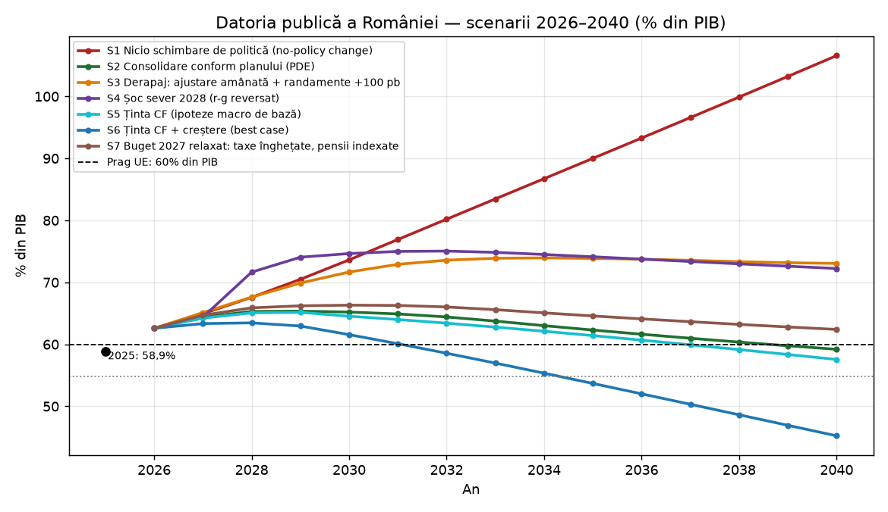
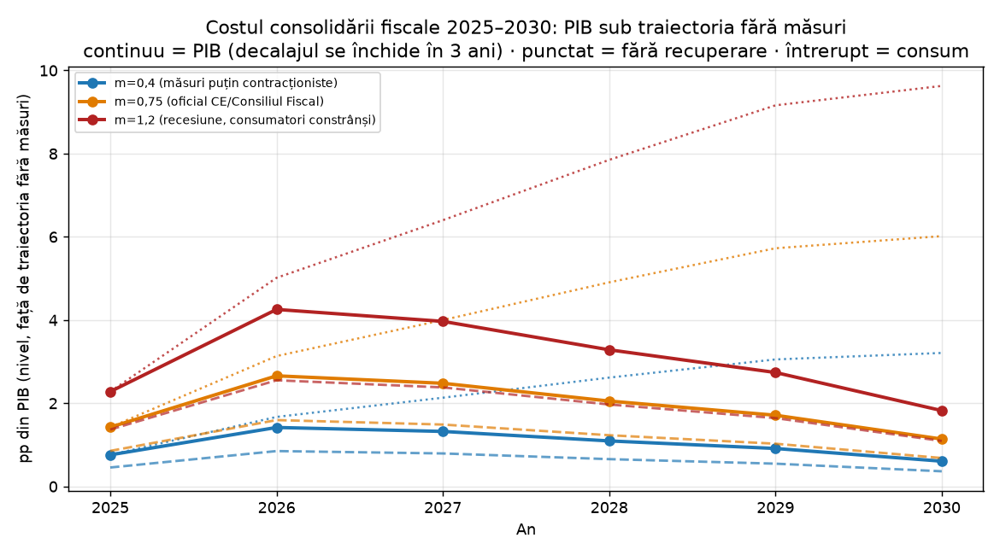
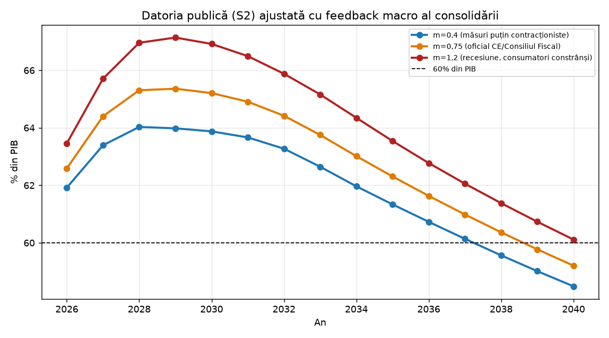
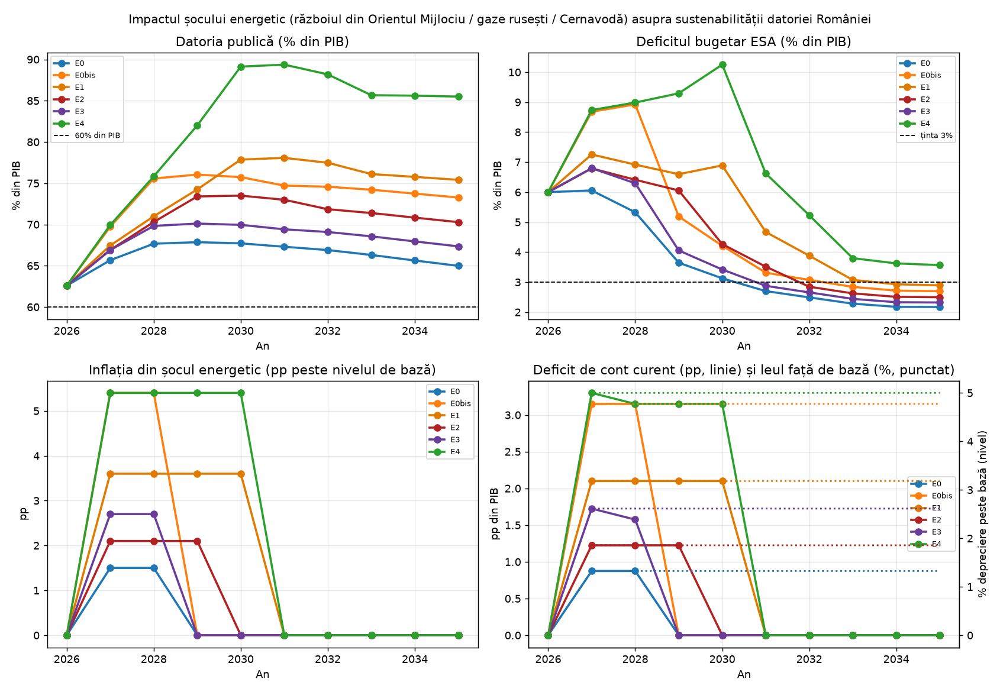
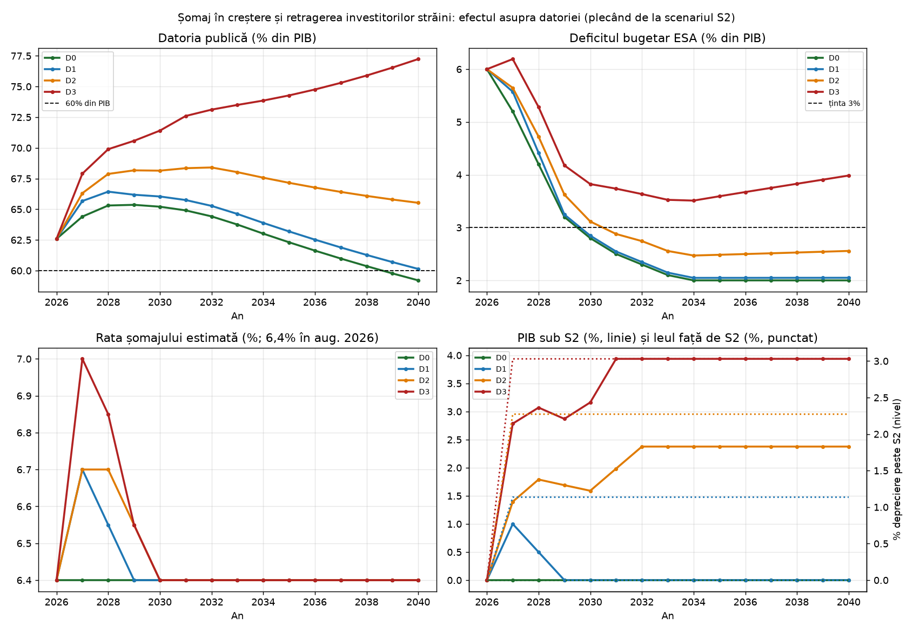
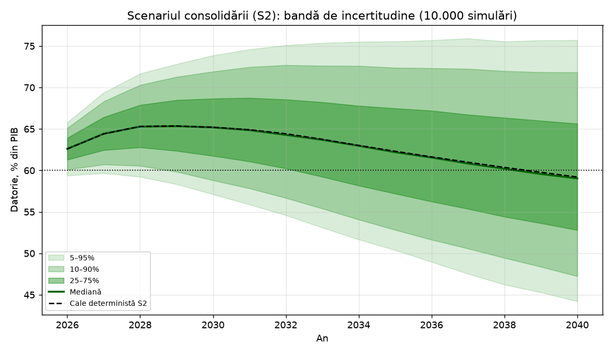
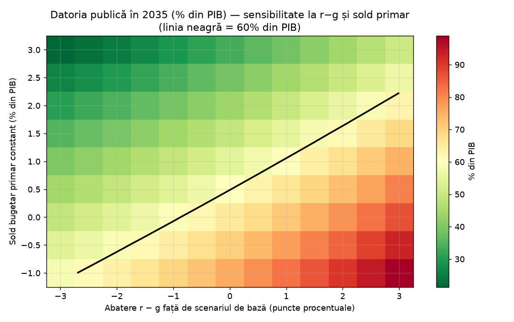
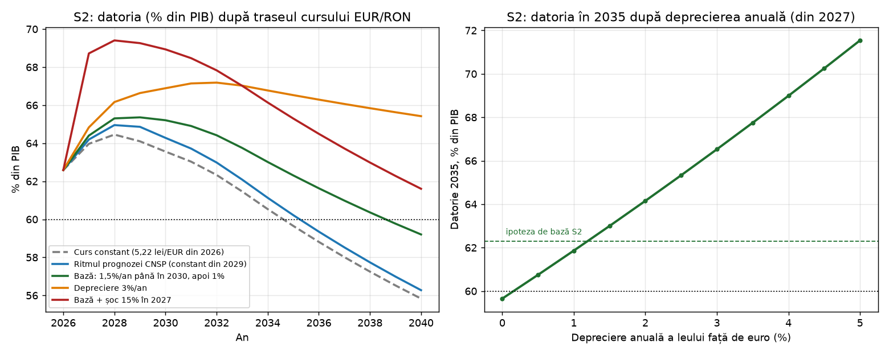

# Poate România să „plătească” deficitul?
## Analiză de sustenabilitate a datoriei publice a României (2026–2040)

**Data raportului:** 17 octombrie 2026

**Metodă:** analiză de sustenabilitate a datoriei (DSA) în stilul metodologiei Comisiei
Europene (CE), aplicată de Consiliul Fiscal (CF) prin codul de replicare Bruegel DSA, cu model propriu
rulat independent: scenarii deterministe, simulare stocastică (10.000 de traiectorii) și
analiză de sensibilitate.

**Limbă:** română. Cifrele preluate din documente sunt referențiate cu [Sn] (lista completă
în secțiunea „Surse” de la final); rezultatele marcate „model propriu” provin din codul din
`model/`.

**Cod și date:** codul modelelor, rezultatele (serii CSV, Excel, grafice), sub-rapoartele
tematice și acest raport sunt publice în repo-ul
[github.com/Infuscy/romania-deficit](https://github.com/Infuscy/romania-deficit), cu licența
CC BY 4.0 pentru texte, date și grafice și licența MIT pentru cod. Copiile documentelor altor
instituții nu sunt republicate; fiecare are linkul original în lista de surse.

**Ediția din 17 octombrie 2026** adaugă §8.6 și concluzia-cheie 6: cât mai poate cheltui noul
guvern pentru primării, firme, pensii și salarii fără ca deficitul să crească din nou, calculat
cu un model nou, construit peste scenariile S1, S2 și S7 [S43]. Celelalte cifre sunt cele din
ediția din 16 octombrie. De la această ediție, codul, datele și sub-rapoartele sunt publice (vezi „Cod și date” mai sus).

**Ediția din 16 octombrie 2026** actualizează ediția din 4 octombrie cu datele apărute între
timp: execuția bugetară pe nouă luni, PIB-ul revizuit de Institutul Național de Statistică,
prognoza Fondului Monetar Internațional din octombrie, dobânzile mai mari plătite în 2026,
cursul record din octombrie, prefinanțarea primită de la UE pentru apărare și noul guvern,
cu condițiile lui pentru bugetul 2027 (scenariul nou S7, §5). Toate modelele au fost rulate
din nou cu acești parametri [S35][S36][S37][S38][S39][S40][S41][S42].

---

## 1. Rezumat executiv

**Răspunsul scurt:** *Da — România poate să își acopere și să își gestioneze datoria, dar NU în
structura bugetară actuală. „Plata” nu se face prin rambursarea stocului de datorie (nicio țară
nu face asta), ci prin două lucruri: (a) oprirea adăugării de datorie nouă — închiderea
deficitului — și (b) rostogolirea datoriei existente la costuri pe care economia le poate
susține. Primul lucru este în desfășurare și este credibil, dar incomplet; al doilea este
posibil doar dacă primul continuă.*

**Concluziile-cheie:**

1. **Situația este gravă, dar nu disperată.** Datoria publică a urcat de la ~35% din PIB
   (2019) la 54,8% (2024) și **59,3% din PIB la finalul lui 2025 (ESA, Eurostat)** — ~58,9%
   pe PIB-ul revizuit în sus de Institutul Național de Statistică (INS) la 9 octombrie 2026 —,
   iar în **T1 2026 a trecut de pragul de 60% din Tratatul de la Maastricht (60,1%,
   Eurostat)**. Pe metodologia națională (OUG 64/2007), stocul este și mai
   mare: 1.284 mld. lei (66,5% din PIB) la finalul lui 2025 și 1.341,5 mld. lei (65,3%) în
   iulie 2026 [S1][S3][S5][S7][S12][S22][S23][S36]. Deficitul a atins un record UE de **9,3% din PIB
   (2024, ESA)** și a fost redus la **7,9% (2025, ESA, validat Eurostat; ~7,8% pe PIB-ul
   revizuit) / 7,6% (cash)**, iar ținta pe 2026 este **6,0% (ESA) / 6,2% (cash, 127,8 mld.
   lei)**; după 9 luni din 2026, deficitul cash este **3,82% din PIB** (78,52 mld. lei, față
   de 5,35% în aceeași perioadă din 2025), deși numai septembrie a adăugat ~0,9% din PIB,
   mai ales prin dobânzi, bunuri și servicii și investiții [S1][S2][S3][S23][S35].

2. **„Plata” deficitului nu înseamnă rambursarea unui împrumut scadent.** Deficitul este un
   *flux* anual; datoria este *stocul* acumulat. Statele nu rambursează stocul, îl
   *rostogolesc*. În 2026 statul român rambursează 148 mld. lei scadențe și împrumută din nou
   ~275–280 mld. lei (scadențe + deficit), adică ~13,5% din PIB [S3][S4]. Problema reală este
   dacă această „mașină de rostogolire” poate continua la dobânzi suportabile. **Astăzi: da.**
   Peste 3–4 ani fără consolidare: **nu**.

3. **Dacă nu se schimbă nimic, datoria devine explozivă.** În scenariul „no-policy change”
   (ținta din 2026 este atinsă, apoi soldul primar rămâne blocat la −2,3% din PIB — structura
   bugetară de la finalul lui 2026), modelul nostru — care replică analiza Consiliului Fiscal —
   duce datoria la **~87% din PIB în 2034, ~90% în 2035 și ~107% în 2040** (CF: 80% în 2034,
   100% în 2040; avertisment reluat în septembrie 2026). CF proiectează pentru 2034 dobânzi de
   **5% din PIB** și un necesar de finanțare de **~20% din PIB** (modelul propriu: 4,6% și
   ~17% în 2034, 5,5% și ~21% în 2040, cu costul efectiv al datoriei urcând treptat spre
   randamentele pieței) [S3][S19][S39]. Piețele financiare
   ar penaliza România **mult înainte** de atingerea acestor valori: retrogradarea la „junk”
   (sub pragul *investment grade*, în categoria speculativă)
   este deja un risc explicit (S&P a menținut perspectiva *negativă*, adică semnalează o posibilă retrogradare, în
   octombrie 2026, iar Fitch a avertizat la 18 septembrie că ratingul *junk* devine probabil
   dacă criza politică continuă) [S6][S40].

4. **Cu consolidarea aflată în curs, traiectoria este sustenabilă — dar abia.** Dacă deficitul
   scade conform planului (ESA: 6,0% în 2026 → 5,2% în 2027 → 4,2% în 2028 → 3,2% în 2029 →
   **2,8% în 2030**, închiderea procedurii de deficit excesiv, PDE), datoria atinge un vârf de
   **~65,4% din PIB în 2029**, apoi scade foarte lent și **coboară sub 60% abia în 2039**
   (~59% în 2040; model propriu, care include deprecierea treptată a leului) [S2][S3]. Planul
   oficial singur **nu** aduce datoria sub 60% în 2030 (Consiliul UE proiectează 61,1%;
   modelul propriu 65,2%). Și acest rezultat cere un efort tot mai mare: costul efectiv al
   datoriei urcă de la ~5,5% în 2026 (dobânzile plătite în primele nouă luni au crescut cu
   26,8% față de aceeași perioadă din 2025) la ~6,0% în 2029–2030, pe măsură ce datoria veche
   se refinanțează la randamentele actuale, așa că excedentul primar necesar pentru aceleași
   ținte de deficit ajunge la **~1,4% din PIB în 2035** [S35]. Dacă datoria crește în
   continuare și prin alte ajustări stoc-flux (creșteri ale datoriei care nu trec prin
   deficit, ca prefinanțarea de 2,5 mld. € primită în august 2026 prin SAFE, instrumentul UE
   de împrumuturi pentru apărare), chiar și la jumătate din ritmul din 2024–2025 (~0,5 puncte
   procentuale, pp, din PIB pe an), ea rămâne la ~64,5% în 2040 (§7.5). **Cursul contează:**
   ~49% din datorie este în valută, iar fiecare punct procentual de depreciere anuală a leului
   față de euro adaugă ~2,4 pp din PIB la datoria din 2035; cu un curs constant, același plan
   ar duce datoria la ~60% în 2035 (§7.4). Pentru o traiectorie robust descendentă,
   Consiliul Fiscal cere un **excedent primar structural de ~2% din PIB potențial în 2030**
   (*structural* = ajustat pentru ciclul economic și pentru măsurile temporare, §12;
   echivalent cu un excedent primar de ~1,4% din PIB și, în calculul CF, cu un deficit ESA de
   ~2,2%). Cu ipotezele macro de bază ale modelului (S5), ținta CF singură coboară datoria sub
   60% abia în 2037 (~57,6% în 2040); doar împreună cu o creștere mai bună și randamente mai
   mici (S6) duce datoria sub 60% din 2032, spre ~54% în 2035 și ~45% în 2040 (model propriu)
   [S3].

5. **Primul test al noului guvern este bugetul 2027 — iar o relaxare mică are un cost mare.**
   Guvernul minoritar al premierului desemnat Luca Niculescu (votul de învestitură era
   așteptat după 16 octombrie), în care Partidul Social Democrat (PSD) intră cu 11 ministere,
   are drept condiții bugetul 2027 adoptat până la 1 decembrie, **nicio creștere de taxe în
   2027** și indexarea pensiilor conform legii [S38]. Consiliul Fiscal estimează un deficit
   realist de **~5,5% din PIB în 2027**, față de ținta de 5,2% (ESA), cu condiția ca salariile
   și pensiile să nu crească mai repede decât PIB-ul [S39]. În modelul propriu (S7), o abatere
   de 0,3 pp care devine permanentă amână închiderea PDE până în 2031, urcă vârful datoriei la
   ~66,3% în 2030 și o lasă **peste 60% până în 2040** (~62,4%). Dacă consolidarea se amână cu
   un an, vârful ajunge la ~68%; dacă piețele cer în plus doar 50 de puncte de bază (pb,
   0,5 pp), datoria rămâne la ~66–67% până în 2040 (§5).

6. **Spațiul pentru cheltuieli noi (primării, firme, pensii, salarii) este mic și se poate
   folosi o singură dată (§8.6).** Dacă măsurile din 2025–2026 rămân în vigoare și nu se adaugă
   nimic, deficitul scade în 2027 la 5,5–5,7% din PIB, ceea ce lasă ~6–11 mld. lei (0,27–0,5%
   din PIB) față de 2026. Din 2028 deficitul crește singur, din cauza dobânzilor: ar fi nevoie
   de măsuri noi de ~4–6 mld. lei pe an doar ca să rămână pe loc. Programul de guvernare (5,2%
   în 2027, 2,8% în 2030) cere, peste ele, măsuri noi de 7–12 mld. lei în 2027 și de ~80 mld.
   lei pe an în 2030, încă nespecificate. Chiar dacă sunt adoptate toate, mai încap permanent
   doar **~4 mld. lei pe an** fără ca închiderea PDE din 2030 să fie ratată. Pensiile +12% și
   salariile bugetare +10% ar costa 12–15 mld. lei pe an peste creșterea PIB-ului. Un pachet de
   ~22 mld. lei pe an pentru primării și firme, cât în anii electorali 2023–2024, ar ține
   deficitul la ~4% în 2030, iar datoria ar urca la ~71% din PIB în 2035, față de ~62% în
   program (model propriu) [S43].

7. **Efortul necesar este mare, dar precedentele există.** Este nevoie de o reducere a
   deficitului de **~5–5,6 pp din PIB** între 2025 și 2030 (de la ~7,8% la 2,2–2,8% ESA), din
   care cel puțin **1,7–2 pp din PIB pe partea de venituri** (reforma fiscală cerută de
   Consiliul UE), restul (**~3–4 pp**) pe cheltuieli. România are un potențial uriaș de
   colectare: **gap-ul de TVA este ~30% (cel mai mare din UE)**, **gap-ul la impozitul pe
   profit 43,6% (cel mai mare din UE)**, economia subterană ~29% din PIB. Potrivit CF, doar o
   reducere semnificativă a gap-ului de TVA ar aduce **peste 1,5 pp din PIB** venituri
   suplimentare, la care se adaugă impozitul pe profit și economia subterană [S3].

8. **Costul măsurilor asupra economiei și consumului a fost modelat explicit (§6).**
   Consolidarea din 2025–2030 — o îmbunătățire cumulată a soldului primar de **8,0 pp din PIB**
   față de 2024 (mai mult decât reducerea deficitului total, pentru că dobânzile cresc) —
   lovește creșterea și consumul: în modelul propriu, cu multiplicatorul oficial al CE (0,75),
   PIB-ul ajunge cu **~2,7 pp sub traiectoria fără măsuri în 2026** (consumul privat cu
   ~1,6 pp); dacă efectele nu s-ar stinge deloc, pierderea cumulată ar fi de până la
   **~6,0 pp până în 2030** (consum: ~3,6 pp). **~24% din efortul bugetar al fiecărui an se
   întoarce în deficit** prin efecte de runda a doua (venituri pierdute pentru că economia încetinește, §6.2).
   Consumul real este deja în scădere (**−2,5% în sem. I 2026**; prognoza CE de toamnă 2025
   pentru întregul an: −0,8%). Dar chiar și cu multiplicatorul la 1,2 (recesiune), datoria
   atinge un vârf de ~67,1% în 2029, după care scade lent (~63,5% în 2035) — **feedback-ul
   scumpește consolidarea, nu o invalidează**;
   concluzia practică: compoziția măsurilor (colectare vs. taxe pe consum) contează enorm.

9. **Progresul din 2025–2026 este real și a fost recunoscut oficial:** la 3 iunie 2026
   Comisia Europeană a constatat că România *a luat măsuri eficace* și a **pus procedura de
   deficit excesiv în așteptare** (COM(2026) 200): cheltuielile nete (indicatorul
   regulilor fiscale ale UE, §12) au crescut cu doar 0,5%
   în 2025 (plafonul era 2,8%) și +1,8% proiectat în 2026 (plafon 2,6%) [S11][S12]. Însă
   **consolidarea se sprijină încă în mare parte pe măsuri temporare** (înghețări de salarii
   și pensii, suprataxe temporare), nu pe reforme structurale.

10. **Piața testează România exact în aceste zile.** La 1 octombrie 2026 Ministerul Finanțelor (MFP) **a respins toate
   ofertele băncilor** la licitația de obligațiuni (țintă 500 mil. lei, oferte de doar 250 mil.
   lei, la randamente considerate inacceptabile), iar în septembrie o redeschidere a obligațiunilor în euro cu scadența
   2040 s-a vândut **sub țintă** (doar 67 mil. €); în aceleași zile, statul a majorat
   dobânzile Fidelis la **7,75% (10 ani, lei)** și 6,60% (EUR);
   cursul a atins recordul de **5,3527 lei/euro (6 octombrie)**, iar Banca Națională (BNR) a
   intervenit: rezervele valutare au scăzut cu 4,8 mld. € în septembrie [S26][S40]. După ce
   S&P a menținut ratingul (2 octombrie), cererea a revenit: licitațiile din 5–15 octombrie
   s-au închis la randamente de 6,81–7,18%, iar la 15 octombrie cererea a fost de 5 ori suma
   oferită [S40]. Acestea sunt primele semne că „mașina de rostogolire” se tensionează — nu că
   s-a rupt, dar costul finanțării urcă.

11. **Șocul energetic (războiul din Orientul Mijlociu, gazele rusești, Cernavodă) este un al
   doilea val de riscuri (§6.7).** Bugetul 2026 absoarbe deocamdată șocul observat (execuția
   este pe țintă), dar persistența lui contează enorm: în prima jumătate a lui octombrie,
   Brentul a urcat din nou la ~107 USD/baril [S42]. Modelul de șoc energetic (șocuri
   aplicate din 2027 peste S2) arată că o persistență moderată (E0) este gestionabilă
   (datoria urcă la ~68% în 2028–2029, apoi scade lent), dar un **șoc sever prelungit (E1)
   duce datoria la ~78% în 2030**, iar **prețurile de vârf din 2026 combinate cu o cădere a
   Cernavodă și întreruperea gazelor rusești (E4) — la ~89%**. Consiliul Fiscal avertizează că o prelungire
   a războiului, cu prețuri înalte la petrol și gaze, „ar pune sub semnul întrebării datele
   construcției bugetului” [S3]. Canalele: inflație (+1,5–5,4 pp), deficit de cont curent
   (+0,9–3,3 pp) și, prin el, un leu cu 1,3–5% mai slab, care reevaluează datoria în valută
   (+0,4–1,7 pp din PIB), compensări pentru consumatori vulnerabili, indexări pensii/salarii,
   dobânzi mai mari [S15][S29][S30].

12. **Șomajul crește, iar investitorii străini se retrag — un al treilea risc, modelat
   separat (§6.8).** Șomajul a urcat la 6,4% (+28.600 de șomeri într-un an), concedierile
   colective efective sunt cu 25% mai multe decât în 2025, iar investițiile străine directe
   au scăzut cu **77%** în ianuarie–iulie 2026 (1,1 mld. €, față de 4,9 mld. €); Dacia nu
   mai primește modele noi la Mioveni până în 2030, iar Aptiv (Ineu), Leoni (Marghita) și
   Joyson (Jibou) au închis fabrici, mutând producția în Maroc sau în afara UE [S32][S33].
   În modelul propriu, o **dezindustrializare graduală (D2)** ține deficitul din 2030 la
   ~3,1% (PDE nu se închide la termen) și datoria la ~67–68% din PIB în 2030–2035 (~65,5% în
   2040), cu ~5–6 pp peste S2 în 2035–2040; un **exod sever (D3)** o duce la ~74% în 2035 și ~77% în 2040, în creștere
   [S34]. Costul bugetar nu vine din ajutoarele de șomaj (neglijabile), ci din creșterea
   pierdută și din baza fiscală erodată.

13. **Principalele riscuri:** (i) oboseala fiscală și presiunea socială (salarii și pensii
   înghețate doi ani); (ii) criza politică (guvernul Bolojan a căzut la 5 mai, un cabinet
   propus a fost respins la votul de învestitură din 30 septembrie, iar noul guvern minoritar
   promite bugetul 2027 până la 1 decembrie, dar fără taxe noi și cu pensiile indexate, S7);
   (iii) șocul energetic (războiul din Orientul Mijlociu; inflație medie anuală de ~8% în
   2026 după Fondul Monetar Internațional, FMI, cea mai mare din UE; 6,6% în septembrie);
   (iv) cheltuielile militare în creștere; (v)
   presiunea pensiilor (generația „decrețeilor”); (vi) deficitul de cont curent de ~7–7,5%
   din PIB, care face finanțarea externă vulnerabilă la un „sudden stop”; (vii) anul electoral
   2028; (viii) **costul datoriei**: randamentul pe 10 ani a urcat la 7,64% (2 oct. 2026)
   față de un cost mediu efectiv al datoriei de ~5,2% în 2025 (calcul propriu: dobânzi raportate
   la stocul de la începutul anului; S&P îl estimează la 5,6%), care urcă pe măsură ce datoria
   veche se refinanțează (~5,5% în 2026 și ~6,0% în 2029–2030 în modelul propriu), iar aproape
   jumătate din
   datoria guvernamentală (~49%) este în valută — fiecare punct procentual de depreciere
   anuală a leului adaugă ~2,4 pp din PIB la datoria din 2035 (§7.4); (ix) **retragerea
   investitorilor străini și pierderea de capacitate industrială** (investițiile străine directe,
   ISD: −77% în 2026, §6.8)
   [S13][S14][S22][S26][S33][S36][S37][S38].

14. **Prognozele converg asupra aceluiași tablou:** Comisia Europeană (primăvara 2026) vede
   stagnare economică (PIB +0,7% în 2025, +0,1% în 2026, +2,3% în 2027), deficit ESA
   7,9% → 6,2% → 5,8% și datorie 59,3% → 61,6% → 63,4%; **Raportul de convergență (iun. 2026)
   avertizează că, fără măsuri suplimentare, datoria ar ajunge la ~90% din PIB în 2036**;
   FMI (13 octombrie 2026) vede acum o **contracție de 0,5% în 2026** (România și Irlanda sunt
   singurele economii europene în scădere) și +2,2% în 2027, iar INS a confirmat stagnarea:
   PIB-ul din T2 2026 este la nivelul din T1, iar în sem. I 2026 a scăzut cu 0,6% față de
   sem. I 2025; creșterea din 2025 a fost revizuită la 0,8%;
   S&P, Fitch și Moody's mențin ratingul la ultima treaptă *investment grade* (BBB-/Baa3),
   **toate cu perspectivă negativă**; FMI (consultarea pe articolul IV, nov. 2025) avertizează
   explicit asupra riscului de retrogradare [S11][S12][S13][S14][S15][S17][S36][S37].

**Verdictul expert:** România *poate* plăti (servi și rostogoli) datoria — semnalul cel mai
clar este că toate cele trei agenții majore au păstrat ratingul *investment grade* în 2026,
statul se împrumută în continuare de pe piață, iar Comisia Europeană a recunoscut progresul
(punerea PDE în așteptare). Dar *poate* doar dacă deficitul coboară sub 3% din PIB până în
2030 și spre ~2% după aceea. La deficitul actual de ~6%, datoria s-ar stabiliza abia în jurul
a 125% din PIB (~140% dacă leul pierde în continuare ~1% pe an față de euro) — un nivel
imposibil de finanțat: fiecare an de amânare adaugă ~2,5–3 pp la
datorie și ~0,2 pp la dobânzi, îngustând
opțiunile până când ajustarea devine „dezordonată și mult mai severă” (formularea Consiliului
Fiscal) [S3].

---

## 2. Întrebarea pusă corect: ce înseamnă „să plătești deficitul”?

În dezbaterea publică se confundă primele trei noțiuni din tabel; celelalte sunt folosite în tot
raportul (ceilalți termeni tehnici și abrevierile sunt explicați în glosarul din §12):

| Concept | Ce este | Exemplu concret pentru România |
|---|---|---|
| **Deficitul bugetar** | flux: cât cheltuiește statul peste venituri *într-un an* | 146,03 mld. lei în 2025 (7,6% din PIB) [S1][S22] |
| **Datoria publică** | stoc: totalul împrumuturilor acumulate și nerambursate | 1.284 mld. lei la finalul lui 2025 (66,5% din PIB, metodă națională) / 58,9% din PIB (ESA; 59,3% pe PIB-ul provizoriu, Eurostat; MF: 1.138 mld. lei) [S3][S12][S23][S36] |
| **Serviciul datoriei** | plățile anuale: scadențe (capital) + dobânzi | 206 mld. lei în 2026 în proiecția MF: 148 mld. capital + 58 mld. dobânzi; dobânzile efective vor fi ~63,5 mld. (§8.1) [S4][S35] |
| **Soldul primar** | veniturile minus cheltuielile *fără dobânzi*: partea bugetului pe care guvernul o controlează direct (dobânzile sunt costul datoriei moștenite); deficitul ESA = dobânzi − sold primar | −2,3% din PIB la finalul lui 2026 (plan); excedent primar = sold primar pozitiv [S3] |
| **Consolidarea fiscală** | reducerea deliberată a deficitului prin taxe mai mari sau colectare mai bună și prin cheltuieli mai mici sau înghețate; se măsoară prin îmbunătățirea soldului primar | +8,0 pp din PIB în 2025–2030 față de 2024 (TVA, accize, CASS, înghețarea salariilor și pensiilor; model propriu, §6.3) [S5][S12] |
| **Cash vs. ESA 2010** | două metodologii de măsurare. *Cash* (metodologia națională, MF): deficitul = plățile minus încasările efective ale bugetului general consolidat într-un an. *ESA 2010* (sistemul european de conturi naționale, raportat la Eurostat): veniturile și cheltuielile se înregistrează când apare obligația, nu când se plătesc (de aceea include și datoriile neplătite), pentru tot sectorul administrațiilor publice; pe ESA se judecă pragul de 3% și PDE. La datorie, metodologia națională (OUG 64/2007) include datoria contractată sau garantată de Guvern și de autoritățile locale, iar datoria ESA este datoria brută consolidată între subsectoarele administrației publice | deficit 2025: 7,6% (cash) vs. 7,8% (ESA; 7,9% pe PIB-ul provizoriu); datorie la finalul lui 2025: 66,5% (națională) vs. 58,9% (ESA), ambele pe PIB-ul semidefinitiv [S22][S23][S36] |

În tot raportul, **„consolidare”** înseamnă *efortul* bugetar (măsurile care îmbunătățesc
soldul primar), nu *rezultatul* lui: datoria poate continua să crească o vreme chiar și în
timpul consolidării, dacă dobânzile urcă sau creșterea economică încetinește.

Un deficit nu se „plătește” ca un împrumut — el se **reduce** până la un nivel care oprește
creșterea datoriei raportate la PIB, iar stocul de datorie rezultat se **rostogolește**:
statul emite titluri noi ca să le plătească pe cele vechi, la fel cum o companie își
refinanțează creditele. Nicio țară dezvoltată nu rambursează stocul datoriei publice
(Japonia: 250% din PIB; SUA: ~120%; Italia: ~137%). Întrebările care
contează cu adevărat sunt:

1. **Se stabilizează datoria raportată la PIB?** (datoria scade ca pondere când excedentul
   primar depășește „taxa” datoriei: `d·(r−g)/(1+g)`);
2. **Poate statul continua să se împrumute** (cerere la licitații, acces la piețe, rating)?
3. **Costul datoriei este suportabil** (dobânzile ca pondere în venituri și în PIB)?
4. **Finanțarea nu distruge economia** (efect de evicțiune, *crowding-out*: împrumuturile
   statului lasă mai puțin credit pentru firme; presiune pe curs, pe dobânzi)?

Restul acestui raport răspunde la fiecare.

---

## 3. Punctul de plecare: cum am ajuns aici

### 3.1 Traiectoria fiscală (2019–2026)

**Stocul datoriei (iulie 2026, metodologia națională, MFP):** 1.341,5 mld. lei, din care
guvernamentală 1.310,9 mld. (97,7%) și locală 30,7 mld.; 44,7% externă / 55,3% internă;
datoria guvernamentală este ~51% în lei, ~39% în EUR și ~10% în USD. PIB 2025: **1.929,9 mld.
lei** (date semidefinitive ale INS, 9 oct. 2026, cu o creștere reală de 0,8%; estimarea
provizorie era 1.916,4 mld.); PIB 2026: ~2.056 mld. lei în execuția bugetară a MF (prognoza
Comisiei Naționale de Strategie și Prognoză, CNSP, din primăvara 2026; modelul propriu: 2.065
mld.). Pe metodologia națională, raportul datorie/PIB a scăzut de la 66,5% (dec. 2025, pe
PIB-ul semidefinitiv) la **65,3% în iulie 2026** (pe PIB-ul estimat pentru 2026); pe metodologia
ESA (Eurostat) a continuat să urce: **59,3% la finalul lui 2025** pe PIB-ul provizoriu (~58,9%
pe cel semidefinitiv; MF raportează 1.138 mld. lei), 60,1% în T1 2026 (Eurostat) și 61,4% în
mai 2026 (MF, 1.194 mld. lei) [S3][S12][S22][S23][S35][S36].

| An | Deficit cash (% PIB) | Deficit ESA (% PIB) | Datorie publică (% PIB, ESA) | Observații |
|---|---|---|---|---|
| 2019 | ~4,4 | ~4,3 | ~35 | Începutul degradării fiscale [S16] |
| 2023 | 5,58 (−89,9 mld. lei) | 6,6 | 48,9 | Ținta de 4,4% depășită cu 2,2 pp [S8][S9][S23] |
| 2024 | 8,67 (−152,5 mld. lei) | **9,3** (record UE) | 54,8 | Cel mai mare deficit din UE [S5][S7][S23] |
| 2025 | **7,6** (−146,03 mld. lei; 7,65 în comunicatul MF, pe PIB provizoriu) | **7,8** (7,9 validat Eurostat, pe PIB-ul provizoriu) | **58,9** (59,3 Eurostat, pe PIB-ul provizoriu) | Măsuri de corecție din iulie 2025; ținta era 8,4%; PIB revizuit la 1.929,9 mld. lei (INS, 9 oct. 2026) [S1][S3][S5][S10][S23][S36] |
| 2026 (plan) | 6,2 (−127,8 mld. lei; 6,25 în legea bugetului) | 6,0 | 61,8 (prognoză buget); 62,6 în modelul propriu, cu prefinanțarea SAFE | Înghețarea salariilor și pensiilor continuă [S3][S22][S23] |
| 2026 (9 luni, execuție) | 3,82 (−78,52 mld. lei) | — | 60,1 (T1 2026, Eurostat); 61,4 (mai 2026, MF) | Cu 1,53 pp sub aceeași perioadă din 2025; dobânzi 50,63 mld. lei (+26,8% a/a) [S35] |
| 2027 (prognoză CE) | — | 5,8 | 63,4 | Stagnare economică 2026, revenire 2027 [S11] |
| 2027 (estimare CF) | — | ~5,5 (ținta: 5,2) | — | Fără taxe noi, pensii indexate (scenariul S7) [S39] |

**Cronologia procedurii de deficit excesiv (PDE):** deschisă în aprilie 2020 → decizie de
„neeficacitate” (iul. 2024) → plan fiscal-structural pe 7 ani aprobat (ian. 2025) → a doua
constatare de neeficacitate (iun. 2025, cheltuieli nete +19,9% în 2024) → **recomandare
revizuită** (adoptată la 8 iul. 2025): închiderea PDE până în 2030, traseu concentrat în primii ani (*front-loaded*) →
măsuri de consolidare din iulie 2025 încoace (pachetele 1 și 2: TVA, accize, CASS, bănci,
jocuri de noroc, dividende, proprietate — impact ~3,7 pp din PIB cumulat) → raport de progrese (4 mai 2026) →
**„măsuri eficace” recunoscute și PDE pusă în așteptare (3 iunie 2026)** → următorul raport
de progres, datorat la 15 octombrie 2026, nu fusese făcut public până la 16 octombrie
[S5][S11][S12][S42].

Surse: execuțiile MF [S1][S2], Eurostat via Consiliul UE [S5], Consiliul Fiscal [S3],
Comisia Europeană [S11][S12].

### 3.2 De ce s-a umflat deficitul — diagnosticul Consiliului Fiscal

Consiliul Fiscal (martie 2026) este tranșant: *„Problema deficitului bugetar a fost cauzată nu
de investiții, ci de stimularea excesivă a consumului și neglijarea necesității de a avea
venituri fiscale superioare”* [S3]. Punctele-cheie:

- **Venituri fiscale structural joase: ~29% din PIB (2024)** față de media UE ~40% și media
  regiunii 34–35% [S3]. Statul român are cheltuieli de nivel european, dar venituri de stat
  slab dezvoltat.
- **Colectare deficitară:** gap-ul de TVA ~30% din TVA teoretică (cel mai mare din UE),
  gap-ul la impozitul pe profit 43,6% (cel mai mare din UE), economia subterană ~29% din PIB
  (locul 3 în UE) [S3].
- **Cheltuieli permanente excesiv crescute:** salarii publice ~25% din cheltuieli (8,2–8,8% din
  PIB), asistență socială 12,2% din PIB (2026), ambele înghețate nominal în 2025–2026 [S3][S6].
- **Deficite gemene:** deficit de cont curent 8,2% (2024), ~8% (2025), ~7,5% (2026, estimare
  S&P) — finanțarea externă depinde de continuarea intrărilor de fonduri UE și de apetitul
  investitorilor [S3][S6].
- **Investiții publice record (6,7% și 7,2% din PIB în 2024–2025, ~8% în 2026), dar cu
  eficiență redusă:** creșterea economică nu a depășit 1% [S3].

**Concluzia diagnosticului:** deficitul nu este cauzat de investiții sau de „prea multă
dezvoltare”, ci de o combinație de venituri insuficiente și cheltuieli recurente crescute
politic. Asta contează enorm pentru răspuns: **remediul este fezabil tehnic** (colectare +
controlul cheltuielilor), dar **politic dificil**.

---

## 4. Mecanica datoriei: modelul folosit

### 4.1 Identitatea fundamentală

```
d(t) = d(t−1) × (1 + r(t)) × (1 + α·e(t)) / (1 + g(t)) − pb(t)
```

unde `d` = datoria (% din PIB), `r` = rata efectivă a dobânzii pe datorie, `g` = creșterea
nominală a PIB, `pb` = soldul bugetar primar (pozitiv = excedent), `α` = ponderea datoriei în
valută (~49%), `e` = deprecierea anuală a leului față de euro (forma DSA a FMI și a CE pentru
datorie parțial în valută). Dobânzile anului, ca pondere în PIB-ul aceluiași an, sunt
`r·d(t−1)·(1+α·e)/(1+g)` (dobânzile la datoria în valută se plătesc la cursul nou), iar
deficitul bugetar total = dobânzi − sold primar; echivalent,
`d(t) = d(t−1)/(1+g) + deficit(t) + α·e·d(t−1)/(1+g)`. Ultimul termen este **reevaluarea în
lei a datoriei în valută**: nu trece prin deficit (este o ajustare stoc-flux), dar crește
datoria. Alte ajustări stoc-flux (lichidități acumulate în trezorerie, împrumuturi trase
înaintea cheltuielii, active financiare) sunt zero în scenariile de bază din 2027, după
convenția DSA a Comisiei Europene; în 2026 ele includ doar prefinanțarea SAFE (+0,6 pp din
PIB), iar §7.5 arată cât contează dacă rămân la nivelul din 2024–2025.

**Intuiția:** datoria scade dacă excedentul primar depășește „taxa” datoriei
`d·(r−g)/(1+g)`. Cu datorie de 60% din PIB și un avantaj de creștere `g−r` de +1 pp, „taxa” este
negativă (≈ −0,6 pp) — creșterea economică *plătește* o parte din datorie. Dar dacă `r−g` devine
pozitiv (dobânzi peste creșterea nominală), e nevoie de excedente primare reale. Deprecierea
leului acționează ca o dobândă suplimentară pe partea în valută: 1,5% pe an pe ~49% din
datorie înseamnă ~0,7 pp în plus la `r`. Inflația din România umflă PIB-ul nominal și erodează
datoria în lei, dar nu și pe cea în valută, dacă leul se depreciază în același ritm.

### 4.2 Parametrii (calibrați pe date oficiale)

| Parametru | Valoare | Sursă / rațiune |
|---|---|---|
| Datorie start (2025) | 58,9% din PIB | ESA, final 2025: 59,3% pe PIB-ul provizoriu (Eurostat, aprilie 2026, ~1.136 mld. lei), recalculat pe PIB-ul semidefinitiv INS din 9 oct. 2026; MF: 1.138,3 mld. lei (59,0%); cifra oficială revizuită vine în notificarea Eurostat din 21 oct. 2026 [S12][S23][S36] |
| PIB nominal 2025 | 1.929,9 mld. lei | INS, date semidefinitive (9 oct. 2026; creștere reală 0,8%); estimarea provizorie: 1.916,4 mld. [S36] |
| Creștere nominală PIB | 7,0% (2026), 6,5%→5,5% (2027–2030), 5,0% din 2031 | 2026: contracție reală de 0,5% (FMI, oct. 2026; S&P) și un deflator de ~7,5% (INS: PIB-ul nominal din sem. I 2026 cu ~9% peste sem. I 2025, la o scădere reală de 0,6%; inflația a coborât la 6,6% în septembrie); CNSP: 7,1% (PIB de 2.056 mld. lei, folosit de MF în execuție); 2027: FMI +2,2% real și inflație de 4,1%; din 2031: creștere potențială reală de ~2,5% (capătul de jos al intervalului de 2,5–3,5% estimat de CF) + deflator de ~2,5% (ținta BNR, puțin peste inflația din zona euro) [S3][S6][S36][S37] |
| Randamentul pieței la emisiunile noi | ~7,0% (2027) → 5,8% (2030) → 5,5% din 2032 | 10 ani lei ~7,6% la finalul lui septembrie (7,64% la 2 oct. 2026), licitațiile MF din 5–15 oct. la 6,81–7,18%, emisiunile din 2026 la 6,3–7,5%, Fidelis 7,75% (lei) / 6,60% (EUR); ipoteză: scădere odată cu dezinflația și închiderea PDE, până la r − g ≈ +0,5 pp față de creșterea nominală terminală [S23][S26][S40] |
| Rată efectivă dobândă | 5,5% (2026) → ~6,0% (2029–2030) → ~5,5% (2040) | 2026: dobânzi estimate la ~63,5 mld. lei (50,63 mld. plătite în ian.–sep., +26,8% a/a, extrapolate cu profilul lunar din 2025) / stocul ESA de la începutul anului (~1.136 mld.) ≈ 5,5% (S&P: 5,6%); 2025: 50,2 / 964,3 mld. ≈ 5,2%; ediția din 4 oct. folosea 5,1%, din proiecția MF (58,4 mld. lei), care acoperă doar stocul de la 30.11.2025; din 2027 converge spre randamentul pieței, pe măsură ce datoria se refinanțează [S4][S13][S23][S35] |
| Transmiterea randamentelor în rata efectivă | ~20% din stoc pe an | scadențe ~13% + finanțarea deficitului; ~81% din datorie are dobândă fixă, deci randamentele de piață (și șocurile din S3, S4, E0–E4 și D3) ajung treptat în rata efectivă [S22] |
| Alte ajustări stoc-flux | 0,6 pp din PIB în 2026, apoi 0 (sensibilitate: 0,5 și 1 pp din PIB pe an din 2027) | 2026: prefinanțarea SAFE de 2,502 mld. € (~13 mld. lei), încasată la 25–26 aug. 2026 și cheltuită abia din 2027, crește datoria brută fără să treacă prin deficit; din 2027, convenția DSA a CE; reziduul identității datoriei a fost însă +1,2 pp din PIB în 2024 și +0,8 pp în 2025 (§7.5) [S12][S23][S41] |
| Scadențe anuale | ~13% din stoc | MFP: 148 mld. lei scadențe 2026 / stoc ESA [S4]; scadența medie rămasă este mai lungă (4,1 ani titluri interne, 8,1 ani euroobligațiuni), dar rambursările se concentrează pe titlurile scurte [S22] |
| Traseu deficit ESA | variabil pe scenarii (vezi §5) | Legea bugetului 2026, recomandarea Consiliului UE, CF; S7: estimarea CF pentru 2027 [S3][S5][S39] |
| Datorie în valută | ~49% din datoria guvernamentală, constantă | iulie 2026 (ultimul raport MF publicat la 16 oct.): ~51% lei, ~39% EUR, ~10% USD; prefinanțarea SAFE și împrumutul PNRR, ambele în euro, o pot urca cu ~1 pp; strategia MF ține ponderea în lei în banda indicativă 45–55%; curs EUR/USD presupus constant [S22] |
| Cursul EUR/RON | 5,22 lei/EUR în 2026 (+3,5%); depreciere de 1,5%/an în 2027–2030 și de 1%/an din 2031 (~5,8 lei/EUR în 2035) | 2026: mediile lunare Eurostat din ian.–sep. (5,09–5,10 până în aprilie, 5,23–5,26 după căderea guvernului din mai), iar oct.–dec. la nivelul din octombrie (~5,34; record BNR 5,3527 la 6 oct.) [S40]; ediția din 4 oct. folosea 5,18 (CNSP, prognoza de primăvară); 2027–2030: diferențialul de inflație față de zona euro din ipotezele de creștere; din 2031, cu un deflator de ~2,5%, o depreciere reală de ~0,5%/an, care corectează treptat supraevaluarea reală a leului estimată de FMI (~18,5% în 2024) [S15]; istoric: +1,7%/an în 2005–2025 [S31]; ritmul prognozei CNSP din dec. 2025 (~1%/an până în 2029, apoi constant) [S4] este folosit în S6 (~5,36 lei/EUR) |

### 4.3 Validarea modelului

Modelul propriu (Python, rulat independent) se compară astfel cu analizele instituționale:

| Comparație | Sursa oficială | Modelul propriu |
|---|---|---|
| No-policy change: datorie în 2034 / 2040 | CF: 80% / 100% [S3][S19] | S1: 86,7% / 106,6% |
| Ținta CF (excedent primar structural de 2% în 2030): vârf datorie / sub 60% | CF: ~63% în 2027–2028 / din 2030 [S3] | S5 (ipoteze macro de bază): 65,2% în 2029 / din 2037; S6 (+ creștere, randamente mai mici): 63,5% în 2028 / din 2032 |
| Consolidare conform planului: datorie 2030 | Consiliul UE: 61,1% [S5] | S2: 65,2% |
| Stres 2028: datorie (2027 → 2028) | CF: 62% → 68,5% [S3] | S4: 64,4% → 71,7% |

Direcția traiectoriilor coincide, dar nivelurile modelului propriu sunt cu ~2–7 pp mai
ridicate decât cele instituționale. Motivul principal este costul datoriei: modelul lasă
rata efectivă să urce de la 5,5% (2026) spre randamentele actuale ale pieței (~6,0% în
2029–2030), pe măsură ce datoria veche se refinanțează, și include deprecierea treptată a
leului (§4.1, §7.4) și prefinanțarea SAFE din 2026 (§7.5). De aceea, în scenariul no-policy
modelul este mai pesimist decât CF (87% față de 80% în 2034, 107% față de 100% în 2040).
Nici ipotezele macro mai favorabile din S6 nu coboară datoria sub 60% în 2030, ca la CF: S6
ajunge acolo abia în 2032, iar cu ipotezele de bază același efort fiscal o coboară sub 60%
abia în 2037 (S5). Prin urmare, concluzia CF că ținta sa aduce datoria sub 60% în 2030
depinde și de creștere și de dobânzi, nu doar de efortul fiscal. Saltul din testul de stres
este similar (+7,3 pp față de +6,5 pp), deși S4 pornește de la un nivel mai ridicat și nu
folosește propagarea prin matricea de covarianță istorică a CF. Modelul este mai pesimist
decât proiecția Consiliului UE pentru 2030 (făcută în iunie 2025, înaintea datelor finale
pentru 2025, a deprecierii leului din 2026 și a dobânzilor mai mari din 2026). Atenție la
comparație: scenariul „de consolidare” al CF (vârf ~63%, sub 60% în 2030) este traseul
țintei CF, deci corespunde lui S5/S6, nu lui S2. Raportul citează, unde există, cifrele
instituționale alături de cele ale modelului.

Codul modelului: [`model/model_dsa.py`](model/model_dsa.py); rezultate: [`model/Model_DSA_Romania.xlsx`](model/Model_DSA_Romania.xlsx).

---

## 5. Scenariile 2026–2040



| Scenariu | Deficit ESA 2030 | Datorie 2030 | Datorie 2035 | Datorie 2040 | Dobânzi 2035 |
|---|---|---|---|---|---|
| **S1 Nicio schimbare de politică** | 6,3% | 73,6% | 90,0% | **106,6%** | 4,7% PIB |
| **S2 Consolidare conform planului (PDE)** | 2,8% | 65,2% | 62,3% | 59,2% | 3,4% PIB |
| **S3 Derapaj (ajustare amânată, randamente +100 pb)** | 4,9% | 71,7% | 73,9% | 73,1% | 4,6% PIB |
| **S4 Șoc sever în 2028 (r−g reversat)** | 3,9% | 74,6% | 74,1% | 72,2% | 4,2% PIB |
| **S5 Ținta CF (ipoteze macro de bază)** | 2,3% | 64,5% | 61,4% | 57,6% | 3,4% PIB |
| **S6 Ținta CF + creștere (best case)** | 1,9% | 61,6% | 53,7% | 45,2% | 2,6% PIB |
| **S7 Buget 2027 relaxat (taxe înghețate, pensii indexate)** | 3,1% | 66,3% | 64,6% | 62,4% | 3,5% PIB |

În S1, S5 și S6 este fixat traseul soldului primar, iar deficitul total rezultă din dobânzi.
S2 și S7 urmează direct țintele de deficit total (S2: 6,0% → 2,8%), așa că dobânzile mai mari
nu le schimbă traseul datoriei, ci cer un excedent primar mai mare. În scenariile de stres S3 și
S4 este fixat efortul primar, astfel încât dobânzile mai mari se văd în deficit și în
datorie. În toate scenariile, rata efectivă a dobânzii urcă treptat de la 5,5% (2026) spre
randamentele pieței (~20% din stoc se refinanțează în fiecare an, vezi §4.2): ~6,0% în
2029–2030, apoi ~5,5% spre 2040; șocurile de randament din S3 și S4 se adaugă tot treptat.
Toate scenariile includ reevaluarea datoriei în valută (§4.1): în S1–S3, S5 și S7 cursul ajunge
la ~5,8 lei/EUR în 2035, în S4 la ~6,4 (după șocul din 2028), iar în S6 rămâne la ~5,4
(ritmul prognozei CNSP). Reevaluarea cumulată în 2026–2035 adaugă la datorie ~4,2 pp din PIB
în S2, ~7,6 pp în S4 și ~1,7 pp în S6. Toate includ și prefinanțarea SAFE din 2026 (+0,6 pp
din PIB la datorie, §7.5).

**S1 — „Nimic nu se schimbă”.** Ținta din 2026 este atinsă, apoi structura bugetară de la
finalul lui 2026 se păstrează: din 2027, sold primar blocat la −2,3% din PIB, iar deficitul
total *crește* odată cu dobânzile. Datoria urcă ~2,5–3,3 pp/an: 87% din PIB în 2034, 90% în
2035, 107% în 2040; dobânzile urcă la 4,6% din PIB în 2034 și 5,5% în 2040 (CF: 5% deja în
2034), iar necesarul de finanțare la ~17% din PIB în 2034 și ~21% în 2040 (CF: ~20% în
2034). **Această traiectorie este imposibil de finanțat:**
piețele ar refuza împrumuturile sau ar cere dobânzi de criză cu mult înainte de 2035.

**S2 — „Consolidarea continuă conform planului oficial”.** Deficit ESA: 6,0 (2026) → 5,2 (2027)
→ 4,2 (2028) → 3,2 (2029) → 2,8 (2030), apoi ~2% (apropiere de obiectivul pe termen mediu).
Datoria atinge vârful de 65,4% în 2029, rămâne pe un platou de ~65% până în 2031 și scade
apoi lent, la 62,3% în 2035 și 59,2% în 2040: **coboară sub 60% abia în 2039**. Profilul
este apropiat de cel al Consiliului UE (vârf 62,3% în 2028, 61,1% în 2030), dar cu ~3–4 pp
mai sus, mai ales din cauza deprecierii leului (3,5% în 2026, apoi 1,5%/an), pe care o
include modelul propriu [S5]. Cu un curs constant după 2026, același plan ar duce datoria
la ~60% în 2035 (§7.4). Pentru că dobânzile urcă (de la 3,1% din PIB în 2026 la ~3,7% în
2030), aceleași ținte de deficit cer un excedent primar de ~0,9% din PIB în 2030 și ~1,4% în 2035.
Dacă efortul primar s-ar opri la acest nivel, iar randamentele pieței ar rămâne cu
1 pp peste ipoteza de bază, datoria ar rămâne la ~66% până în 2040, iar deficitul din 2030
ar fi ~3,2% (§11). La finalul lui 2026, datoria este 62,6% din PIB, din care ~0,6 pp vin din
prefinanțarea SAFE (§7.5); MF raporta 61,4% în mai 2026 [S35].
**Observație cheie:** planul oficial *stabilizează* datoria, dar o lasă deasupra pragului de 60%
aproape tot deceniul următor — de aceea Consiliul Fiscal cere mai mult (vezi S5 și S6).

**S3 — „Derapaj politic”.** Corecția se oprește după 2026 (efortul primar corespunde unui
deficit de ~5,6–5,8% în 2027–2028), piețele reacționează (+100 pb permanent pe randamente,
perspectivă negativă → junk), apoi o ajustare tardivă. Pentru că prima de risc se transmite
treptat în costul întregii datorii, deficitul efectiv rămâne mai mare decât în planul de
derapaj (4,9% în 2030, ~3% din 2035). Datoria urcă la 71,7% în 2030 și apoi la un platou de
~74% în 2033–2035, fără să mai scadă semnificativ (~73% în 2040), cu dobânzi de 4,6% din PIB
în 2035.
**Acesta este scenariul cel mai probabil dacă negocierile politice eșuează.**

**S4 — „Șoc sever în 2028”** (stres stilizat, de tipul celui din analiza CF): randamente de
piață +300 pb în 2028 (+200 pb în 2029, +100 pb în 2030), creștere nominală a PIB cu 2 pp sub
prognoză în 2028 (și cu 1 pp în 2029), sold primar mai slab cu 1,5 pp în 2028 și cu 1 pp
în 2029, plus o **depreciere a leului cu 10% peste trend în 2028** (~2/3 din cel mai sever
an istoric, +15% în 2009). Datoria sare de la 64,4% la 71,7% în 2028 (~3,5 pp numai din
reevaluarea datoriei în valută) și urcă până la un vârf de ~75,0% în 2032; deficitul nu mai
coboară sub 3% în 2030 (3,9%). Chiar și cu efortul primar din plan, un singur șoc major
**lasă datoria cu ~12 pp peste S2 pentru mai bine de un deceniu** (74,1% față de 62,3% în
2035) — de aceea spațiul fiscal tampon este esențial.

**S5 — „Ținta Consiliului Fiscal”, cu ipotezele macro de bază:** excedent primar structural
de ~2% din PIB potențial în 2030, echivalent cu un excedent primar de ~1,4% din PIB,
menținut ulterior; creșterea, randamentele și cursul sunt cele din S2, deci S5 izolează
efectul țintei fiscale. Deficitul ESA rezultat este ~2,3% în 2030, apropiat de estimarea CF
(~2,2%). Datoria atinge un vârf de ~65,2% în 2029 și scade apoi constant, dar coboară sub 60%
abia în 2037 (61,4% în 2035, ~57,6% în 2040), nu în 2030 ca în analiza CF: cu dobânzile care urcă spre
randamentele pieței și cu deprecierea leului, efortul fiscal cerut de CF este necesar, dar
nu suficient pentru a reveni repede sub 60%.

**S6 — „Ținta CF + creștere” (best case):** același traseu al soldului primar ca în S5,
plus colectare mai bună și creștere mai mare (fonduri UE, investiții: 7,5% nominal în 2027,
5,5% din 2031), randamente de piață cu 0,75 pp mai mici (credibilitate, perspectivă de
rating îmbunătățită) și un curs care urmează ritmul prognozei oficiale CNSP (~1%/an până
în 2029, apoi constant). Deficitul ESA este ~1,9% în 2030 și ~1,2% în 2035. Datoria scade sub
60% din 2032 (60,1% în 2031) și ajunge la **~54% în 2035 și ~45% în 2040**. Diferența față de S5 (~8 pp în
2035) arată cât din „succesul” țintei CF depinde de creștere și de dobânzi. S5 și S6 sunt
singurele scenarii care *reduc* substanțial datoria și creează spațiu pentru șocuri viitoare.

**S7 — „Buget 2027 relaxat”: taxe înghețate, pensii indexate.** PSD a pus drept condiții
pentru intrarea în guvernul minoritar al lui Luca Niculescu (octombrie 2026) bugetul 2027
adoptat până la 1 decembrie, nicio creștere de taxe în 2027 și indexarea pensiilor conform
legii; programul de guvernare promite în schimb reducerea cheltuielilor de personal de la
9,3% din PIB (2024) la 7,9% în 2031 [S38]. Consiliul Fiscal estimează că deficitul realist
din 2027 este de ~5,5% din PIB (ESA), nu 5,2%, cât prevede Strategia fiscal-bugetară (5,1%
cash), cu condiția ca salariile și pensiile să nu crească mai repede decât PIB-ul [S39]. S7
pornește de la această estimare: deficitul din 2027 este 5,5%, iar consolidarea continuă
apoi cu aceeași pantă ca în S2, cu abaterea de 0,3 pp păstrată (măsurile sunt permanente):
4,5% în 2028, 3,5% în 2029, 3,1% în 2030 și 2,8% în 2031. **PDE se închide abia în 2031, cu
un an întârziere.** Ipotezele macro sunt cele de bază, iar deficitul total este fixat, ca în
S2. Datoria urcă la un vârf de 66,3% în 2030 (S2: 65,4% în 2029), este 64,6% în 2035 și 62,4%
în 2040 și **nu mai coboară sub 60% în orizontul analizei**. O abatere de doar 0,3 pp din PIB
pe an se adună: datoria este cu ~1,1 pp peste S2 în 2030, cu ~2,3 pp în 2035 și cu ~3,2 pp în
anul 2040. Două variante arată cât de repede se pot agrava lucrurile:

| Varianta (model propriu) | Deficit ESA 2027 | Deficit ESA 2030 | Vârful datoriei | Datorie 2035 | Datorie 2040 |
|---|---|---|---|---|---|
| S2 (planul oficial) | 5,2% | 2,8% | 65,4% (2029) | 62,3% | 59,2% |
| **S7: deficit de 5,5% în 2027, apoi aceeași pantă** | 5,5% | 3,1% | 66,3% (2030) | 64,6% | 62,4% |
| Consolidarea amânată cu un an (2027 la nivelul din 2026, apoi traseul S2 decalat) | 6,0% | 3,2% | 68,2% (2030) | 65,4% | 61,7% |
| S7 + randamente de piață cu 50 pb mai mari din 2027, cu efortul primar din S7 | 5,6% | 3,3% | 67,0% (2031) | 66,4% | 65,8% |

Amânarea cu un an costă ~3 pp de datorie în 2035 față de S2. O primă de risc de numai 50 pb,
cât ar putea cere piețele la o retrogradare a ratingului, ajunge treptat în costul datoriei,
ține deficitul peste 3% până în 2031 și oprește aproape complet scăderea datoriei (~66% în
2035–2040). Fără taxe noi, indexarea pensiilor trebuie compensată din alte cheltuieli; dacă
nu este, bugetul 2027 pune datoria pe traseul S7 sau mai rău. S7 rămâne totuși mult sub S3
(~74% în 2035), scenariul în care corecția se oprește de tot.

---

## 6. Ce costă consolidarea? Efectele măsurilor asupra economiei, consumului și comportamentului

Scenariile din §5 pornesc de la prognoze care *implică* deja o parte din efectul
contracționist al măsurilor, dar nu modelează explicit **feedback-ul** dintre consolidare și
economia reală: taxele majorate și înghețarea veniturilor lovesc consumul,
consumul lovește firmele, iar firmele și consumatorii plătesc mai puține taxe — o parte din
efortul bugetar se întoarce. Această secțiune măsoară exact acest circuit, cu metoda oficială.

### 6.1 Ce măsuri s-au luat în 2025–2026 și prin ce canale lovesc economia

Măsurile (adoptate din iulie 2025 încoace — Legile 141/2025 și 239/2025, OUG 89/2025, OUG 8/2026):
majorări de **TVA și accize**, extinderea bazei de **CASS**, **suprataxarea băncilor**,
taxarea jocurilor de noroc, **creșterea impozitului pe dividende**, impozite mai mari pe
proprietate și mașini, taxă logistică — plus **înghețarea salariilor bugetare și a punctului
de pensie** doi ani la rând (2025–2026) și control strict al cheltuielilor. Impactul cumulat
al pachetelor din 2025 este estimat de Comisia Europeană la **~3,7 pp din PIB** [S3][S12].

Canalele de transmitere către economie și comportament:

| Canal | Mecanism | Efect observat |
|---|---|---|
| Venituri reale disponibile | TVA ↑ = taxă pe consum; salarii/pensii înghețate cu o inflație medie de ~8% (2026, FMI) = pierdere reală | consum privat real prognozat **−0,8% în 2026** (CE, prognoza de toamnă 2025) și **−2,5% realizat în sem. I 2026**; S&P: consolidarea și inflația „afectează consumul privat” [S6][S27][S28][S37] |
| Consum → firme | vânzări ↓ → profit ↓ → investiții/angajări ↓ | PIB real: +0,8% (2025, date semidefinitive) → **−0,5% (2026, FMI)**; sem. I 2026: −0,6% a/a, iar T2 la nivelul din T1 [S18][S23][S36][S37] |
| Comportament de prudență | incertitudine → amânarea achizițiilor, economisire mai mare | populația împrumută masiv statul (titluri pentru populație: 77,4 mld. lei stoc în iul. 2026; stocul de pe piața internă crescuse cu 47,9% în anul încheiat în nov. 2025) în loc să consume [S22][S26] |
| Efecte de runda a doua | baze de impozitare mai mici → venituri sub proiecție | impactul brut de +1,25 pp din PIB al măsurilor 2026 apare în proiecția de venituri doar cu **~+0,8 pp**; CF atribuie diferența în principal efectelor de runda a doua [S3] |
| Contra-efecte pozitive | credibilitate ↑, dobânzi mai mici decât altfel, acces la fonduri UE | PDE „pusă în așteptare”; rating investment grade păstrat [S12][S6] |

### 6.2 Metoda oficială de estimare (CE / Consiliul Fiscal)

Consiliul Fiscal calculează efectele de runda a doua cu metodologia standard a Comisiei
Europene (folosită în analiza de sustenabilitate a datoriei) [S3]:

```
efect de runda a doua = impact inițial × multiplicator fiscal × semi-elasticitate bugetară
multiplicator fiscal agregat = 0,75
semi-elasticitate bugetară   = 0,32
```

**Multiplicatorul fiscal** arată cu cât scade PIB-ul (în %) când soldul bugetar se îmbunătățește
cu 1% din PIB prin măsuri: la 0,75, o consolidare de 1 pp din PIB reduce PIB-ul cu ~0,75%.
**Semi-elasticitatea bugetară** arată cu câte pp din PIB se înrăutățește soldul bugetar când
PIB-ul coboară cu 1% sub potențial (taxe încasate mai puține, cheltuieli sociale mai mari):
pentru România, 0,32 [S3].

Exemplul oficial din bugetul 2026: MF estimează impactul brut al măsurilor la **+1,25 pp din
PIB**, dar proiecția de venituri încorporează doar **~+0,8 pp**. CF apreciază că diferența
(~0,45 pp) „pare să integreze” efectele de runda a doua și este apropiată de estimarea
standard: 1,25 × 0,75 × 0,32 **≈ 0,3 pp din PIB** [S3]. Cu alte cuvinte, după metoda
standard **~24% (0,75 × 0,32) din efortul de consolidare se pierde pe drum** prin efecte
contracționiste; diferența implicită din buget (~36%) sugerează că pierderea poate fi chiar
mai mare. Procentul crește dacă multiplicatorul real este mai mare decât 0,75 (în recesiune, cu
consumatori constrânși de lichiditate, multiplicatorul poate depăși 1,0, vezi experiența
Greciei 2010–2015) [S3][S28].

### 6.3 Rezultatele modelului de feedback (2025–2030)

Modelul propriu ([`model/model_macro_feedback.py`](model/model_macro_feedback.py)) aplică
consolidarea reală — îmbunătățirea soldului primar: **1,9 pp (2025), 2,3 pp (2026)**, apoi
1,1–1,2 pp/an în 2027–2029 și 0,4 pp în 2030, însumând **8,0 pp din PIB** față de 2024 (mai
mult decât reducerea deficitului total, de la 9,3% la 2,8%, pentru că dobânzile cresc cu
~1,5 pp din PIB). Ca în DSA-ul Comisiei Europene, efectul fiecărei măsuri asupra PIB se
stinge în trei ani (decalajul de producție — distanța dintre PIB-ul efectiv și cel potențial — se închide), iar bugetul pierde 0,32 pp din PIB
pentru fiecare punct de decalaj. Pentru comparație, tabelul dă și limita superioară, în care
pierderile nu se recuperează deloc. Rezultatele, pentru trei calibrări ale multiplicatorului:

| Indicator (2025–2030) | m = 0,4 | **m = 0,75 (oficial)** | m = 1,2 |
|---|---|---|---|
| PIB sub traiectoria fără măsuri: vârf (2026) | −1,4 pp | **−2,7 pp** | −4,3 pp |
| PIB sub traiectoria fără măsuri: 2030 | −0,6 pp | **−1,1 pp** | −1,8 pp |
| Limita superioară, fără recuperare (PIB, 2030) | −3,2 pp | **−6,0 pp** | −9,6 pp |
| Consum privat: vârf (2026) / fără recuperare (2030) | −0,9 / −1,9 pp | **−1,6 / −3,6 pp** | −2,6 / −5,8 pp |
| Reducerea creșterii consumului (pe an) | 0,2–0,9 pp | **0,3–1,7 pp** | 0,5–2,6 pp |
| Feedback bugetar în anul măsurii (revenit în deficit) | 13% din efort | **24% din efort** | 38% din efort |
| Datorie 2030 / 2035 (% PIB, scenariul S2 ajustat) | 63,9% / 61,3% | **65,2% / 62,3% (= S2)** | 66,9% / 63,5% |

Proiecțiile oficiale pe care se sprijină S2 includ deja efectul pentru m = 0,75; de aceea
coloana oficială coincide cu S2, iar celelalte două arată abaterea dacă multiplicatorul real
este mai mic sau mai mare.





**Verificare empirică:** modelul pune PIB-ul din 2026 cu ~2,7 pp sub traiectoria fără măsuri
(~3,1 pp fără nicio recuperare). În realitate, creșterea a fost de 0,8% în 2025 (date
semidefinitive) și va fi de ~−0,5% în 2026 (FMI), față de un potențial de ~3% — un decalaj
de ~5,5–6 pp în doi ani, explicat de consolidare (~2,7–3,1 pp, modelul) plus șocul energetic
și incertitudinea politică (restul). Consumul privat a scăzut însă cu 2,5% în sem. I 2026, mai
mult decât prognoza CE pentru întregul an (−0,8%) și mai mult decât cele ~1,7 pp de creștere a
consumului pe care modelul le atribuie consolidării în 2026. Este un semn că multiplicatorul
efectiv poate fi peste cel oficial [S23][S27][S28][S36][S37].

### 6.4 Comportamentul consumatorilor și firmelor — probele

Efectele nu sunt doar în modele — se văd în datele de comportament [S27]:

- **Consumul s-a prăbușit:** de la +0,6% real în 2025 (contribuție +0,4 pp la creștere) la
  **−2,5% în primul semestru din 2026** (contribuție **−1,5 pp** la PIB) [S27];
- **Retail în declin:** din toamna lui 2025 (oct. 2025: −4% a/a, a treia lună consecutivă de
  scădere), apoi T1 2026 **−5,8%** și sem. I 2026 −5,7%; în 2025, vânzările de **alimentare, băuturi și tutun au scăzut cu 2,7%** — consumatorii au
  redus întâi produsele esențiale, semnul clasic al unui șoc regresiv [S27];
- **Încrederea consumatorilor la minimul ultimilor 15 ani** (iunie 2026), niveluri
  comparabile cu pandemia COVID și criza 2009–2010 (Concordia/date CE) [S27];
- **Venituri reale în scădere:** indicele câștigului salarial real **93,5%** în aprilie 2026
  (**−6,5% real a/a**), pe fondul unei inflații anuale (IPC, a/a) de 9,7–10,7% (dec. 2025–
  apr. 2026); potrivit BNR, majorarea taxelor indirecte (TVA 19→21%, alimentare 9→11%,
  unificarea cotelor) explică direct **~1,8 pp din inflația de bază (CORE2)**, iar impactul
  total al pachetului fiscal asupra inflației este de ~4 pp (jumătate prin energie);
  comercianții au scumpit **mai mult decât TVA**, adăugând propriile rotunjiri în sus
  [S27][S28];
- **Efect regresiv documentat:** studiul academic al reformei TVA din 2025 (Lele, 2026)
  confirmă costuri de bunăstare „disproporționat asupra gospodăriilor cu venituri mici”,
  declinul salariilor reale și suprimarea cererii agregate; ministrul Muncii: „aproape 1 din
  5 români, la limita sărăciei” [S27];
- **Piața muncii se răcește:** șomaj 6,4% (aug. 2026), **+28.600 șomeri într-un an**,
  șomajul tinerilor 30,8%; numărul de salariați stagnat (prognoză CNSP); concedieri
  colective efective +25% a/a în ianuarie–august 2026 (§6.8) [S27][S33];
- **Firmele slăbesc:** insolvențe **+3,84% în 2025** (7.553) și în creștere în 2026;
  datorii de 77,6 mld. lei ale firmelor către buget — probleme de lichiditate [S27];
- **Comportament defensiv:** populația economisește record (depozite **415,8 mld. lei**,
  maxim istoric, aprilie 2026) și împrumută statul prin Fidelis/Tezaur (subscrieri de
  **47,2 mld. lei în 2025, +44% a/a** — o treime din întregul istoric al programelor) în loc
  să consume;
  creditul neguvernamental scade **real** (−0,5% a/a); achizițiile mari sunt amânate:
  înmatriculări auto **−36,85% a/a** în august 2026, apartamente **−9% în sem. I 2026**,
  tranzacții imobiliare −12% (ian.–mai 2026); comercianții raportează „downtrading”
  (trecerea la produse mai ieftine) și vânătoarea de promoții [S27][S28];
- **Tensiune socială vizibilă:** sărăcie relativă 18,4% și AROPE 27,4% (INS SILC 2025);
  fără pensii și transferuri sociale, 44,2% dintre români ar fi sub pragul sărăciei;
  proteste față de majorările de taxe (februarie 2026); cel mai mare număr de emigrări
  definitive din ultimii 35 de ani (2025) [S28];
- **Recesiune tehnică confirmată:** T3 2025 −0,2% și T4 2025 −1,9% față de trimestrul
  anterior (serie ajustată sezonier, INS); în 2026, T1 −0,2% și T2 0,0% față de trimestrul
  anterior, iar în sem. I 2026 −0,6% a/a pe seria brută și −1,6% pe seria ajustată sezonier
  (a doua estimare INS, 9 oct. 2026, care a revizuit și seria 2018–2025) — cu investițiile
  (formarea brută de capital fix +10,9% în sem. I 2026) ca unic motor [S23][S27][S36].

### 6.5 Ce înseamnă asta pentru răspunsul la întrebarea principală

1. **Da, măsurile din 2025–2026 au costat economia și consumul** — și costul este măsurabil:
   PIB-ul ajunge cu ~2,7 pp sub traiectoria fără măsuri în 2026 și consumul cu ~1,6 pp
   (model propriu, cu multiplicatorul oficial; până la ~6,0 pp și ~3,6 pp până în 2030 dacă
   pierderile nu s-ar recupera deloc); în anul măsurii, fiecare leu de consolidare aduce
   doar 0,76 lei de efect bugetar real, restul se pierde prin cerere.
2. **Dar asta NU schimbă răspunsul la „poate România plăti deficitul?” — îl nuanțează.**
   Alternativa (S1, fără consolidare) nu înseamnă consum mai mare pe termen lung, ci criză
   de finanțare, dobânzi în spirală și austeritate forțată mult mai dureroasă (§8.4).
   Chiar și cu multiplicatorul la 1,2, datoria atinge un vârf de ~67,1% în 2029 și scade
   apoi lent (66,9% în 2030, ~63,5% în 2035) — cu ~1–2 pp peste scenariul oficial.
3. **Compoziția măsurilor contează la fel de mult ca mărimea lor — și acum există probe
   românești.** Studiul Consiliului Fiscal pentru România (Cozmancă & Voinescu, metoda
   TVP-VAR) estimează **multiplicatorul veniturilor la 0,3–0,5** (întotdeauna subunitar) și
   **al cheltuielilor la 0,5–0,8**, cu **multiplicatorul net al consolidării negativ** dacă
   ajustarea merge preponderent pe cheltuieli — concluzia studiului: consolidarea trebuie
   direcționată spre **venituri** (colectare), nu spre tăieri de cheltuieli cu multiplicator
   mare [S28]. Consolidarea „ieftină” (multiplicator mic): reducerea gap-ului de TVA (30%)
   și a celui de profit (43,6%), digitalizarea ANAF, combaterea evaziunii, eficientizarea
   cheltuielilor. Consolidarea „scumpă” (multiplicator mare): înghețarea veniturilor
   gospodăriilor cu tendință mare de consum și tăierea investițiilor publice (care au **cei
   mai mari multiplicatori** din toate categoriile). Majorările de cote de TVA sunt un caz
   intermediar: multiplicatorul *mediu* al veniturilor este mic, dar taxele pe consum lovesc
   direct venitul real al gospodăriilor cu tendință mare de consum, iar efectul regresiv este
   documentat în §6.4 (raționament propriu).
   Un pachet bine calibrat reduce deficitul **cu mai puțin consum sacrificat**.
4. **Protecția socială nu ține doar de echitate, ci și de stabilitatea macroeconomică:** gospodăriile cu venituri
   mici au cea mai mare tendință marginală de consum — tăierile acolo lovesc cererea cel mai
   tare și se întorc în deficit ca venituri neîncasate.

### 6.6 Lecția internațională: când multiplicatorul „se răzbună”

- **Grecia 2010–2015:** studiul oficial al Comisiei Europene confirmă că „multiplicatorul
  fiscal s-a dovedit **mai mare decât unu**” — PIB-ul a scăzut mai mult decât reducerea
  deficitului; Blanchard & Leigh (2013, FMI) au arătat că prognozatorii au subestimat
  sistematic multiplicatorii; încrederea
  firmelor și gospodăriilor a fost distrusă și au fost necesari **~10 ani** pentru a se reface; multiplicatorul
  taxelor în criză a fost estimat la 0,9–1,7 [S28];
- **Portugalia 2011–2014:** multiplicatorii s-au dovedit „substanțial mai mari decât cei
  asumați implicit de prognozatori” [S28];
- **Letonia 2008–2009:** contrapunctul pozitiv — ajustare internă urmată de revenire
  export-led, datoria stabilizată la ~45% din PIB, mult sub vârful inițial anticipat [S28].

**Lecția pentru România:** o consolidare amplă, într-o economie deja slăbită, cu măsuri
concentrate pe consum, riscă să repete greșeala grecească (măsuri care se autolimitează
bugetar, dar distrug creșterea). Mixul corect — colectare + protecția consumului vulnerabil +
investiții — este exact cel recomandat de Consiliul Fiscal și FMI.

### 6.7 Șocul energetic: războiul din Orientul Mijlociu, gazele rusești și Cernavodă

Pe lângă feedback-ul consolidării, un al doilea set de riscuri lovește România: **șocul
energetic**. Conflictul din Orientul Mijlociu (început la finalul lui februarie 2026, cu
închiderea de facto a Strâmtorii Hormuz) a împins prețurile la petrol și gaze în sus, cu
efecte în lanț asupra inflației, contului curent, bugetului și dobânzilor. Consiliul Fiscal
avertizează explicit: „o prelungire a războiului din Orientul Mijlociu, însoțită de
persistența unor prețuri înalte la petrol, gaze naturale (și gaze lichefiate), ar pune sub
semnul întrebării datele construcției bugetului” [S3]. BNR a identificat deja **~2 pp din
inflație** ca venind din liberalizarea pieței energiei, iar conflictul a adăugat presiuni
suplimentare [S27].

#### Datele reale ale șocului (2026)

| Indicator | Referință | Vârf 2026 | Oct. 2026 | Sursă |
|---|---|---|---|---|
| **Brent (USD/baril)** | 61 (ian. 2026) | **118** (31 mart.) | 99–108 (~105 la 16 oct.) | EIA [S30][S42] |
| **TTF gaze** | 11,27 USD/MMBtu (feb. 2026; ≈ 30–35 EUR/MWh, conversie aproximativă) | **82,5 EUR/MWh** (14 sept.) | >80 EUR/MWh | GECF; IndexBox/ICE [S30] |
| **PZU electricitate (lei/MWh)** | 492 (sept. 2025) | **927** (sept. 2026, **+88% a/a**) | — | OPCOM, via Curierul Național [S30] |
| **Benzină (lei/l)** | — | 9,99 (oct.) | **9,79–9,99** | Adevărul [S30] |
| **Motorină (lei/l)** | — | 10,91 (oct.) | **10,75–10,91** | Adevărul [S30] |
| **Inflație (IPC a/a, INS)** | 9,69% (dec. 2025) | **10,71%** (apr. 2026) | 6,61% (sept. 2026; motorina +37,6% a/a) | Economedia [S30]; INS [S36] |

**Evenimente-cheie:**
- **28 feb. 2026:** acțiune militară în Orientul Mijlociu + închiderea de facto a Strâmtorii
  Hormuz (trafic naval oprit de riscul atacurilor iraniene) [S30].
- **12 mart. 2026:** Brent depășește 100 USD/b; **31 mart.: 118 USD/b** — **cea mai mare
  creștere trimestrială ajustată cu inflația din 1988** [S30].
- **2 oct. 2026:** G7/IEA eliberează **100 mil. barili** din rezerve strategice pe 4 luni;
  petrolul se ieftinește cu ~2 USD/b [S30].
- **12–14 oct. 2026:** după atacurile asupra Arabiei Saudite și incidentele din Strâmtoarea
  Hormuz, Brent urcă din nou la ~106,7 USD/b; ~105 USD/b la 16 oct. [S42].
- **13 aug. 2026: Cernavodă 0 MW nuclear** — prima oprire completă în 23 de ani, cauză:
  **debitul istoric de mic al Dunării** (apa de răcire). Nuclearelectrica declară **forță
  majoră** [S30].
- **Hidro — secetă istorică:** 2025 = **cea mai mică producție hidro din istoria României**
  (Hidroelectrica: 12.215 GWh, −14% vs 2024) [S30].
- **Chimcomplex** (cel mai mare combinat chimic): **oprește secții, concediază 1.200 oameni**
  din cauza costurilor energiei [S30].
- **Deficit comercial țiței+produse rafinate 2026: 2,52 mld. euro** (vs 1,78 mld. anterior);
  petrol importat = **76%** [S30].
- **Compensări decontate: >20 mld. lei** cumulat în criza energetică; vouchere energie
  **50 lei/lună pentru 2,1 mil. gospodării** [S30].

#### Canalele de transmitere

| Canal | Mecanism | Impact estimat |
|---|---|---|
| **Petrol & carburanți** | preț Brent ↑ → preț la pompă ↑ → inflație + cost transport/producție | +1,5–5,4 pp inflație (E0–E4) |
| **Gaze naturale** | preț TTF ↑ + risc de întrerupere a tranzitului (TurkStream/Bulgaria) | cost energie electrică ↑, deficit cont curent ↑ |
| **Energie electrică** | mix dependent de gaze → preț electricitate ↑ pentru casnici și industrie | inflație + pierdere competitivitate industrială |
| **Cernavodă** | disponibilitate nucleară (reactoarele 1–2, proiectul unităților 3–4 cu Canada) — opriri, întârzieri, costuri | dacă cade → mai mult gaz/cărbune în mix → preț ↑, importuri ↑ |
| **Importuri de energie** | deficit de cont curent ↑ → nevoi de finanțare externă ↑ → presiune pe curs → leu mai slab → reevaluarea în lei a datoriei în valută (~49% din datorie) | +0,9–3,3 pp la deficitul de cont curent; leul cu 1,3–5% mai slab decât în bază; +0,4–1,7 pp din PIB la datorie |
| **Buget** | compensări/plafonări pentru consumatori vulnerabili + indexări pensii/salarii + venituri pierdute + dobânzi mai mari | +0,9–3,5 pp la deficitul ESA în 2027 |

#### Rezultatele modelului de șoc energetic

Modelul propriu ([`model/model_energie_soc.py`](model/model_energie_soc.py), [S29]) aplică
șocurile energetice **incremental** peste scenariul de consolidare (S2), cu 6 sub-scenarii.
Șocurile încep în **2027**: execuția bugetară din 2026 (deficit cash de 3,82% din PIB după
nouă luni, cu 1,53 pp sub aceeași perioadă din 2025; ținta confirmată de MF, S&P, Moody's și
BERD) arată că bugetul 2026 absoarbe deja șocul observat, inclusiv compensările plătite [S35].
Scenariile testează deci *persistența* sau *agravarea* șocului după 2026. Fără șoc, modelul
reproduce exact S2 (datorie 65,4% în 2029, 64,4% în 2032; deficit ESA 5,2% în 2027),
inclusiv deprecierea de bază a leului.

**Canalul valutar.** Importurile de energie mai scumpe măresc deficitul de cont curent, iar o
parte din acest deficit se închide prin curs. FMI estimează elasticitatea contului curent la
cursul real efectiv la 0,33: pentru a închide 1 pp din PIB de deficit, cursul real trebuie să
scadă cu ~3% [S15]. Pentru că regimul de curs este de facto „stabilizat” (BNR intervine, iar
rezervele de ~20% din PIB, fondurile UE și împrumuturile externe pot finanța o parte din
deficit), modelul presupune că **jumătate** din deficitul suplimentar se închide prin curs.
Leul nu își revine după încheierea șocului (ca după 2009; FMI și BNR consideră că leul este
supraevaluat în termeni reali, cu ~18,5% în 2024 după FMI) [S15][S24]. Deprecierea
suplimentară reevaluează datoria în valută, ca în §4.1.

| Scenariu | Datorie 2029 (% PIB) | Datorie 2032 (% PIB) | Inflație din șoc (pp) | Leul față de bază | Deficit ESA 2027 (% PIB) |
|---|---|---|---|---|---|
| **E0 Șocul actual persistă moderat (+25% preț, 2027–2028)** | 67,9% | 66,9% | +1,5 | −1,3% | 6,1% |
| **E0bis Prețurile de vârf din 2026 persistă (+90% preț, Cernavodă indisponibilă, 2027–2028)** | **76,0%** | **74,6%** | **+5,4** | **−4,8%** | **8,7%** |
| **E1 Șoc sever prelungit (+60% preț, 2027–2030)** | 74,2% | 77,5% | +3,6 | −3,2% | 7,3% |
| **E2 Cernavodă oprit + întârziere 3/4 (+35% preț, 2027–2029)** | 73,4% | 71,8% | +2,1 | −1,9% | 6,8% |
| **E3 Întrerupere gaze rusești (iarna 2026–27)** | 70,1% | 69,1% | +2,7 | −2,6% | 6,8% |
| **E4 Combinat (E0bis prelungit la 4 ani + E2 + E3, worst case)** | **82,0%** | **88,2%** | **+5,4** | **−5,0%** | **8,7%** |



Două mecanisme ale modelului contează pentru citirea tabelului. Pierderea de creștere
deschide un decalaj de producție, care se adâncește cât durează șocul și se închide în trei
ani după aceea; bugetul pierde 0,32 pp din PIB pentru fiecare punct de decalaj, deci un șoc
lung costă tot mai mult în fiecare an. Randamentele mai mari ajung în costul datoriei treptat,
pe măsură ce datoria se refinanțează (~20% din stoc pe an), ca în S3 și S4.

**Interpretare:**
- **Chiar și o persistență moderată (E0)** lasă o urmă permanentă: datoria urcă la ~68% în
  2028–2029 și rămâne cu ~2,5 pp peste S2 în 2032 — deficitele suplimentare din anii de șoc
  și leul mai slab nu se recuperează, chiar dacă economia revine.
- **Dacă prețurile de vârf din 2026 persistă încă doi ani (E0bis — test de stres, nu
  prognoză)**: petrol +93%, PZU +88%, Cernavodă indisponibilă → deficitul ESA ar urca la
  **~8,7% în 2027 și ~8,9% în 2028** (față de 5,2% și 4,2% în plan), iar datoria la **~76% în
  2029**, fără să mai coboare sub 73% până în 2035. Este nivelul la care piețele ar penaliza
  sever (vezi §8.4).
- **Un șoc sever prelungit (E1)** ar duce datoria la **~78% în 2030–2031**, cu deficit de
  6,6–7,3% din PIB până în 2030 — PDE nu s-ar mai putea închide la termen.
- **Cernavodă (E2)** este un risc major: o oprire neplanificată + întârzierea unităților 3/4
  adaugă ~1,6 pp la deficit în 2027 și ~8 pp la datorie până în 2029 față de S2.
- **Gazele rusești (E3)** lovesc concentrat în 2027 (iarna 2026–27), dar lasă datoria cu
  ~5 pp peste S2.
- **Combinat (E4)**: datoria ajunge la **~89% în 2030–2031** — nivel la care piețele ar
  penaliza sever (vezi §8.4): ajustare forțată, dobânzi în spirală, de tipul celei din 2010.
- **Canalul valutar** adaugă la datoria din 2030 între ~0,4 pp (E0) și ~1,7 pp din PIB (E4).
  Dacă tot deficitul suplimentar s-ar închide prin curs, efectul s-ar dubla (până la +3,4 pp
  în E4); dacă ar fi finanțat integral din rezerve și împrumuturi, ar dispărea, dar ar consuma
  rezervele BNR (în septembrie 2026 deja −4,8 mld. €, §8.4).

Trei calibrări sunt ipoteze de stres, nu estimări. (i) Compensările sunt calibrate la ~1,5%
din PIB pe an la o dublare a prețurilor. Este peste ordinul de mărime observat: compensările
decontate în criza energetică (peste 20 mld. lei cumulat, ANRE [S30]) înseamnă ~1,2% din PIB
pe mai mulți ani, adică sub 0,5% din PIB pe an. (ii) Indisponibilitatea Cernavodă este
modelată ca un cost economic de 1,2% din PIB pe an; din acesta, efectul bugetar direct este
de ~0,4 pp din PIB în primul an și crește la ~0,8 pp în al treilea (compensări plus
veniturile pierdute din decalajul de producție, care se cumulează). O estimare proprie, de jos în
sus (~10 TWh/an înlocuiți la prețuri de piață, plus efectul asupra prețului marginal), dă un
cost economic de ordinul a 0,5% din PIB pe an. (iii) Fracția din deficitul de cont curent
suplimentar care se închide prin curs (jumătate) este o ipoteză; elasticitatea de 0,33 este a
FMI. Transmiterea deprecierii în prețuri, care ar crește puțin PIB-ul nominal și ar compensa o
mică parte din efect, nu este modelată. Rezultatele scenariilor E sunt deci mai degrabă o
limită superioară și sunt sensibile la aceste ipoteze și la durata șocului.

#### Ce poate face România pentru a se proteja

1. **Diversificarea aprovizionării:** accelerarea proiectului **Neptun Deep** (gaze din Marea
   Neagră, investiție de 4 mld. euro, producție din 2027), terminale GNL și interconectoare
   regionale — reducerea dependenței de gazele rusești livrate prin rute indirecte (15–20% din
   necesar prin „blend turcesc”) [S30].
2. **Cernavodă — prioritate strategică:** finalizarea unităților 3 și 4 (cu partenerii
   canadieni și americani; EnergoNuclear a obținut un împrumut US EXIM de 57,3 mil. USD pentru
   etapa pregătitoare) este esențială pentru independența energetică; în modelul propriu
   (scenariul E2, ipoteză de stres), indisponibilitatea nucleară adaugă la deficit ~0,4 pp din
   PIB în primul an și ~0,8 pp în al treilea [S29][S30].
3. **Stocuri tampon:** depozite de gaze pline înainte de iarnă (în UE, gradul de umplere era
   doar 68,5% la 15 sept. 2026, sub media sezonieră de 84%), rezervele strategice de petrol
   impuse de UE (90 de zile de importuri nete) și capacitate de stocare a energiei electrice
   (baterii, hidrocentrale cu acumulare prin pompaj) — astăzi marginală (0,8% din mix la
   13 aug. 2026) [S30].
4. **Compensări țintite, nu universale:** ajutoare pentru consumatori vulnerabili (nu
   plafonări generale care distorsionează piața și costă bugetul) — vezi lecția din §6.5.
   Veniturile suplimentare încasate de stat din prețurile mai mari la energie (TVA, accize,
   redevențe, dividende de la companiile de stat) ar trebui direcționate spre cei care au
   nevoie de sprijin, eventual completate de o **taxă pe profiturile excepționale** ale
   producătorilor (recomandare proprie).
5. **Eficiență energetică:** reducerea intensității energetice a PIB — investițiile în
   eficiență au multiplicator mare și reduc expunerea la șocuri.

### 6.8 Șomajul în creștere și retragerea investitorilor străini

Secțiunile anterioare tratează șomajul doar ca simptom al consolidării (§6.4). Această
secțiune adaugă datele despre concedieri și despre retragerea companiilor străine și le
modelează ca șoc separat asupra datoriei.

#### Datele (2025–2026)

**Piața muncii:**
- **Șomajul BIM (INS):** 6,4% în august 2026, **523.400 de șomeri**, cu 28.600 mai mulți
  decât în august 2025 (494.800); șomajul tinerilor (15–24 ani) 30,8% [S27][S33].
- **Concedieri colective (ANOFM):** în ianuarie–august 2026, 208 angajatori au notificat
  concedieri pentru 22.146 de persoane; **10.451 au fost concediate efectiv, cu 25% mai
  mult decât în aceeași perioadă din 2025** (8.251) [S33].
- **Industria prelucrătoare se contractă:** producția industrială −3,7% în ianuarie–iulie
  2026, prelucrătoare −4,8% (iulie: −7,3% a/a) [S33].

**Investitorii străini:**
- **Investițiile străine directe (ISD) s-au prăbușit:** 1.127 mil. € în ianuarie–iulie
  2026, față de 4.915 mil. € în aceeași perioadă din 2025 (**−77%**). Creditele intragrup
  sunt net negative (−280 mil. €): filialele își rambursează finanțarea către grup. Este
  al doilea cel mai slab ianuarie–iulie din 2013 încoace, sub nivelul din 2020 [S32][S33].
- **Contrastul cu 2025 este puternic:** în 2025, ISD au fost 7,9 mld. € (~2,1% din PIB,
  +41% față de 2024), iar stocul a ajuns la 134,8 mld. € [S33]. Ritmul din 2026 (anualizat
  ~1,9 mld. €, ~0,5% din PIB) lasă descoperit ~1,5 pp din PIB din finanțarea „nedatorie” a
  deficitului de cont curent (16,3 mld. € în ianuarie–iulie 2026). Datoria externă a crescut
  cu 6,4 mld. € de la începutul anului, iar rezervele acoperă doar 91,4% din datoria
  externă pe termen scurt (104,4% la finalul lui 2025) [S32].
- **Relocări și restructurări documentate** (selecție; lista completă în [S33]):

| Companie, unitate | Ce s-a întâmplat | Locuri de muncă |
|---|---|---|
| **Dacia (Grupul Renault)**, Mioveni | niciun model nou până în 2030 (Striker la Bursa, în Turcia; modelul electric mic în Slovenia); plecări voluntare în 2026; în 2025, uzina din Tanger (Maroc) a produs pentru prima dată mai mult decât Mioveni (299.395 vs. 297.182 vehicule) | ~1.000–1.200 |
| **Aptiv**, Ineu (Arad) | închidere completă, producția mutată în afara UE (finalizare T2 2026) | ~900–1.000 |
| **Leoni**, Marghita / Arad / Beiuș | închiderea fabricii din Marghita, reorganizare la Arad și Beiuș | până la ~700 |
| **Joyson Safety Systems**, Jibou (Sălaj) | închidere în iulie 2026, producția mutată în Maroc | ~100 |
| **Fujikura**, Dej | reducerea activității | 309 |

Motivele invocate sunt aproape aceleași peste tot: costul energiei (§6.7), costul muncii
(salariul minim de 3–4 ori mai mare decât în Maroc sau Tunisia), instabilitatea fiscală și
politică, întârzierile de infrastructură și cererea slabă din industria auto germană [S33].
Ce **nu** arată datele este un exod general: relocările de mai sus însumează câteva mii de
locuri de muncă, iar ONRC nu publică separat radierile firmelor cu capital străin. Semnalul
serios este fluxul de ISD și faptul că proiectele noi (modelele Dacia) merg în altă parte.

#### Cât costă șomajul bugetul: puțin direct, mult indirect

Costul direct al șomajului este mic. Indemnizația este 75% din ISR (495 lei) plus 3–10% din
salariul anterior, iar doar ~62.000 din cei 523.400 de șomeri (~12%) o primesc [S33]. Un
punct procentual de șomaj în plus (~82.000 de persoane) costă indemnizații de ordinul a
**0,005% din PIB** pe an (calcul propriu, cu o indemnizație medie presupusă de ~900
lei/lună). Costul real vine din **impozitele și contribuțiile pierdute** (CAS, CASS, impozit
pe venit, TVA din consum): un decalaj de producție de 1% din PIB scade soldul bugetar cu
~0,32 pp din PIB (semi-elasticitatea CE/CF, §6.2). Plecarea unui producător exportator are
și un efect permanent: activitatea relocată este formală și plătește impozite peste media
economiei, iar ce o înlocuiește, dacă o înlocuiește, plătește de regulă mai puțin.

#### Modelul: patru canale, aplicate peste S2

Modelul propriu ([`model/model_dezindustrializare.py`](model/model_dezindustrializare.py),
[S34]) aplică șocul din **2027** peste scenariul de consolidare S2, ca modelul energetic;
fără șoc, reproduce exact S2. Soldul primar structural rămâne cel din S2 (nicio măsură
suplimentară). Canalele:

1. **Creștere:** relocările reduc creșterea *potențială* (pierdere permanentă de nivel a
   PIB), iar concedierile și cererea slabă deschid un decalaj de producție temporar.
2. **Șomaj:** legea lui Okun, cu un coeficient de 0,3 pp de șomaj per pp de decalaj
   (ipoteză, apropiată de 2025–2026, când șomajul a urcat cu ~0,5 pp la un decalaj de
   ~2 pp). Bugetul pierde 0,32 pp din PIB per pp de decalaj, plus indemnizațiile.
3. **Baza fiscală:** venituri pierdute de 0,1 pp din PIB pentru fiecare 1% din PIB
   activitate pierdută permanent (ipoteză: producția relocată poartă taxe cu ~10 pp din
   valoarea adăugată peste medie; sensibilitate 0 / 0,1 / 0,2).
4. **Finanțare externă → curs:** ISD lipsă trebuie înlocuite cu împrumuturi sau închise prin
   curs. Ca în §6.7, jumătate din decalaj se închide prin curs, cu elasticitatea FMI de 0,33,
   iar leul nu își revine [S15].

| Scenariu (șocuri din 2027) | Șomaj maxim | PIB sub S2 (2035) | Leul față de S2 | Deficit ESA 2030 | Datorie 2030 | Datorie 2035 | Datorie 2040 |
|---|---|---|---|---|---|---|---|
| **D0 Bază (S2, fără șoc)** | 6,4% | — | — | 2,8% | 65,2% | 62,3% | 59,2% |
| **D1 Răcire ciclică:** decalaj −1 pp (2027) și −0,5 pp (2028); ISD mai mici cu 0,75 pp din PIB în 2027 | 6,7% | 0% | −1,1% | 2,8% | 66,0% | 63,2% | 60,1% |
| **D2 Dezindustrializare graduală:** potențial −0,4 pp/an în 2027–2032; decalaj −1 pp (2027–2028); ISD la ritmul din 2026 în 2027–2028 (−1,5 pp din PIB), jumătate din lipsă în 2029–2030 | 6,7% | −2,4% | −2,3% | **3,1%** | 68,1% | **67,2%** | **65,5%** |
| **D3 Exod sever al investitorilor (stres):** potențial −0,8 pp/an în 2027–2031; decalaj −2 pp (2027); ISD −2 pp din PIB în 2027–2030; randamente +100 pb (risc de rating) | 7,0% | −3,9% | −3,0% | **3,8%** | 71,4% | **74,3%** | **77,2%** |



Contribuția fiecărui canal la datoria din 2035, față de S2 (pp din PIB; totalurile pot
diferi de suma rotunjită):

| Canal | D1 | D2 | D3 |
|---|---|---|---|
| Creștere și ciclu (inclusiv șomaj) | +0,5 | +2,5 | +4,1 |
| Eroziunea bazei fiscale | — | +1,6 | +2,9 |
| ISD mai mici → curs | +0,4 | +0,8 | +1,1 |
| Prima de risc (+100 pb) | — | — | +4,0 |
| **Total față de S2** | **+0,9** | **+4,8** | **+12,0** |

**Interpretare:**
- **O răcire ciclică (D1) este gestionabilă:** dacă slăbiciunea din 2025–2026 mai durează un
  an, șomajul urcă la ~6,7%, deficitul din 2027 la ~5,6% (față de 5,2%), iar datoria rămâne
  cu ~0,9 pp peste S2. Și un șoc temporar lasă însă o urmă permanentă, prin deficitele
  acumulate și prin leul mai slab.
- **Dezindustrializarea graduală (D2) este riscul relevant:** fără măsuri suplimentare,
  deficitul din 2030 ar fi **~3,1%**, deci PDE nu s-ar închide la termen, iar datoria scade
  mult mai încet: **~67% din PIB în 2035 și ~65,5% în 2040** (față de ~62% și ~59% în S2).
  Soldul primar este mai slab cu ~0,2–0,4 pp din PIB pe an; pentru a readuce datoria pe
  traseul S2 ar fi nevoie de un efort suplimentar de ~0,25–0,5 pp din PIB pe an (mai mult în
  2027, anul cu cel mai mare șoc). Canalul principal este creșterea (r − g mai prost), urmat
  de eroziunea bazei fiscale.
- **Un exod sever (D3)** duce datoria la ~74% în 2035, cât scenariile de stres S3 și S4, dar
  cu o diferență importantă: datoria **nu se stabilizează** (~77% în 2040), pentru că
  pierderea de creștere este permanentă și deficitul rămâne la 3,5–4,0% din PIB. Menținerea
  datoriei pe traseul S2 ar cere un efort suplimentar permanent de ~1 pp din PIB pe an, după
  un efort de peste 3 pp în 2027.
- **Rata șomajului subestimează paguba.** Chiar și în D3, șomajul urcă doar la ~7% (~49.000
  de șomeri în plus), ca în 2009–2010. În România, o parte din cei concediați emigrează sau
  ies de pe piața muncii (2025 a avut cel mai mare număr de emigrări definitive din ultimii
  35 de ani, §6.4), astfel încât pierderea apare în PIB-ul potențial, nu în statistica
  șomajului.
- **Sensibilitate:** în D2, datoria din 2035 este 65,5% fără eroziunea bazei fiscale și 68,8%
  cu o eroziune dublă (0,2); este 66,4% dacă ISD lipsă sunt finanțate integral prin
  împrumuturi și 67,9% dacă tot decalajul se închide prin curs.

**Limite.** Scenariile D sunt teste de stres, nu prognoze. Coeficientul Okun, eroziunea
bazei fiscale și traseele ISD sunt ipoteze; datele lunare BNR privind ISD sunt preliminare și
se revizuiesc la cercetarea statistică anuală. Modelul nu include efectele care ar compensa
parțial: un leu mai slab îmbunătățește competitivitatea, iar unele investiții noi continuă
(de exemplu, în industria de apărare finanțată prin SAFE). Nici efectul cererii mai slabe asupra deflatorului PIB nu este modelat.

**Ce înseamnă pentru răspunsul principal:** concluzia rămâne „da, condiționat”, dar cu o
condiție în plus. Consolidarea trebuie făcută fără să grăbească plecarea producătorilor
străini: predictibilitate fiscală, costul energiei (§6.7) și infrastructură. O
dezindustrializare graduală (D2) ar costa ~0,25–0,5 pp din PIB efort bugetar anual în plus;
una severă (D3) ar face planul actual insuficient.

---

## 7. Incertitudine și stres

### 7.1 Simulare stocastică (10.000 de traiectorii, scenariul S2)



Cu șocuri istorice (2005–2024) pe creștere, dobânzi, sold primar și cursul EUR/RON (abatere
standard de 4,5% pe an, permanentă):
- **Criteriul Comisiei Europene** (probabilitatea ca datoria să scadă în cei 5 ani de după
  perioada de ajustare să fie de cel puțin 70%): ca în analiza CF, perioada de ajustare se
  încheie în 2030; în S2, datoria din 2035 este mai mică decât cea din 2030 în **~71% din
  simulări** — **criteriul este îndeplinit doar la limită** [S3]. Pe varianta planului de 7
  ani (2031 → 2036), probabilitatea este ~73%. Fără efectul cursului, probabilitatea ar fi
  ~83%: deprecierea de bază, care aplatizează traiectoria după 2030, o scade cu ~8 pp,
  iar volatilitatea cursului cu încă ~4 pp. Marja este fragilă: dacă alte ajustări stoc-flux
  ar adăuga 0,5 pp din PIB pe an la datorie (§7.5), probabilitatea ar coborî la ~57%;
- **Probabilitatea ca datoria să fie sub 60% din PIB în 2035: ~39%** — sub o aruncare
  de monedă (mediana: 62,2%);
- **~67% din scenarii** lasă datoria în 2035 **mai mare** decât în 2025 (58,9%);
- Coada de sus (percentila 95) ajunge la ~75,5% din PIB în 2035 → **planul oficial
  stabilizează datoria în majoritatea simulărilor, dar o reduce cu siguranța cerută de
  criteriul CE doar la limită** — un argument în plus pentru ținta mai ambițioasă a CF (S5).

### 7.2 Sensibilitate la r−g și la soldul primar



Linia neagră marchează combinațiile `(r−g, sold primar)` care aduc datoria exact la 60% din PIB
în 2035; harta include deprecierea de bază a leului, ca în S2. În scenariul de bază, r−g este
între −1,5 și +0,9 pp (între +0,1 și +1,4 pp dacă se adaugă deprecierea pe partea în valută,
α·e, deci pozitiv în fiecare an): negativ până în 2028, pozitiv din 2029, pe măsură ce costul
efectiv al datoriei urcă spre randamentele pieței. **Lecția:** la r−g de bază, datoria ajunge
la 60% în 2035 cu un excedent primar constant de ~0,5% din PIB; dacă r−g urcă cu 2 pp față
de bază, este nevoie de un **excedent primar constant de ~1,6% din PIB**; la +3 pp, de ~2,2%
din PIB. Regula de
stabilizare spune
același lucru: cu datoria la ~60% din PIB și r−g = +2 pp, excedentul primar care ține
datoria pe loc este de ~1,1% din PIB (60 × 0,02 / 1,05). Tocmai de aceea consolidarea nu se
poate opri la „sub 3%”: tamponul de excedent primar este singura apărare împotriva
reversării r−g.

### 7.3 Testul de stres al Consiliului Fiscal (2028)

CF a aplicat cel mai sever episod istoric 2005–2024 (creșterea maximă a costului de finanțare
+ decelerarea maximă a PIB nominal, cu propagare prin corelațiile istorice): datoria sare de la
~62% (2027) la **~68,5% în 2028**, însoțită de depreciere și deteriorarea soldului primar.
Concluzia CF: *„analiza de stres indică vulnerabilitatea ridicată a datoriei publice la șocuri
adverse”* [S3]. Modelul propriu (S4, un șoc stilizat care include o depreciere a leului cu
10%) dă un salt similar în 2028 (de la 64,4% la 71,7%, adică +7,3 pp față de +6,5 pp la CF),
iar datoria continuă să urce până la un vârf de ~75,0% în 2032, pentru că randamentele mai
mari intră treptat în costul datoriei. Concluzia este aceeași.

### 7.4 Cursul de schimb: euro mai scump, datorie mai mare

Aproape jumătate din datoria guvernamentală (~49%: ~39% în EUR, ~10% în USD) este în valută
[S22]. Inflația din România umflă PIB-ul nominal în lei și erodează datoria în lei, dar **nu
și datoria în valută**: dacă leul se depreciază în ritmul diferențialului de inflație, partea
în valută crește în lei la fel de repede ca PIB-ul nominal, iar beneficiul inflației se pierde
pentru jumătate din datorie. Leul a pierdut în medie 1,7% pe an față de euro în 2005–2025 (de
la 3,62 la 5,04 lei/EUR), cu un an de criză de +15% (2009) [S31]. În 2026, media lunară a
fost 5,09–5,10 lei/EUR până în aprilie și 5,23–5,26 după căderea guvernului din mai (media
ian.–sep.: 5,18), iar la 6 octombrie cursul a atins recordul de 5,3527 lei/EUR; modelul
presupune pentru 2026 o medie de ~5,22 lei/EUR (+3,5% față de 2025) [S23][S26][S40].

Modelul include acest efect în toate scenariile (§4.1): reevaluarea în lei a datoriei în
valută este o ajustare stoc-flux — nu apare în deficit, dar crește datoria —, iar dobânzile
la datoria în valută se plătesc la cursul nou.



| Traseul cursului EUR/RON (S2, aceleași ținte de deficit) | Curs 2035 (lei/EUR) | Datorie 2030 | Datorie 2035 | Datorie 2040 |
|---|---|---|---|---|
| Curs constant după 2026 | 5,22 | 63,6% | 59,7% | 55,8% |
| Ritmul prognozei CNSP (~1%/an până în 2029, apoi constant) | 5,36 | 64,3% | 60,2% | 56,3% |
| **Bază: 1,5%/an în 2027–2030, apoi 1%/an** | **5,82** | **65,2%** | **62,3%** | **59,2%** |
| Depreciere de 3%/an | 6,81 | 66,9% | 66,5% | 65,4% |
| Bază + șoc de 15% în 2027 (un an ca 2009) | 6,68 | 68,9% | 65,3% | 61,6% |

Ce înseamnă:

- Față de un curs constant, deprecierea de bază adaugă **~2,7 pp din PIB** la datoria din
  2035 și **~3,4 pp** la cea din 2040; cu un curs stabil, planul oficial ar aduce datoria
  sub 60% în 2035, cu ritmul prognozei CNSP în 2036, iar cu deprecierea de bază abia în 2039.
- **Regula practică:** fiecare punct procentual de depreciere anuală în plus adaugă ~2,4 pp
  din PIB la datoria din 2035 (figura de mai sus, dreapta). La 3% pe an, datoria aproape nu
  mai scade după 2030.
- **Un șoc de curs lovește imediat:** o depreciere de 15% într-un singur an adaugă ~4,3 pp din
  PIB la datorie în același an, iar efectul se estompează greu (+2,4 pp în 2040).
- Prognoza oficială a cursului (5,25 lei/EUR din 2029, apoi constant [S4]) este optimistă față
  de istorie și de inflația mai mare din România, iar cursul din octombrie 2026 (~5,34
  lei/EUR) o depășește deja; dacă leul continuă să se deprecieze ca în
  ultimele două decenii (~1,7% pe an), planul oficial nu mai aduce datoria sub 60% până în
  2040 (~61%). Pârghiile:
  reducerea ponderii datoriei în valută (piața internă, titlurile pentru populație în lei), o
  inflație mai mică (care reduce presiunea pe curs) și, pe termen lung, aderarea la zona euro,
  care ar elimina riscul valutar.

### 7.5 Alte ajustări stoc-flux: datoria crește și în afara deficitului

Identitatea datoriei explică doar o parte din creșterea ei recentă. Aplicată pe datele
istorice (deficitul ESA, creșterea PIB nominal și reevaluarea datoriei în valută), ea prezice
o datorie de 53,6% din PIB la finalul lui 2024 și de 58,1% la finalul lui 2025; datoria
efectivă a fost 54,8% și 58,9% (pe PIB-ul semidefinitiv). Reziduul, **+1,2 pp din PIB în 2024 și +0,8 pp în 2025**
(calculat cu cursuri medii anuale; cu cursurile de final de an, partea valutară ar fi ceva
mai mare și reziduul ceva mai mic), provine din
operațiuni care cresc datoria fără să treacă prin deficit: lichidități acumulate în
trezorerie (prefinanțare), împrumuturi UE trase înaintea cheltuielii, achiziții de active
financiare [S12][S23]. Scenariile de bază urmează convenția DSA a Comisiei Europene și le
consideră zero din 2027: o parte se poate inversa (trezoreria își poate folosi rezerva), dar
nimic nu garantează asta. Excepția este 2026: prefinanțarea SAFE pentru apărare (2,502 mld. €,
~13 mld. lei, ~0,6 pp din PIB), încasată la sfârșitul lui august și cheltuită abia din 2027,
crește datoria brută fără să treacă prin deficit [S41]. Fără ea, datoria ar fi 62,0% din
PIB în 2026 (în loc de 62,6%) și 61,9% în 2035 (în loc de 62,3%). Modelul o păstrează în
datorie, ca rezervă de trezorerie; dacă banii ar înlocui în 2027 împrumuturi noi, ajustarea
s-ar inversa și datoria ar reveni spre traseul fără SAFE.

| Alte ajustări stoc-flux din 2027 (S2; în 2026, SAFE) | Datorie 2030 | Datorie 2035 | Datorie 2040 |
|---|---|---|---|
| **0 (bază)** | **65,2%** | **62,3%** | **59,2%** |
| 0,5 pp din PIB pe an | 67,1% | 66,1% | 64,5% |
| 1 pp din PIB pe an | 68,9% | 69,9% | 69,9% |

Dacă ritmul din 2024–2025 continuă chiar și pe jumătate, planul oficial nu mai coboară
datoria sub 60% în orizontul analizei, iar criteriul CE din §7.1 nu mai este îndeplinit
(~57%). Indicatorul merită urmărit în fiecare notificare Eurostat: diferența dintre
creșterea datoriei și deficit.

---

## 8. Poate România „plăti”? Răspunsul detaliat

### 8.1 Poate plăti dobânzile și scadențele de acum? — **DA**

- **Serviciul datoriei 2026: 206 mld. lei** în proiecția MF (148 mld. scadențe + 58 mld.
  dobânzi) — mare, dar acoperit: bugetul a plătit deja, la timp, 50,63 mld. lei dobânzi în
  primele nouă luni din 2026 (+26,8% a/a); pe întregul an, dobânzile vor fi ~63,5 mld. lei
  (~3,1% din PIB, estimare proprie), peste proiecția MF [S4][S14][S23][S35].
- **Necesarul brut de finanțare 2026: 278,4 mld. lei (13,5% din PIB)** — din care scadențe
  (capital) 150,7 mld. și deficitul 127,8 mld. — față de 248,6 mld. (13,0%) în 2025.
  **La 31 iulie 2026, MFP angajase deja finanțări de 139,9 mld. lei (50,3% din necesarul
  anual)**: 135,8 mld. la nivelul administrației centrale — 98,0 mld. pe piața internă și
  37,9 mld. extern (euroobligațiuni 24,4 mld.), inclusiv 23,8 mld. lei de la populație
  (Fidelis/Tezaur) — și ~4,1 mld. la nivelul administrației locale [S4][S22]. Piața absoarbe
  volumele: băncile locale dețin ~43% din titlurile interne, iar fondurile private de pensii
  și populația (stoc de 77,4 mld. lei în iulie 2026) sunt cumpărători stabili [S22].
- **Structura datoriei este relativ sănătoasă:** scadența medie rămasă **4,1 ani** pentru
  titlurile interne și **8,1 ani** pentru euroobligațiuni; ~81% din datorie cu dobândă fixă;
  ~51% din datoria guvernamentală în lei, restul (~49%) în EUR/USD — expunere la curs
  [S22][S26].
- **Dar expunerea externă este mare:** **non-rezidenții dețin 45,3% din datoria
  guvernamentală** (593 mld. lei, iul. 2026, +19% în 2025); pe piața internă, deținătorii
  sunt băncile (42,9%), fondurile private de pensii (29,6%) și non-rezidenții (16,7%);
  populația deține titluri de 77,4 mld. lei [S22][S26].
- **Sarcina dobânzilor este deja cea mai grea din UE:** dobânzile consumă **~9,6% din
  veniturile bugetare în 2026** (locul 1 în UE), iar investițiile publice sunt presate de
  serviciul datoriei [S26].
- **Ratingul este încă investment grade** (S&P: BBB-/A-3, confirmat la 2 oct. 2026 [S6];
  Fitch: BBB-, menținut la 1 aug. 2026 [S17]; Moody's: Baa3, comentariu din 1 oct. 2026
  [S14]) — dar **toate cu perspectivă negativă**. La 18 septembrie, Fitch a avertizat că
  România riscă ratingul *junk* dacă criza politică continuă (următoarea evaluare: ianuarie
  2027); Moody's estimează un deficit de 5,8% din PIB în 2026 [S40].
- **Intrări masive de fonduri UE în 2026: ~3,5% din PIB** (PNRR + coeziune + agricultură),
  care acoperă o parte din necesarul de finanțare externă [S6]: în primele nouă luni, bugetul
  a primit 48,79 mld. lei din fonduri UE (+39,3% a/a), iar din PNRR mai sunt de încasat
  ~6,43 mld. € (cererea nr. 5 și cererea finală nr. 6; decizia Consiliului UE pentru aceasta
  din urmă este estimată pe 20 noiembrie) [S35][S41].
- **Proiecția MFP a serviciului datoriei arată dobânzi în scădere** (de la 58 mld. lei în 2026
  la 34 mld. în 2030), dar ea acoperă doar stocul existent la 30.11.2025 — nu include dobânzile
  la datoria nouă emisă pentru deficite și refinanțări, deci subestimează costul viitor [S4].
  S&P estimează că dobânzile vor urca la 3,5% din PIB în 2028 (~10% din venituri) [S13].
  **Presiunea reală a dobânzilor abia acum se simte:** plățile au urcat de la 35,2 mld. lei
  (2024) la 50,1 mld. (2025) și 50,63 mld. numai în primele nouă luni din 2026 (+26,8% a/a),
  adică ~63,5 mld. pe întregul an (estimare proprie) [S2][S14][S23][S35].
- **Randamentele la care se împrumută statul ACUM sunt peste costul istoric:** curba
  titlurilor de stat la 31.12.2025: 6,12–6,91% (6 luni–15 ani); pe 10 ani: ~6,8% (dec. 2025) →
  6,44% (feb. 2026, minim 23 luni) → **7,64% (2 oct. 2026, piața secundară)**; la licitațiile
  MF din 5–15 octombrie, 6,81–7,18% (la 15 octombrie, cererea a fost de cinci ori oferta); grila
  Fidelis/Tezaur din octombrie 2026: până la **7,75%/an (10 ani, lei)** și 7,50% (Tezaur);
  dobânda-cheie BNR este 6,50% (cea mai mare din UE, la egalitate cu Ungaria)
  [S23][S24][S26][S40]. Costul *efectiv* al datoriei este încă ~5,2% (2025, calcul propriu:
  dobânzi / stocul de la începutul anului; S&P: 5,6%) [S13], dar se va ridica spre
  randamentele pieței pe măsură ce datoria veche se rostogolește — în modelul nostru urcă de
  la 5,5% (2026) la ~6,0% în 2029–2030, iar scenariul S3 testează încă +100 pb pe
  randamentele de piață.
- **Piața euroobligațiunilor este scumpă și tensionată:** în noiembrie 2025 România plătea cele
  mai mari randamente în euro din Europa — peste Turcia și Albania (rating junk) — cu un
  spread (diferență de randament) de ~300 pb față de Germania; în februarie 2026 a atras 4,7 mld. € (cerere >3x), dar
  în septembrie 2026 o redeschidere a obligațiunilor în euro cu scadența 2040 s-a vândut
  **sub țintă** (67 mil. €), iar analiștii estimează
  că MFP mai are nevoie de **cel puțin 5 mld. €** de pe piețele externe până la finalul
  anului [S26].
- **Finanțarea externă este majoritară:** programul MFP 2026 prevede finanțarea netă a
  deficitului ~25% intern / ~75% extern, cu ~21 mld. € pe piețele externe (euroobligațiuni +
  Samurai 10 mld., plasamente private 3,5 mld., RRF+SAFE 6 mld., IFI 1,5 mld.); deficitul de
  cont curent a fost 30,1 mld. € (8,1% din PIB) în 2025, iar datoria externă totală a ajuns
  la 234,9 mld. € (iul. 2026) [S24][S25].

### 8.2 Poate plăti *stocul* de datorie? — Întrebare greșită, dar răspunsul contează

Stocul de ~1.284 mld. lei (~252 mld. euro la finalul lui 2025, ≈ 13.000 euro/locuitor;
1.341,5 mld. lei în iulie 2026) **nu va fi rambursat vreodată integral** — și nu trebuie. Va
fi rostogolit la nesfârșit, în timp ce PIB-ul crește. Condiția este ca raportul datorie/PIB
să scadă. Aici răspunsul este **„depinde de politica fiscală”**:

- cu consolidarea planificată: **DA** — datoria se stabilizează la ~65% din PIB și scade apoi
  lent (S2: sub 60% abia în 2039, din cauza deprecierii leului și a dobânzilor în creștere;
  ~64,5% în 2040 dacă datoria crește și prin alte ajustări stoc-flux, §7.5); cu ținta CF scade
  sub 60% din 2037 (S5), iar cu ținta CF și o creștere mai bună, din 2032 (S6);
- cu un buget 2027 relaxat (S7: deficit de 5,5% în 2027, apoi aceeași pantă): **DA, dar mai
  încet** — datoria urcă la ~66% în 2030 și rămâne peste 60% până în 2040 (62,4%, §5);
- fără consolidare: **NU** — datoria ajunge la 87–107% din PIB în 2034–2040, iar costul
  finanțării explodează (S1) [S3].

### 8.3 Poate opri deficitul? — **DA, se întâmplă deja, dar incomplet**

Deficitul ESA a scăzut de la 9,3% (2024) la 7,8% (2025; 7,9% pe PIB-ul provizoriu) și este
țintit la 6,0% (2026). Deficitul cash după nouă luni din 2026 (3,82% din PIB) este cu 1,53 pp
sub cel din aceeași perioadă a lui 2025; dacă T4 adaugă cât în 2025 (43,6 mld. lei), anul se
încheie la ~5,9% din PIB (cash), sub ținta de 6,2% [S1][S2][S23][S35]. Însă:
- corecția de până acum se bazează în mare parte pe **măsuri temporare** (înghețări de
  salarii și pensii, suprataxe temporare), nu pe reforme structurale;
- **consolidarea de-abia acum devine dureroasă** (2 ani de salarii/pensii înghețate, tensiuni
  sociale, „oboseală fiscală”) [S3];
- pentru a coborî *sustenabil* sub 3% este nevoie de partea grea: **colectare + reforma
  cheltuielilor recurente** (vezi §9);
- **bugetul 2027 se pregătește în condiții dificile:** guvernul minoritar propus (Luca
  Niculescu, cu PSD) nu fusese încă învestit la 16 octombrie, iar PSD cere taxe înghețate și
  pensii indexate în 2027; CF estimează un deficit de ~5,5% în 2027, nu 5,2%, iar scenariul S7
  (§5) arată că o asemenea abatere ține datoria peste 60% până în 2040 [S38][S39].

### 8.4 Ce s-ar întâmpla dacă România „nu mai poate”?

Secvența clasică a unei crize de finanțare — **primele ei trepte sunt deja vizibile în
octombrie 2026** [S26]:

| Treaptă | Semnal clasic | Situația României, oct. 2026 |
|---|---|---|
| 1. Credibilitate politică | guverne care cad, bugete neadoptate | guvernul Bolojan **demis prin moțiune de cenzură (5 mai 2026)**; trei premieri desemnați au eșuat, ultimul (Mureșan) respins de Parlament la 30 sept.; guvernul minoritar Niculescu, cu PSD (11 ministere), încă neînvestit la 16 oct.; bugetul 2027 trebuie adoptat până la 1 dec. [S38] |
| 2. Costul finanțării urcă | randamente în creștere, spread-uri | 10 ani RON la ~7,6% (**7,64%** la 2 oct.); licitațiile din 5–15 oct. la 6,81–7,18%; Fidelis 7,75%; spread ~300 pb vs Germania [S40] |
| 3. Licitații ratate | cerere slabă, respingeri | **1 oct.: toate ofertele respinse**; sept.: euroobligațiuni vândute sub țintă; cererea și-a revenit după decizia S&P (de cinci ori oferta la 15 oct.) [S40] |
| 4. Presiune pe curs | depreciere, rezerve în scădere | record **5,3527 lei/euro (6 oct.)**; **rezerve BNR −4,8 mld. € în sept.**, la 60,06 mld. € [S40] |
| 5. Rating junk | retrogradare sub BBB- | perspectivă **negativă** la toate cele 3 agenții; Fitch (18 sept.): *junk* dacă criza politică continuă; decizii Fitch/Moody's la începutul lui 2027 [S40] |
| 6. Criză de finanțare | neîmprumutare, program FMI | *nu s-a ajuns aici* |

Secvența clasică completă: ratingul coboară sub investment grade → investitorii străini
vând (non-rezidenții dețin 45% din datoria guvernamentală, deși o parte sunt creditori
oficiali — UE, BEI, instituții financiare internaționale — care nu vând) → randamentele cresc
cu 200–400 pb → dobânzile urcă, pe măsură ce datoria se refinanțează, de la ~3% spre 5–6% din
PIB în câțiva ani (mai repede dacă scadențele se scurtează) → statul nu mai poate rostogoli scadențele la prețuri rezonabile →
tipărire/inflație, depreciere, sau program cu FMI. Ajustarea forțată este **mult mai severă**
decât una voluntară (vezi Grecia 2010–2015, România 2010: tăieri de 25% la salariile
bugetare). Consiliul Fiscal avertizează exact asupra acestui risc: amânarea corecției riscă
„o ajustare dezordonată și mult mai severă” [S3]. S&P: fără un guvern cu „cadru de politici
puternic și susținut”, vulnerabilitățile se adâncesc [S6].

### 8.5 Context internațional: nivelul datoriei nu este problema — *traiectoria* este

La finalul lui 2025, media europeană a datoriei publice era de **81,7% din PIB** (zona euro:
87,8%), cu Grecia la 146,1%, Italia 137,1%, Franța 115,6%, Belgia 107,9%, Spania 100,7% [S21].
**România (59,3%) este sub media UE** — deci *nivelul* datoriei nu este în sine alarmant;
țări cu datorii duble funcționează fără criză. Diferențele care contează:

|  | Italia / Franța | România |
|---|---|---|
| Datorie | 115–137% din PIB | ~60% din PIB |
| Venituri fiscale | ~42–47% din PIB | **~29% din PIB** |
| Deficit | ~3% (Italia) – ~5% (Franța) din PIB | 6–9,3% din PIB |
| Deficit de cont curent | excedent / mic | **7–8% din PIB** |
| Monedă | euro (monedă comună, BCE) | leu (monedă națională, curs flotant administrat) |
| Cumpărători de datorie | BCE (backstop), piețe profunde | bănci locale, populație; BCE nu cumpără |
| Creștere datorie | relativ stabilă | **+10,4 pp în doi ani (2023–2025)** |

O țară cu venituri publice de peste 45% din PIB și cu excedente primare (cazul Greciei după
2015) poate duce o datorie de peste 130% din PIB; o țară cu venituri fiscale de 29% din PIB,
cu deficit extern de 8% și cu datorie care crește cu ~5 pp pe an, **nu își poate permite
același nivel**. De aceea Consiliul Fiscal
spune că datoria de peste 60% este „foarte mult pentru o țară având caracteristicile
economice ale României” [S3].

### 8.6 Cât mai poate cheltui noul guvern fără ca deficitul să crească din nou?

Guvernul minoritar condus de Luca Niculescu, în care PSD ocupă 11 ministere, are votul de
învestitură programat pe 20 octombrie 2026; Partidul Național Liberal (PNL) a anunțat că îl
votează, dar trece în opoziție [S38][S45]. Cu alegerile locale și parlamentare din 2028,
presiunea pentru cheltuieli noi va fi cea mai mare în 2027–2028: transferuri către primării
(programul Anghel Saligny, alocări din Fondul de rezervă al Guvernului), ajutoare și scutiri
pentru firme, pensii și salarii bugetare. Întrebarea secțiunii: dacă măsurile de consolidare
din 2025–2026 (§6.1), în principal ale guvernului Bolojan, rămân în vigoare, cât se poate
cheltui în plus înainte ca deficitul să înceapă din nou să crească? Calculul complet este în
sub-raportul tematic și în modelul `model/model_spatiu_fiscal.py` [S43].

**Metoda (model propriu).** Cheltuiala suplimentară reduce soldul primar cu aceeași sumă, iar
dobânzile la datoria în plus trec în deficit. Efectul asupra economiei urmează metoda CE/CF din
§6.2 (multiplicator 0,75, semi-elasticitate 0,32): în primul an ~24% din cheltuială revine la
buget, iar efectul se stinge în trei ani. Sumele în lei sunt calculate pe PIB-ul din S2 (~2.199
mld. lei în 2027, deci 0,1 pp din PIB ≈ 2,2 mld. lei). Patru baze, toate cu deficit de 6,0% în
2026:

| Bază | Ce presupune | Deficit 2027 | Deficit 2030 | Datorie 2030 |
|---|---|---|---|---|
| **B1** = S1 | doar măsurile din 2025–2026: deficitul primar rămâne la 2,3% din PIB din 2027 (scenariul no-policy change al CF) [S3] | 5,7% | 6,3% | 73,6% |
| **B2** | doar măsurile din 2025–2026, după estimarea CF din sept. 2026: ~5,5% în 2027, dacă salariile și pensiile nu cresc mai repede decât PIB-ul [S39]; apoi soldul primar rămâne la nivelul din 2027 | 5,5% | 6,0% | 72,7% |
| **B3** = S2 | programul de guvernare: 5,2% în 2027, 4,2% în 2028, 3,2% în 2029, 2,8% în 2030 [S44] | 5,2% | 2,8% | 65,2% |
| **B4** = S7 | 5,5% în 2027 (taxe înghețate, pensii indexate), apoi aceeași pantă ca B3 (§5) | 5,5% | 3,1% | 66,3% |

**Ce lasă măsurile din 2025–2026, an de an.** „Spațiu” = cât poate crește cheltuiala într-un an
fără ca deficitul să depășească nivelul din anul precedent (negativ = măsuri noi necesare doar
ca deficitul să stea pe loc). Ultima coloană arată cât cere programul (B3) peste fiecare bază,
ca diferență de sold primar (model propriu):

| An | B1: deficit | B2: deficit | Spațiu față de anul anterior, B1 / B2 (mld. lei) | Creșterea dobânzilor (pp din PIB) | Măsuri noi cerute de program, față de B1 / B2 (mld. lei) |
|---|---|---|---|---|---|
| 2027 | 5,73% | 5,50% | **+5,9 / +11,0** | +0,35 | 11,7 / 6,6 |
| 2028 | 5,97% | 5,73% | −5,6 / −5,3 | +0,24 / +0,23 | 40,7 / 35,2 |
| 2029 | 6,16% | 5,90% | −4,8 / −4,4 | +0,19 / +0,18 | 70,0 / 64,3 |
| 2030 | 6,32% | 6,04% | −3,9 / −3,6 | +0,15 / +0,14 | 84,0 / 77,9 |

Fără nicio măsură nouă, deficitul scade în 2027 la 5,5–5,7% din PIB: efectele întregi ale
măsurilor și revenirea economiei acoperă creșterea dobânzilor și mai lasă **~6–11 mld. lei
(0,27–0,5% din PIB)**. Spațiul acesta se poate folosi o singură dată. Din 2028 dobânzile
continuă să crească, pentru că rata efectivă converge spre randamentele de ~7% ale emisiunilor
noi (§4.2), iar deficitul urcă singur cu ~0,15–0,25 pp pe an: doar ca să rămână pe loc, ar fi
nevoie de măsuri noi de **~4–6 mld. lei pe an** (3,6–5,6 mld. lei în 2028–2030). Programul de
guvernare cere, peste măsurile din 2025–2026, **7–12 mld. lei în 2027** și **~80 mld. lei pe an
în 2030** (78–84 mld. lei, 3,0–3,2% din PIB). Programul nu detaliază aceste măsuri [S44], iar
Strategia fiscal-bugetară nu compensează nici impozitele eliminate de OUG 89/2025 de la 1
ianuarie 2027: impozitul minim pe cifra de afaceri (IMCA), impozitul pe construcții speciale și
impozitul suplimentar pe cifra de afaceri din petrol și gaze [S3].

**Cât încape peste program.** Patru criterii pentru „deficitul nu mai crește”: **K0** — țintele
de deficit din program sunt respectate în fiecare an; **K1** — deficitul nu crește de la un an
la altul în 2027–2030; **K2** — deficitul coboară sub 3% din PIB în 2030, deci PDE se poate
închide la termen; **K3** — datoria scade în fiecare an din 2031 până în 2040. Spațiul maxim
este cea mai mare sumă anuală care respectă criteriul (model propriu, la PIB-ul din 2027; în
2028 sumele sunt cu ~6% mai mari):

| Criteriu | Program (B3), permanent | Program (B3), doar 2027–2028 | B4 (S7), permanent |
|---|---|---|---|
| **K0** Țintele din program | 0 | 0 | depășite deja (5,5% în 2027) |
| **K1** Deficitul nu crește de la un an la altul | 1,09 pp ≈ 24 mld. lei/an | 1,09 pp ≈ 24 mld. lei/an | 0,68 pp ≈ 15 mld. lei/an |
| **K2** Deficit sub 3% în 2030 | **0,17 pp ≈ 4 mld. lei/an** | **0,71 pp ≈ 16 mld. lei/an** | −0,09 pp: măsuri de ~2 mld. lei/an |
| **K3** Datoria scade în fiecare an 2031–2040 | **0,29 pp ≈ 6,5 mld. lei/an** | nu limitează | 0,05 pp ≈ 1 mld. lei/an |

- K1 singur este înșelător: ~24 mld. lei pe an înseamnă un deficit care rămâne la ~6% în 2027
  și coboară doar la ~4% în 2030, fără închiderea PDE și cu datoria în creștere. „Deficitul nu
  crește” nu înseamnă „datoria nu crește”.
- Constrângerea care contează este **K2**: ținta Consiliului UE pentru 2030 este 2,8%, deci
  până la pragul de 3% rămân doar 0,2 pp. Rezultatul nu depinde de multiplicator (0,17 pp la m
  = 0,4 și 0,18 pp la m = 1,2), pentru că efectul asupra economiei s-a stins până în 2030. O
  primă de risc de 50 de puncte de bază pe randamente (cât ar putea cere piețele la o
  retrogradare) anulează complet spațiul permanent.
- Un val de cheltuieli doar în 2027–2028 încape până la ~16 mld. lei pe an, dar numai dacă
  dispare complet în 2029 și dacă toate măsurile din program sunt adoptate. După alegerile din
  2024 nu s-a întâmplat așa: corecția a venit prin majorări de taxe, în 2025–2026.
- În B4 (S7) spațiul este deja consumat: PDE se închide abia în 2031, chiar fără cheltuieli
  noi. Fără măsuri noi (B1, B2), nu există spațiu deloc: ca deficitul să coboare sub 3% în
  2030, sunt necesare măsuri permanente de 2,7–2,9% din PIB din 2027 (~58–64 mld. lei).

**Pensii și salarii bugetare.** Condițiile PSD includ indexarea pensiilor conform legii [S38].
Formula din Legea 360/2023 dă pentru 2027 ~7,3% (punctul de pensie de la 81 la ~87 lei) [S51].
Pensiile publice costă 154,7 mld. lei în 2026 (7,6% din PIB), după proiectul bugetului
asigurărilor sociale de stat (BASS) [S52], deci 1 pp de indexare a tuturor pensiilor costă
~1,55 mld. lei pe an; după Monitorul Fiscal, o indexare de 12% ar costa ~12 mld. lei în plus pe
an, adică ~1 mld. lei pe punct procentual [S51]. Cheltuielile de personal sunt 8,2% din PIB în
2026 [S3]. Costul este socotit peste o creștere cât PIB-ul nominal (6,5% în 2027), ipoteza CF
pentru deficitul de 5,5% (B2) [S39], și rămâne permanent, pentru că majorarea intră în nivelul
pensiilor și al salariilor (model propriu; intervalele vin din costul unei indexări, 1,0–1,55
mld. lei pe punct procentual):

| Varianta (din 2027) | Cost peste creșterea PIB (mld. lei/an) | B2: deficit 2027 / 2028 / 2030 | B3: deficit 2030 | B3: PDE închisă | B3: datorie 2035 |
|---|---|---|---|---|---|
| Fără (referință) | 0 | 5,50 / 5,73 / 6,04% | 2,80% | 2030 | 62,3% |
| Pensii indexate după formulă (7,3%) | 0,8–1,2 | 5,53–5,54 / 5,76–5,77 / 6,08–6,11% | 2,84–2,86% | 2030 | 62,6–62,8% |
| Pensii +12% | 5,5–8,5 | 5,68–5,79 / 5,94–6,06 / 6,33–6,49% | 3,09–3,24% | 2031 | 64,5–65,8% |
| Salarii bugetare +10% | 6,3 | 5,71 / 5,97 / 6,37% | 3,13% | 2031 | 64,9% |
| **Pensii +12% și salarii bugetare +10%** | **11,9–14,9** | 5,90–6,00 / 6,19–6,31 / 6,66–6,82% | 3,42–3,57% | 2032 / după 2040 | 67,1–68,3% |

Indexarea după formulă încape: costă ~1 mld. lei pe an peste creșterea PIB-ului. Pensiile +12%
și salariile bugetare +10% costă împreună **12–15 mld. lei pe an** peste o creștere normală,
mai mult decât tot spațiul din 2027 (6–11 mld. lei), și amână închiderea PDE chiar dacă toate
măsurile din program sunt adoptate. Pentru salarii, calculul este mai degrabă optimist:
Strategia fiscal-bugetară coboară cheltuielile de personal de la 8,2% la 7,3% din PIB până în
2029 [S3], adică o masă salarială care crește cu doar ~2,5–3% pe an; față de această ipoteză,
salariile +10% ar costa ~12–13 mld. lei (estimare proprie), nu 6,3 mld. lei.

**Pachete pentru primării și firme.** Pachetele sunt cheltuieli noi, peste ritmul din 2026:
Anghel Saligny decontează deja ~11 mld. lei pe an, iar acest ritm este inclus în baze. Pachetul
mic, de 0,25% din PIB (~5,5 mld. lei pe an), este cam jumătate din contractele Saligny
nesemnate, eșalonată pe doi ani. Pachetul mediu, de 0,5% din PIB (~11 mld. lei), corespunde
tuturor contractelor nesemnate într-un an sau alocărilor din Fondul de rezervă către primării
în ritmul guvernului Ciolacu (~8 mld. lei pe an), plus ~3 mld. lei pentru firme. Pachetul mare,
de 1% din PIB (~22 mld. lei pe an), le cumulează pe amândouă, ca în anii electorali 2023–2024
(model propriu):

| Varianta | Deficit 2027 | Deficit 2028 | Deficit 2030 | PDE închisă | Datorie 2035 | Datorie 2040 |
|---|---|---|---|---|---|---|
| **B3 Programul (S2), fără cheltuieli în plus** | 5,20% | 4,20% | 2,80% | 2030 | 62,3% | 59,2% |
| B3 + pachet mic, permanent | 5,38% | 4,42% | 3,09% | 2031 | 64,5% | 62,8% |
| B3 + pachet mediu, doar 2027–2028 | 5,57% | 4,63% | 2,94% | 2030 | 63,4% | 60,4% |
| B3 + pachet mediu, permanent | 5,57% | 4,63% | 3,37% | 2032 | 66,8% | 66,5% |
| B3 + pachet mare, doar 2027–2028 | 5,94% | 5,07% | 3,08% | 2031 | 64,5% | 61,5% |
| **B3 + pachet mare, permanent** | 5,94% | 5,07% | 3,95% | după 2040 | 71,3% | 73,7% |
| B3 + pachet mare, permanent, randamente +50 pb | 5,99% | 5,18% | 4,16% | după 2040 | 73,2% | 77,4% |
| **B4 Program cu taxe înghețate și pensii indexate (S7)** | 5,50% | 4,50% | 3,10% | 2031 | 64,6% | 62,4% |
| B4 + pachet mediu, permanent | 5,87% | 4,93% | 3,67% | după 2040 | 69,1% | 69,7% |
| **B2 Doar măsurile din 2025–2026, nimic nou** | 5,50% | 5,73% | 6,04% | după 2040 | 87,8% | 103,1% |
| B2 + pachet mediu, permanent | 5,87% | 6,16% | 6,62% | după 2040 | 92,3% | 110,3% |


- **Un pachet temporar lasă urme mici în datorie, dacă este retras complet după alegeri.**
  Pachetul mare doar în 2027–2028 (~46 mld. lei în total) amână închiderea PDE cu un an și lasă
  datoria cu ~2 pp peste program în 2035.
- **Un pachet permanent schimbă traiectoria.** Chiar și pachetul mic amână PDE la 2031.
  Pachetul mare, permanent, ține deficitul la ~4% în 2030 chiar dacă toate măsurile din program
  sunt adoptate: PDE nu se mai închide, iar datoria urcă la ~71% din PIB în 2035 (~73% cu o
  primă de risc de 50 pb), față de ~62% în program; dobânzile ajung la 3,8% din PIB în 2035,
  față de 3,4%.
- **Fără măsuri noi, orice pachet se adaugă unui deficit care crește deja.** Cu pachetul mediu
  peste B2, deficitul ajunge la 6,2% în 2028 și 6,6% în 2030, iar datoria la ~92% din PIB în
  2035.

**Repere.** Programul Anghel Saligny finanțează investiții locale (apă, canalizare, drumuri)
prin Ministerul Dezvoltării, Lucrărilor Publice și Administrației (MDLPA). Până la 30 iunie
2026 a decontat 31,0 mld. lei, din 55,2 mld. lei contractați [S48], față de 19,6 mld. lei la 30
iunie 2025 [S49]: ~11 mld. lei pe an. În 2026 creditele de angajament au fost de 9 mld. lei,
față de un necesar de 14 mld. lei. În septembrie, 1.159 de contracte, de ~11,25 mld. lei, nu
erau semnate, iar ministrul dezvoltării, Cseke Attila, a propus prelungirea contractărilor până
la 31 decembrie 2027 [S46]. La 11 septembrie 2026 platforma de plăți a fost închisă cu 1.626 de
cereri neplătite, de 2,3 mld. lei [S47]. Din Fondul de rezervă al Guvernului, guvernele Ciucă
și Ciolacu au alocat ~80 mld. lei, din care ~20 mld. lei primăriilor (3,7 mld. lei sub Nicolae
Ciucă, 16,3 mld. lei sub Marcel Ciolacu); alocările au crescut din vara lui 2023 și au
continuat mai ales în 2024, anul cu patru rânduri de alegeri [S50].

**Ce intră în deficit.** Transferurile de la bugetul de stat către primării cresc deficitul ESA
abia când lucrările sunt executate, nu la transfer. Plata restanțelor pentru lucrări deja
executate (cei 2,3 mld. lei Saligny; condiția PSD privind facturile plătite în 90 de zile
[S42]) nu schimbă deficitul ESA, dar crește deficitul cash și datoria. Garanțiile de stat
pentru creditele firmelor intră în deficit doar când sunt executate. Aceste instrumente sunt
„ieftine” în deficitul ESA, indicatorul urmărit de UE, dar nu și în datorie și în necesarul de
finanțare, urmărite de agențiile de rating și de investitori.

**Regula de cheltuieli a UE nu oprește singură cheltuielile din 2027.** După CE, cheltuielile
nete au crescut cu 0,5% în 2025 și ar crește cu 1,8% în 2026, mult sub plafoanele de 2,8% și
2,6% [S12]. Plafonul cumulat față de 2024 (10,4% în 2027) permite astfel în 2027 o creștere de
~7,9%, nu doar de 4,6%: o marjă de ~24 mld. lei, ~1,1% din PIB (estimare proprie, cu cheltuieli
nete de ~35% din PIB) [S43]. Marja există pentru că majorările de taxe din 2025–2026 se scad
din cheltuielile nete, iar folosirea ei ar ține deficitul din 2027 la ~6%. Constrângerile care
contează rămân ținta de deficit, ratingul (§8.1) și termenul PDE din 2030.

**Limite.** B1 și B2 nu includ explicit impozitele eliminate de OUG 89/2025, pentru care nu am
găsit o estimare publică, deci spațiul din 2027 este o limită superioară și poate fi zero.
Bugetele locale (surplusuri, împrumuturi proprii) nu sunt modelate separat. Cifrele despre
Anghel Saligny și Fondul de rezervă provin din presă și din Expert Forum, care citează MDLPA și
hotărârile de guvern.

---

## 9. Ce ar trebui să se schimbe — pachetul necesar

Efortul total: **~5–5,6 pp din PIB** (de la ~7,8% ESA în 2025 la 2,2–2,8% în 2030), cu
front-loading (concentrat în 2025–2027), conform Consiliului UE: ajustare structurală de
**~2 pp/an în 2025–2026 și ~1 pp/an după aceea** [S5].

### 9.1 Partea de VENITURI (minim 1,7–2 pp din PIB)

| Măsură | Potențial | Sursă |
|---|---|---|
| Reducerea semnificativă a gap-ului de TVA (acum ~30%, cel mai mare din UE) | >1,5 pp din PIB | [S3] |
| Reducerea gap-ului la impozitul pe profit (43,6%, cel mai mare din UE) | suplimentar (necuantificat de CF) | [S3] |
| Combaterea economiei subterane (~29% din PIB), ANAF modernizat, digitalizare, antifraudă | suplimentar, se suprapune parțial cu gap-urile de mai sus | [S3] |
| Reforma cadrului fiscal (Consiliul UE cere **semnificativ peste 1,7% din PIB**) | 1,7–2 pp | [S5] |
| Reforma insolvenței, recuperarea creanțelor, justiție eficientă | calitativ | [S3] |

Consiliul Fiscal: *„nivelul jos al veniturilor fiscale/bugetare este o chestiune de securitate
națională”*; reducerea gap-urilor este „un război intern pe care România trebuie să îl
câștige” [S3].

### 9.2 Partea de CHELTUIELI (restul, ~3–4 pp din PIB)

- **Plafonul de cheltuieli primare nete** al Consiliului UE (creșteri nominale maxime:
  **2,6% (2026), 4,6% (2027), 4,4% (2028), 4,2% (2029), 4,0% (2030)**) — sub creșterea PIB
  nominal, deci o reducere a cheltuielilor ca pondere în PIB (în termeni reali doar în anii
  cu inflație peste plafon, cum este 2026). Pentru ținta sa mai ambițioasă, CF a recalculat
  traseul cu front-loading: 2,7%/2,9%/3,2%/4,1%/5% în 2026–2030 — mai strict decât plafonul
  Consiliului UE în 2027–2028, aproape identic în 2029 și mai permisiv în 2026 și 2030
  [S3][S5];
- **Salariile publice** (~25% din cheltuieli): legea unitară a salarizării (absența ei costă
  deja 750 mil. euro granturi RRF), predictibilitate, plafonarea anvelopei [S3][S6];
- **Pensiile/Asistența socială** (12,2% din PIB): presiunea generației „decrețeilor”;
  creșterea participării la muncă (**67% vs. 75,3% media UE**), alinierea vârstei de pensionare
  la speranța de viață, eliminarea excepțiilor [S3];
- **Protejarea investițiilor** (8% din PIB în 2026, majoritatea din fonduri UE), dar cu
  eficiență mai bună — 7% din PIB investiții pentru <1% creștere este inacceptabil [S3][S6];
- **Cheltuielile militare** (2,3% din PIB în 2026 după CF, o măsură comparabilă cu țintele
  NATO; 1,7% după definiția Eurostat folosită de Consiliul UE; în creștere spre 3,5–5%): o
  constrângere reală care trebuie absorbită în plan [S3][S12].

### 9.3 Fondurile europene — pârghia cu cel mai bun raport cost–beneficiu

- Absorbție CFM 2021–2027 la finalul lui noiembrie 2025: **doar 15,2% pentru programele
  naționale și 13,4% în total** [S3] — spațiu uriaș de recuperare;
- PNRR: termenul pentru jaloane a expirat la 31 august 2026, iar ultima cerere de plată a fost
  depusă la 30 septembrie (mai sunt de încasat ~6,43 mld. €); **16,6 mld. euro alocare
  SAFE** (2026–2030; S&P: 16,8 mld.; prefinanțarea de 2,5 mld. € a fost încasată în august
  2026), împrumuturi care *adaugă* la datorie dacă nu se creează spațiu fiscal (~4,1% din PIB
  2026, CF) [S3][S13][S35][S41];
- ~3,5% din PIB intrări UE în 2026 acoperă o parte din deficitul de cont curent [S6].

### 9.4 Credibilitate și guvernanță

- Învestirea guvernului Niculescu și adoptarea unui **buget credibil 2027–2028** (condiția S&P
  pentru evitarea retrogradării la evaluările Fitch/Moody's de la începutul lui 2027; Moody's
  avertizează explicit că bugetul 2027 riscă să nu fie adoptat) [S6][S14]. Condițiile PSD
  (buget adoptat până la 1 decembrie, fără taxe noi în 2027, pensii indexate) fac greu de
  atins ținta de 5,2%: CF estimează ~5,5% (scenariul S7, §5); programul de guvernare promite în
  schimb reducerea cheltuielilor de personal de la 9,3% din PIB (2024) la 7,9% în 2031
  [S38][S39]. Daniel Dăianu (oct. 2026): „Situația este foarte gravă. Avem nevoie de un
  guvern de criză” [S20];
- Menținerea angajamentului față de PDE (aflată „în așteptare” din 3 iunie 2026; raportare la
  fiecare 6 luni; raportul datorat la 15 octombrie 2026 nu fusese făcut public până la 16
  octombrie) [S11][S12][S42];
- Managementul datoriei: prelungirea scadențelor, dezvoltarea pieței Fidelis/Tezaur pentru
  populație, **reducerea ponderii datoriei în valută (~49% din datoria guvernamentală conform
  MFP; Moody's o estimează la peste jumătate)** — fiecare punct procentual de depreciere
  anuală a leului adaugă ~2,4 pp din PIB la datoria din 2035 (§7.4) —, calendar predictibil
  de emisiuni [S4][S14][S22];
- Aderarea la zona euro rămâne blocată (convergență 2026: inflația IAPC 8,4% vs prag 2,7%, dobânda
  pe termen lung 6,7% vs 5,1%, nicio participare la ERM II) [S12] — dar este un ancoraj de credibilitate
  valoros.

---

## 10. Concluzie

1. **„Poate România să plătească deficitul?” — Da, în singurul sens în care o țară plătește
   deficite: prin închiderea lor și rostogolirea datoriei.** Nu prin rambursarea stocului,
   care nu se va întâmpla niciodată și nici nu este necesar.
2. **În structura bugetară actuală, răspunsul este NU.** La deficit de ~6% din PIB, datoria
   crește cu ~2,5–3 pp/an și devine imposibil de refinanțat în decurs de un deceniu (80% din
   PIB în 2034, 100% în 2040 — CF; ~90% din PIB în 2036 — Raportul de convergență al CE)
   [S3][S12].
   Piețele ar bloca finanțarea mult înainte.
3. **Cu consolidarea în curs, răspunsul este DA, condiționat.** Planul actual (deficit ESA
   2,8% în 2030) stabilizează datoria în jurul a 65% din PIB și o coboară sub 60% abia în
   2039, cu deprecierea treptată a leului (~60% în 2035 cu un curs stabil) și cu un excedent
   primar care trebuie să urce la ~1,4% din PIB, pentru că dobânzile cresc. Pentru o
   siguranță reală (datorie sub 60%, spațiu pentru șocuri), este nevoie de ținta Consiliului
   Fiscal: excedent primar structural de ~2% din PIB potențial în 2030 (excedent primar de
   ~1,4% din PIB; deficit ESA ~2,2% în calculul CF) — și de creștere: cu ipotezele de bază,
   ținta CF coboară datoria sub 60% abia în 2037; cu o creștere mai bună și dobânzi mai
   mici, din 2032. Abaterile mici contează: un deficit de 5,5% în 2027 în loc de 5,2%, păstrat
   apoi pe tot traseul (S7), ține datoria peste 60% până în 2040.
4. **Prețul neplății este mai mare decât prețul plății.** Ajustarea de ~5–5,6 pp din PIB în 5 ani
   este dureroasă, dar o criză de finanțare ar însemna tăieri de tip 2010, depreciere, inflație
   și ani pierduți.
5. **Factorul decisiv nu este economic, ci politic:** colectarea taxelor (gap de TVA de 30%) și
   disciplina cheltuielilor recurente sunt fezabile tehnic și demonstrate în alte țări
   (Bulgaria, Polonia au redus semnificativ evaziunea) [S3]. Depind de voință politică,
   stabilitate guvernamentală și justiție eficientă.
6. **Consolidarea însăși costă economia — și acest cost a fost modelat (§6).** Măsurile din
   2025–2030 țin PIB-ul cu ~2,7 pp sub traiectoria fără măsuri în 2026 (până la ~6 pp cumulat
   până în 2030, dacă pierderile nu se recuperează) și consumul cu ~1,6 pp (~3,6 pp cumulat;
   model propriu, cu multiplicatorul oficial 0,75), iar
   ~24% din efortul bugetar se pierde prin efecte de runda a doua. De aceea **compoziția
   măsurilor este decisivă**: colectare, digitalizare și eficientizarea cheltuielilor
   (multiplicator mic) în locul majorărilor de taxe pe consum și al înghețării veniturilor
   gospodăriilor (multiplicator mare); protejarea investițiilor și a consumului vulnerabil
   scade costul macro al ajustării fără să slăbească consolidarea.
7. **Baza de producție este o condiție a plății (§6.8).** Investițiile străine directe au
   scăzut cu 77% în 2026, iar producători ca Dacia, Aptiv, Leoni sau Joyson mută proiecte și
   linii în Maroc, Turcia sau în afara UE. O dezindustrializare graduală ar ține deficitul
   peste 3% în 2030 și datoria la ~65–68% din PIB până în 2040 (model propriu, D2), adică ar
   cere ~0,25–0,5 pp din PIB efort bugetar anual în plus; una severă ar face planul actual
   insuficient. Predictibilitatea fiscală, costul energiei și infrastructura sunt deci și
   politici de sustenabilitate a datoriei.

**Răspunsul într-o propoziție:** România își poate plăti datoria dacă, de acum înainte, își
acoperă cheltuielile din venituri; dacă va continua să trăiască peste mijloace, datoria o va
face să plătească — prin dobânzi, inflație și austeritate forțată.

---

## 11. Metodologie și limite

- **Metodă:** DSA standard (identitatea din §4), în stilul metodologiei Comisiei Europene;
  replicare independentă a analizei Consiliului Fiscal (care folosește codul Bruegel DSA —
  Darvas, Welslau, Zettelmeyer, 2023) [S3]; **efectul cursului de schimb** (reevaluarea
  datoriei în valută, ~49% din total, §4.1 și §7.4); șapte scenarii (S1–S7, §5), inclusiv
  variantele bugetului 2027 relaxat (S7 cu consolidarea amânată sau cu o primă de risc);
  simulare Monte Carlo (10.000 traiectorii,
  șocuri pe creștere, dobânzi, sold primar și curs, calibrate pe volatilitatea istorică
  2005–2024); analiză de sensibilitate 2D; **model de
  feedback macro al consolidării fiscale** (§6), cu metoda oficială CE/CF
  (multiplicator 0,75 × semi-elasticitate bugetară 0,32), extins cu calibrări de
  sensibilitate m ∈ {0,4; 0,75; 1,2}; **model de șoc energetic** (§6.7) aplicat incremental
  peste S2, din 2027, inclusiv canalul valutar (cont curent → curs → datoria în valută);
  **model de șomaj și retragere a investitorilor străini** (§6.8), aplicat tot peste S2, din
  2027: creștere potențială și decalaj de producție, legea lui Okun, eroziunea bazei fiscale
  și canalul ISD → curs; **model de spațiu fiscal** (§8.6): cheltuieli suplimentare
  (primării, firme, pensii, salarii) peste bazele B1–B4, cu același feedback macro.
- **Limite:** (i) datele ESA pentru 2025 (deficit de 7,9% și datorie de 59,3%, Eurostat,
  aprilie 2026) sunt calculate pe PIB-ul provizoriu; modelul le recalculează pe PIB-ul
  semidefinitiv (7,8% și 58,9%), iar cifrele oficiale revizuite vin în notificarea Eurostat
  din 21 octombrie 2026; dobânzile din 2026 sunt o extrapolare a celor plătite în primele
  nouă luni; (ii) mediul este deosebit de incert (război în Orientul Mijlociu din
  feb. 2026, criză politică internă); (iii) traseul randamentelor de piață (~7% în 2027,
  apoi scădere la 5,5% din 2032) este o ipoteză: el presupune dezinflație și închiderea PDE.
  În S2 țintele de deficit total sunt fixate, deci randamente mai mari nu schimbă datoria, ci
  cer un efort primar suplimentar. Dacă însă efortul primar din S2 rămâne cel din bază, iar
  randamentele de piață rămân cu 1–2 pp peste ipoteză (adică la nivelurile din 2026), datoria
  din 2035 ar fi 66–70% din PIB (66–73% în 2040), iar deficitul din 2030 ar fi 3,2–3,6%, deci
  PDE nu s-ar închide la termen (vezi și S3); (iv) alte ajustări stoc-flux (lichidități,
  împrumuturi trase înaintea cheltuielii) sunt zero în bază din 2027 (în 2026, doar
  prefinanțarea SAFE, 0,6 pp din PIB), deși au adăugat ~1 pp din PIB pe an la datorie în
  2024–2025 (§7.5); (v) modelul este anual și nu
  surprinde dinamica intranuală a piețelor; (vi) reacția piețelor la traiectoriile proiectate
  este ipotetică — în realitate ele reacționează anticipat, ceea ce scurtează orizontul
  „no-policy change”. **Modelul de feedback macro (§6)** se sprijină pe multiplicatorul
  oficial CE/CF (0,75) și semi-elasticitatea bugetară (0,32); dacă multiplicatorul real din
  criză este mai mare (1,0–1,2), costul consolidării pentru PIB și consum crește proporțional
  (acoperit de scenariile de sensibilitate m=0,4/0,75/1,2); ca în DSA-ul CE, decalajul de
  producție creat de consolidare se închide în trei ani, iar raportul dă și limita superioară,
  fără nicio recuperare. **Modelul de șoc energetic** are
  elasticități calibrate aproximativ (compensări, indexări, transmitere în inflație, fracția
  din deficitul de cont curent închisă prin curs), iar
  rezultatele depind mult de durata presupusă a șocului (decalajul de producție se adâncește
  cât durează șocul și se închide în trei ani după el); compensările și costul indisponibilității
  Cernavodă sunt calibrate ca ipoteze de stres (§6.7). **Efectul cursului** presupune o
  pondere constantă a datoriei în valută (49%), un curs EUR/USD constant și cursuri medii
  anuale (nu de final de an); traseul de bază al cursului este o ipoteză, cu sensibilitatea
  arătată în §7.4; în simularea stocastică șocurile de curs sunt independente de celelalte,
  deși în crize deprecierea vine de obicei odată cu creștere mai mică și dobânzi mai mari,
  deci cozile benzii sunt mai degrabă subestimate; tot acolo, șocurile de dobândă se aplică
  independent în fiecare an pe rata efectivă, deși aceasta se mișcă lent (prea mult zgomot de
  la un an la altul, prea puțină persistență). **Modelul de dezindustrializare (§6.8)**
  folosește ipoteze pentru coeficientul Okun (0,3), eroziunea bazei fiscale (0,1 pp din PIB
  per 1% din PIB activitate pierdută) și traseele ISD; nu include efectele compensatoare
  (competitivitate prin curs, investiții noi) și nici efectul cererii slabe asupra
  deflatorului.
- **Codul și datele:** [`model/model_dsa.py`](model/model_dsa.py) (modelul),
  [`model/model_macro_feedback.py`](model/model_macro_feedback.py),
  [`model/model_energie_soc.py`](model/model_energie_soc.py) și
  [`model/model_dezindustrializare.py`](model/model_dezindustrializare.py) și
  [`model/model_spatiu_fiscal.py`](model/model_spatiu_fiscal.py) (extensiile),
  [`model/raport_excel.py`](model/raport_excel.py) (export Excel),
  [`model/Model_DSA_Romania.xlsx`](model/Model_DSA_Romania.xlsx) (rezultate),
  [`model/outputs/`](model/outputs/) (serii CSV), [`model/figuri/`](model/figuri/) (grafice),
  toate publice în repo-ul [github.com/Infuscy/romania-deficit](https://github.com/Infuscy/romania-deficit)
  (licențe: CC BY 4.0 pentru texte, date și grafice; MIT pentru cod).

---

## 12. Glosar și abrevieri

### 12.1 Termeni

| Termen | Ce înseamnă | În raport |
|---|---|---|
| **Ajustare stoc-flux** | variație a datoriei care nu trece prin deficit: reevaluarea în lei a datoriei în valută când leul se depreciază, lichidități acumulate în trezorerie, împrumuturi trase înaintea cheltuielii, achiziții de active financiare | §4.1, §7.4, §7.5 |
| **Anghel Saligny (Programul național de investiții)** | program de investiții locale (apă, canalizare, drumuri), finanțat de la bugetul de stat prin MDLPA și derulat de primării; ~11 mld. lei decontați pe an în 2025–2026 | §8.6 [S46][S48] |
| **Bandă de incertitudine (simulare stocastică, Monte Carlo)** | 10.000 de traiectorii ale datoriei, fiecare cu șocuri aleatoare la creștere, dobânzi, curs și sold primar; banda arată între ce valori se află datoria cu o anumită probabilitate | §7.1 |
| **Cash / ESA 2010** | vezi tabelul din §2 | §2 |
| **Cheltuieli nete** | indicatorul după care UE urmărește bugetul (Regulamentul (UE) 2024/1263): cheltuielile publice fără dobânzi, fără programele UE acoperite din fonduri europene și fără cofinanțarea lor națională, fără partea ciclică a ajutoarelor de șomaj și fără măsurile one-off și temporare; din ele se scad și creșterile discreționare de venituri (o taxă nouă contează ca o cheltuială mai mică). Consiliul UE fixează un plafon anual de creștere | §1, §3.1 [S12] |
| **Consolidare fiscală** | vezi tabelul din §2 | §2, §6 |
| **Cont curent** | soldul tranzacțiilor curente cu restul lumii (bunuri, servicii, venituri, transferuri); un deficit trebuie finanțat cu capital din străinătate (ISD, împrumuturi) sau se închide prin depreciere | §1, §6.7, §6.8 |
| **Cost efectiv al datoriei (rata efectivă a dobânzii)** | dobânzile plătite într-un an raportate la datoria de la începutul anului; se apropie treptat de randamentele pieței, pe măsură ce datoria veche se refinanțează | §4.1, §8.1 |
| **Crowding-out (efect de evicțiune)** | împrumuturile mari ale statului absorb economisirea și creditul bancar și urcă dobânzile, lăsând mai puțină finanțare pentru firme | §2 |
| **Decalaj de producție (output gap)** | diferența, în % din PIB-ul potențial, dintre PIB-ul efectiv și cel potențial; negativ când economia merge sub potențial | §6.3, §6.8 [S3] |
| **Deflatorul PIB** | indicele prețurilor din PIB; creșterea nominală ≈ creșterea reală + deflator | §4.2 |
| **Efecte de runda a doua** | venituri bugetare pierdute (și cheltuieli sociale în plus) pentru că măsurile de consolidare încetinesc economia: impact inițial × multiplicator × semi-elasticitate | §1, §6.2 [S3] |
| **Fondul de rezervă bugetară la dispoziția Guvernului** | sume din bugetul de stat pe care Guvernul le alocă prin hotărâre, în cursul anului, ministerelor sau primăriilor | §8.6 [S50] |
| **Gap de colectare (de TVA, de impozit pe profit)** | diferența dintre impozitul datorat teoretic și cel încasat efectiv, în % din cel datorat | §1, §9.1 [S3] |
| **Investment grade / junk** | categoria de rating: *investment grade* = BBB- (S&P, Fitch) / Baa3 (Moody's) sau mai bine; sub acest prag ratingul este „speculativ” („junk”). România este pe ultima treaptă *investment grade*; o retrogradare ar scumpi finanțarea și ar îngusta cercul de investitori | §1, §8.1, §8.4 |
| **Legea lui Okun** | relația empirică dintre decalajul de producție și șomaj; în model, 0,3 pp de șomaj pentru fiecare pp de decalaj | §6.8 |
| **Multiplicator fiscal** | cu cât scade PIB-ul (în %) când soldul bugetar se îmbunătățește cu 1% din PIB prin măsuri; CE și CF folosesc 0,75 | §6.2, §6.6 [S3] |
| **Necesar brut de finanțare** | cât trebuie să împrumute statul într-un an: deficitul + datoria ajunsă la scadență; 278,4 mld. lei (13,5% din PIB) în 2026 | §1, §8.1 [S22] |
| **No-policy change** | scenariul în care nu se mai iau măsuri după 2026 (S1) | §1, §5 |
| **Perspectivă de rating (outlook)** | semnalul agenției despre direcția probabilă a ratingului; „negativă” = o retrogradare este posibilă la evaluările următoare | §1, §8.1 |
| **PIB potențial** | nivelul PIB pe care economia îl poate susține fără presiuni inflaționiste; CF estimează creșterea potențială a României la ~2,5–3,5% pe an | §1, §6.3 [S3] |
| **Prefinanțare (SAFE, PNRR)** | avans plătit de UE înaintea cheltuielilor; când este un împrumut (SAFE, componenta de împrumut a PNRR), crește datoria brută imediat, iar deficitul abia când banii sunt cheltuiți, deci este o ajustare stoc-flux | §4.2, §7.5 [S41] |
| **r − g** | diferența dintre costul efectiv al datoriei și creșterea nominală a PIB; când este pozitivă, datoria crește ca pondere în PIB chiar și cu buget primar echilibrat | §4.1, §7.2 |
| **Randament, spread** | randamentul = dobânda anuală pe care o cere piața pentru titlurile de stat; spreadul = diferența de randament față de un titlu de referință (pentru euro, Germania), în puncte de bază | §8.1, §8.4 [S26] |
| **Regula de cheltuieli** | plafonul de creștere a cheltuielilor nete fixat de Consiliul UE în PDE; pentru România: 4,6% în 2027, 10,4% cumulat față de 2024 | §8.6 [S12] |
| **Rostogolirea datoriei** | plata datoriei ajunse la scadență din împrumuturi noi | §1, §2 |
| **Semi-elasticitate bugetară** | cu câte pp din PIB se înrăutățește soldul bugetar când PIB-ul coboară cu 1% sub potențial; 0,32 pentru România | §6.2 [S3] |
| **Sold primar / excedent primar** | vezi tabelul din §2 | §2 |
| **Sold structural (excedent primar structural)** | soldul bugetar din care se scot componenta ciclică (decalajul de producție × semi-elasticitatea) și măsurile one-off și temporare, exprimat în % din PIB-ul potențial; varianta „primară” exclude și dobânzile | §1, §5 [S3] |
| **Spațiu fiscal** | cât poate crește cheltuiala (sau scădea taxele) fără ca o țintă fiscală să fie ratată; în §8.6: fără ca deficitul să crească din nou, fără ratarea închiderii PDE în 2030 sau fără ca datoria să crească după 2030 | §1, §8.6 [S43] |
| **Test de stres** | scenariu cu șocuri severe simultane (creștere mai mică, dobânzi mai mari), pentru a vedea cât de sus poate urca datoria | §4.3, §7.3 |
| **Traseu front-loaded** | ajustare concentrată în primii ani | §3.1 |

### 12.2 Abrevieri

| Abreviere | Semnificație |
|---|---|
| a/a | față de aceeași perioadă a anului anterior |
| ANAF | Agenția Națională de Administrare Fiscală |
| ANOFM | Agenția Națională pentru Ocuparea Forței de Muncă |
| ANRE | Autoritatea Națională de Reglementare în domeniul Energiei |
| AROPE | rata riscului de sărăcie sau excluziune socială (indicator Eurostat) |
| B1–B4, K0–K3 | bazele și criteriile modelului de spațiu fiscal (§8.6) |
| BASS | bugetul asigurărilor sociale de stat (din care se plătesc pensiile publice) |
| BCE | Banca Centrală Europeană |
| BEI | Banca Europeană de Investiții |
| BERD | Banca Europeană pentru Reconstrucție și Dezvoltare |
| BIM | Biroul Internațional al Muncii (șomajul „BIM” = definiția internațională a șomajului) |
| BNR | Banca Națională a României |
| CAS / CASS | contribuția de asigurări sociale (pensii) / contribuția de asigurări sociale de sănătate |
| CE | Comisia Europeană |
| CF | Consiliul Fiscal |
| CFM | cadrul financiar multianual al UE (bugetul UE pe 7 ani) |
| CNSP | Comisia Națională de Strategie și Prognoză |
| DSA | analiză de sustenabilitate a datoriei (*debt sustainability analysis*) |
| EIA | Administrația pentru Informații Energetice a SUA |
| ERM II | mecanismul european al cursurilor de schimb II (etapa dinaintea adoptării euro) |
| ESA 2010 | Sistemul european de conturi naționale și regionale (vezi §2) |
| EUR / RON / USD | euro / leu / dolar american |
| FMI | Fondul Monetar Internațional |
| GECF | Forumul Țărilor Exportatoare de Gaze |
| GNL | gaz natural lichefiat |
| IAPC | indicele armonizat al prețurilor de consum (măsura de inflație a UE) |
| IEA | Agenția Internațională a Energiei |
| IFI | instituții financiare internaționale |
| IMCA | impozitul minim pe cifra de afaceri |
| INS | Institutul Național de Statistică |
| IPC | indicele prețurilor de consum |
| ISD | investiții străine directe |
| ISR | indicatorul social de referință (baza de calcul a indemnizației de șomaj) |
| MDLPA | Ministerul Dezvoltării, Lucrărilor Publice și Administrației |
| MF / MFP | Ministerul Finanțelor (Publice) |
| mld. / mil. | miliarde / milioane |
| ONRC | Oficiul Național al Registrului Comerțului |
| OPCOM | operatorul pieței de energie electrică și gaze naturale din România |
| OUG | ordonanță de urgență a Guvernului |
| pb | puncte de bază (100 pb = 1 punct procentual) |
| PDE | procedura de deficit excesiv (în engleză, EDP) |
| PIB | produsul intern brut |
| PNL | Partidul Național Liberal |
| PNRR | Planul Național de Redresare și Reziliență |
| pp | puncte procentuale |
| PSD | Partidul Social Democrat |
| PZU | piața pentru ziua următoare (electricitate) |
| RRF | Mecanismul de redresare și reziliență al UE, care finanțează PNRR |
| S1–S7, E0–E4, D0–D3 | scenariile modelului (§5, §6.7, §6.8) |
| SAFE | instrumentul UE de împrumuturi pentru apărare (*Security Action for Europe*) |
| Samurai | obligațiuni emise în yeni pe piața japoneză |
| sem. I–II, T1–T4 | semestre, trimestre |
| SILC | ancheta UE privind veniturile și condițiile de viață |
| TTF | bursa olandeză de gaze, prețul de referință al gazelor în Europa |
| TVA | taxa pe valoarea adăugată |
| TVP-VAR | model vectorial autoregresiv cu parametri variabili în timp |
| UE | Uniunea Europeană |
| US EXIM | Banca de Export-Import a SUA |

---

## Surse

[S1]: https://bankingnews.ro/deficit-2025-pib-romania.html
**[S1]** Ministerul Finanțelor (comunicat execuție bugetară 2025, 26 ian. 2026), preluat de
BankingNews: *„Surpriză majoră în execuția bugetară: deficitul din 2025 a fost de 7,65% din
PIB”* — deficit cash 146,03 mld. lei (7,65% din PIB provizoriu; 7,6% pe PIB-ul revizuit) în 2025, 8,67% în 2024; investiții record;
declarațiile ministrului A. Nazare. <https://bankingnews.ro/deficit-2025-pib-romania.html>

[S2]: https://www.juridice.ro/848127/deficitul-coboara-la-234-din-pib.html
**[S2]** Ministerul Finanțelor (comunicat execuție bugetară 7 luni 2026, 31 aug. 2026), preluat
de JURIDICE.ro: deficit 48,08 mld. lei (2,34% din PIB), cu 28,36 mld. sub 2025; venituri
412,31 mld. (+11,2%); cheltuieli 460,39 mld. (+2,9%); **dobânzi 40,12 mld. lei (+26,5%)**;
investiții 76,51 mld. (+24%). Comunicatul MF:
<https://mfinante.gov.ro/ro/presa-comunicate-de-presa/-/asset_publisher/vMeOfqIFpa30/content/execu-c8-9bia-bugetar-c4-83-la-c8-99apte-luni-deficitul-se-reduce-cu-28-36-miliarde-de-lei-fa-c8-9b-c4-83-de-2025-c8-99i-coboar-c4-83-la-2-34-din-pib>

[S3]: https://fs.icfm.ro/CF%20-%20Opinie%20-%202026.pdf
**[S3]** **Consiliul Fiscal**, *Opinia privind Legea bugetului de stat pe anul 2026, Legea
bugetului asigurărilor sociale de stat pe anul 2026 și Strategia fiscal-bugetară 2026-2028*
(martie 2026), 84 p. — sursa principală: analiza DSA (scenarii no-policy change și
consolidare, test de stres), gap TVA ~30%, gap impozit pe profit 43,6%, venituri fiscale 29%
din PIB, structura cheltuielilor, traseul deficitului 2026-2029, necesar de finanțare.
<https://fs.icfm.ro/CF%20-%20Opinie%20-%202026.pdf>

[S4]: https://mfinante.gov.ro/static/10/Mfp/buletin/executii/Servdatpubguv2024-2034piatadeemisiune112025_2031.pdf
**[S4]** **Ministerul Finanțelor**, *Proiecția serviciului datoriei publice guvernamentale
2025-2034 și pieța de emisiune* (date la 30.11.2025) — serviciul datoriei 2026: 205,99 mld. lei
(147,59 capital + 58,40 dobânzi și comisioane); 2025: 160,31 mld.; scadențe interne/externe pe
ani; curs mediu prognozat (CNSP, dec. 2025): 5,04 / 5,11 / 5,15 / 5,20 / 5,25 lei/EUR în
2025–2029, apoi constant.

[S5]: https://data.consilium.europa.eu/doc/document/ST-10349-2025-INIT/en/pdf
**[S5]** **Consiliul Uniunii Europene**, *Recomandare cu privire la încetarea situației de
deficit excesiv în România* (recomandarea revizuită art. 126(7) TFUE, doc. 10349/2025 din
1 iulie 2025, adoptată de Consiliu la 8 iulie 2025) — închiderea PDE până în **2030** (deficit 2,8% din PIB); traseul corectiv al
cheltuielilor primare nete (max. 2,8%/2,6%/4,6%/4,4%/4,2%/4,0% în 2025-2030); ajustare
structurală ~2 pp/an în 2025-2026; proiecții CE: deficit 9,3% (2024), datorie 54,8% (2024) →
62,3% (2028) → 61,1% (2030); reforma fiscală să depășească 1,7% din PIB. Termen raportare:
15 octombrie.

[S6]: https://bankingnews.ro/sp-confirma-ratingul-suveran-al-romaniei.html
**[S6]** **S&P Global Ratings**, confirmarea ratingului suveran al României (BBB-/A-3,
perspectivă **negativă**), 2 octombrie 2026, preluată de BankingNews — consolidarea 2026 decurge
conform planului; ținta de deficit 2026: 6,2% din PIB; investiții publice 8,5% din PIB; fonduri
UE ~3,5% din PIB; PIB −0,5% (2026), +2,25% (2027); deficit cont curent 7,5% din PIB; pierderea
a 750 mil. euro granturi RRF din cauza lipsei legii salarizării unitare; salarii publice ~25%
din cheltuieli (2025); condiția menținerii ratingului: buget credibil 2027-2028.
<https://bankingnews.ro/sp-confirma-ratingul-suveran-al-romaniei.html>

[S7]: https://www.gandul.ro/financiar/o-mostenire-grea-pentru-copii-si-nepoti-datoria-publica-a-romaniei-a-spart-toate-barierele-si-a-depasit-1-000-de-miliarde-de-lei-adica-200-de-miliarde-de-euro-cine-detine-datoria-romaniei-20763448
**[S7]** Gândul: datoria publică a României a depășit 1.000 mld. lei (~200 mld. euro);
structura deținătorilor. <https://www.gandul.ro/financiar/o-mostenire-grea-pentru-copii-si-nepoti-datoria-publica-a-romaniei-a-spart-toate-barierele-si-a-depasit-1-000-de-miliarde-de-lei-adica-200-de-miliarde-de-euro-cine-detine-datoria-romaniei-20763448>

[S8]: https://mfinante.gov.ro/static/10/Mfp/buletin/executii/Raportan2023.docx
**[S8]** Ministerul Finanțelor, *Raport privind execuția bugetară 2023* — deficit 6,6% din PIB
(2023), peste ținta de 4,4%.

[S9]: https://www.intellinews.com/romania-s-public-deficit-reaches-new-record-in-2024-377700/
**[S9]** intellinews: deficitul public al României, record UE în 2024 — 9,3% din PIB (6,6% în
2023), pe baza datelor Eurostat.
<https://www.intellinews.com/romania-s-public-deficit-reaches-new-record-in-2024-377700/>

[S10]: https://www.zf.ro/eveniment/transformarea-creditelor-in-granturi-din-pnrr-a-dus-deficitul-din-23028968
**[S10]** Ziarul Financiar: transformarea creditelor PNRR în granturi a redus estimarea
deficitului ESA din 2025 la 7,6%, față de 8,4% (estimare intermediară, ulterior înlocuită de
cifra validată de Eurostat, 7,9% — vezi [S23]).
<https://www.zf.ro/eveniment/transformarea-creditelor-in-granturi-din-pnrr-a-dus-deficitul-din-23028968>

[S11]: https://economedia.ro/breaking-comisia-europeana-romania-intra-in-stagnare-economica-in-2026-inflatie-de-7-si-deficit-public-in-scadere-lenta-spre-58-din-pib-in-2027.html
**[S11]** **Comisia Europeană**, *Previziuni economice de primăvară 2026* (21 mai 2026),
preluate de Economedia: PIB +0,7% (2025), +0,1% (2026), +2,3% (2027); inflație 6,8%/7,0%/3,7%;
**deficit 7,9%/6,2%/5,8%; datorie 59,3%/61,6%/63,4%**; cont curent 7,9%/6,9%/6,4%; direcție
fiscală −2,2%/−2,5%/−0,7% din PIB (convenție: negative = contracționist; indicatorul
compozit CE din prognoza de toamnă 2025 măsoară impulsul cu semn inversat: +1,7% din PIB
în 2025 și +3,0% în 2026, pozitiv = contracționist). Previziunile de toamnă 2025 (17 nov. 2025):
PIB +0,7%/+1,1%/+2,1%; deficit 8,4%/6,2%/5,9%.
<https://economedia.ro/breaking-comisia-europeana-romania-intra-in-stagnare-economica-in-2026-inflatie-de-7-si-deficit-public-in-scadere-lenta-spre-58-din-pib-in-2027.html>

[S12]: https://agerpres.ro/english/2026/06/24/romania-s-public-debt-will-increase-to-63-4-of-gdp-in-2027-will-reach-about-90-in-2036-convergence-r--1570034
**[S12]** **Comisia Europeană**, *Raportul de convergență 2026* (24 iunie 2026) și
**COM(2026) 200** (3 iunie 2026): datoria publică ar urca la **~90% din PIB în 2036** fără
măsuri suplimentare („riscuri ridicate de sustenabilitate”); pachetele fiscale din 2025 ≈
3,7 pp din PIB; **procedura de deficit excesiv, pusă în așteptare** (măsuri eficace:
cheltuieli nete +0,5% în 2025 față de plafonul 2,8%; +1,8% în 2026 față de 2,6%); criteriile
de adoptare a euro neîndeplinite (inflație 8,4% vs prag 2,7%; dobândă LT 6,7% vs 5,1%).
Documente primare: ST 11135/2026 (recomandarea Consiliului din 9 iulie 2026: datorie 59,3% din
PIB la finalul lui 2025, după Eurostat; cheltuieli de apărare 1,5% din PIB în 2025 și 1,7% în 2026)
<https://data.consilium.europa.eu/doc/document/ST-11135-2026-INIT/en/pdf>;
ST 10157/2025 (RO) <https://data.consilium.europa.eu/doc/document/ST-10157-2025-INIT/ro/pdf>;
COM(2025) 344 <https://economy-finance.ec.europa.eu/document/download/01b66537-d04e-45fe-95b4-9203635ca4e5_en?filename=CELEX_52025DC0344_EN_TXT.pdf>

[S13]: https://economedia.ro/principalele-ingrijorari-ale-sp-privind-romania-blocajul-politic-deficitul-bugetar-datoria-publica-si-riscul-pierderii-increderii-investitorilor.html
**[S13]** **S&P Global Ratings** (2 oct. 2026), analiza completă preluată de Economedia:
deficit 7,9% (2025) → 6,25% (2026) → 5,8% (2027) → 5,0% (2028); datorie netă 52,7% → 55,2% →
58,3% → >60% (2028), brută 66,3% în 2029; **randament 10 ani ~7,4%** față de dobânda efectivă
5,6%; dobânzi 2,0% din PIB (2024) → 3,2% (2026) → 3,5% (2028) ≈ 10% din venituri; datorie
externă 67 mld. € (2022) → 125,6 mld. € (2025); masa salarială −1,5 pp din PIB până în 2031;
derapaje electorale ~1,3 pp din PIB; SAFE 16,8 mld. €.
<https://economedia.ro/principalele-ingrijorari-ale-sp-privind-romania-blocajul-politic-deficitul-bugetar-datoria-publica-si-riscul-pierderii-increderii-investitorilor.html>

[S14]: https://economedia.ro/breaking-moodys-lipsa-majoritatii-in-parlament-si-problemele-de-finantare-aduc-riscuri-pentru-consolidarea-fiscala-din-romania.html
**[S14]** **Moody's** (comentariu 1 oct. 2026, Baa3/negativ), preluat de Economedia: deficit
cash 2,9% din PIB după 8 luni din 2026 (vs 4,5% în aug. 2025) — „ajustarea a depășit
așteptările”, dar pe măsuri temporare; TVA +25,2%; dobânzi 42 mld. lei (+26,7% an/an);
**peste jumătate din datorie în valută**; nevoi brute de finanțare **~55 mld. € în 2026**;
bugetul 2027 riscă neadoptarea; pierderi RRF până la 770 mil. €.
<https://economedia.ro/breaking-moodys-lipsa-majoritatii-in-parlament-si-problemele-de-finantare-aduc-riscuri-pentru-consolidarea-fiscala-din-romania.html>

[S15]: https://www.imf.org/en/news/articles/2025/11/12/pr-25368-romania-imf-executive-board-concludes-2025-article-iv-consultation
**[S15]** **FMI**, *Concluziile Consiliului Executiv privind consultația pe articolul IV cu
România* (7 nov. 2025; raportul de țară publicat 14 nov. 2025): PIB +0,9%/+1,0%/+1,4%
(2024-2026); „o eventuală retrogradare a ratingului suveran rămâne un risc”; recomandări:
finalizarea consolidării 2025-26 plus ajustări suplimentare pe termen mediu, reformă fiscală,
monetar prudent, flexibilitate graduală a cursului, monitorizarea expunerii băncilor la
datoria suverană. Anexa I (evaluarea sectorului extern, Country Report 25/294): deficit de
cont curent 8,2% din PIB în 2024, decalaj de cont curent −6,2% din PIB, **elasticitatea
contului curent la cursul real efectiv 0,33**, supraevaluare reală a leului de ~18,5% (2024),
regim de curs de facto „stabilizat” din sept. 2021, rezerve 19,9% din PIB (final 2024),
adecvate. Raport: <https://www.imf.org/en/-/media/files/publications/cr/2025/english/1rouea2025001-source-pdf.pdf>
(preluare presă: <https://www.dailybusiness.ro/actualitate/fmi-avertizeaza-524065/>)

[S16]: https://consiliulfiscal.ro/Opinia%20preliminar%C4%83%20a%20CF%20R2.pdf
**[S16]** **Consiliul Fiscal**, *Opinia preliminară privind a doua rectificare bugetară 2025*
(28 nov. 2025): datorie ~59% din PIB (iul. 2025), **de la 35% din PIB în 2019**; plafonul
legii responsabilității fiscal-bugetare urcat la 60%; dobânzi 2,8% din PIB (2025); venituri
fiscale 28,7% din PIB (2024) vs 40,1% UE; absorbție CFM 2021-2027 doar 11,7% (31.10.2025);
fără corecție → „criză a datoriei suverane”.
<https://consiliulfiscal.ro/Opinia%20preliminar%C4%83%20a%20CF%20R2.pdf>

[S17]: https://www.mediafax.ro/economic/fitch-ratings-mentine-ratingul-suveran-al-romaniei-la-bbb-recatia-ministrului-de-finante-alexandru-nazare-23782759
**[S17]** **Fitch Ratings** (1 aug. 2026, BBB-/negativ), preluat de Mediafax: estimare deficit
2026 de 5,9% din PIB (sub ținta de 6%); deficit cash sem. I 2026: 42 mld. lei = 2% din PIB (vs
70 mld. în sem. I 2025); principalul risc: blocarea consolidării și a stabilizării datoriei.
<https://www.mediafax.ro/economic/fitch-ratings-mentine-ratingul-suveran-al-romaniei-la-bbb-recatia-ministrului-de-finante-alexandru-nazare-23782759>

[S18]: https://economedia.ro/breaking-banca-mondiala-economia-romaniei-va-stagna-in-acest-an.html
**[S18]** **Banca Mondială**, *Global Economic Prospects* (11 iun. 2026): PIB 0% (2026),
+1,7% (2027), +2,0% (2028); „spațiu fiscal limitat” în România. **BERD** (24 sept. 2026):
PIB +0,7% (2025), −0,2% (2026), +1,8% (2027); inflație 6,3% (aug. 2026, cifra BERD; INS: IPC
6,2%), cea mai mare din UE;
ținta de deficit 6,2% „realizabilă”
(<https://agerpres.ro/english/2026/09/24/ebrd-expects-romania-s-economy-to-shrink-0-2pct-in-2026-and-warns-downside-risks-persist--1596484>).

[S19]: https://www.bursa.ro/consiliul-fiscal-fara-consolidare-fiscala-datoria-publica-poate-urca-la-80-procente-din-pib-pana-in-2034-89426854
**[S19]** BURSA, sinteza Opiniei CF privind bugetul 2026 (12 mart. 2026): *„Fără consolidare
fiscală, datoria publică poate urca la 80% din PIB până în 2034”*.
<https://www.bursa.ro/consiliul-fiscal-fara-consolidare-fiscala-datoria-publica-poate-urca-la-80-procente-din-pib-pana-in-2034-89426854>

[S20]: https://economedia.ro/daniel-daianu-romania-nu-va-fi-retrogradata-de-sp-situatia-este-foarte-grava-avem-nevoie-de-un-guvern-de-criza.html
**[S20]** Economedia — declarații ale experților: **Daniel Dăianu** (oct. 2026): *„Situația
este foarte gravă. Avem nevoie de un guvern de criză”*; **Dan Bucșa** (Wellington, feb. 2026):
ajustarea de până acum este „doar începutul”, de la ~7,7% la sub 3% din PIB până în 2031,
cu colectare mai bună și impozite mai mari
(<https://economedia.ro/dan-bucsa-wellington-management-ajustarea-fiscala-vazuta-pana-acum-e-doar-inceputul-trebuie-sa-crestem-colectarea-trebuie-din-pacate-sa-avem-si-impozite-mai-mari.html>).

[S21]: https://radiomoldova.md/p/77400/cinci-tari-europene-depasesc-pragul-de-100-din-pib-la-datoria-publica-unde-se-situeaza-r-moldova-si-romania
**[S21]** Radio Moldova / date Eurostat (final 2025): media europeană a datoriei publice
81,7% din PIB (zona euro 87,8% — [finanzen.at](https://www.finanzen.at/nachrichten/aktien/staatsschulden-im-euroraum-steigen-2025-auf-87-8-prozent-1036047839));
Grecia 146,1%, Italia 137,1%, Franța 115,6%, Belgia 107,9%, Spania 100,7%; România 59,3%;
Estonia 24,1%, Bulgaria 29,9%.
<https://radiomoldova.md/p/77400/cinci-tari-europene-depasesc-pragul-de-100-din-pib-la-datoria-publica-unde-se-situeaza-r-moldova-si-romania>

[S22]: https://mfinante.gov.ro/static/10/Mfp/buletin/executii/Raportdatoriapub072026.pdf
**[S22]** **Ministerul Finanțelor**, *Raport privind datoria publică guvernamentală, iulie
2026* (date la 31.07.2026): stoc total 1.341,5 mld. lei (+4,5% față de dec. 2025);
datorie/PIB 65,3% (național); necesar brut de finanțare 2026: 278,4 mld. lei (13,5% din PIB);
finanțări angajate la 31 iulie 2026: 139,9 mld. lei (**acoperire 50,3%**); scadența medie
4,1 ani (interne) / 8,1 ani (euroobligațiuni); ~81% dobândă fixă; dețineri: sistem bancar
~43%, fonduri private de pensii, populație 77,4 mld. lei (Fidelis/Tezaur).
Arhivă locală (privată): `downloads/Raportdatoriapub072026.pdf`.

[S23]: Raport_fiscal_Romania_2024-2026.md
**[S23]** Cercetare documentară proprie — *Execuția bugetară și datoria publică a României
(2023–2026)*, [`Raport_fiscal_Romania_2024-2026.md`](Raport_fiscal_Romania_2024-2026.md),
bazată pe documente primare MFP descărcate și extrase: Anexa 2 BGC (30.11.2025, 31.12.2025,
31.07.2026, 31.08.2026), Rapoarte privind datoria publică (12.2024, 11.2025, 12.2025,
07.2026), Structura datoriei publice (01.2026, 06.2026, 07.2026), Programul indicativ de
emisiuni 2026 (07.04.2026), Raport anual 2023 — arhivate în `downloads/` și `pdf/` (arhivă
privată); comunicat MF privind deficitul ESA 2025 (7,9%, Eurostat):
<https://mfinante.gov.ro/despre-minister/-/asset_publisher/uwgr/content/id/18598609>;
comunicat MF/AGERPRES 22.04.2026 (date Eurostat):
<https://agerpres.ro/comunicate/2026/04/22/comunicat-de-presa---ministerul-finantelor--1549122>.

[S24]: https://www.bnr.ro/uploads/2026-02-18raportasuprainflatiei,februarie2026_documentpdf_545_1771409781.pdf
**[S24]** **Banca Națională a României**, *Raport asupra inflației, februarie 2026*:
inflația 5,66% (iun. 2025) → 9,88% (T3 2025); CORE2 8,5% (dec. 2025); proiecție 3,7%
(dec. 2026), 2,9% (sept. 2027); dobânda de politică 6,50% (menținută în 2025–2026);
deficitul de cont curent 8,2% din PIB (2024), 30,13 mld. € = 8,1% (2025); datoria externă
totală 227,35 mld. € (2025) → 234,88 mld. € (31.07.2026); corecția dezechilibrului extern se
accelerează în 2026. Balanța de plăți iul. 2026:
<https://www.bnr.ro/en/25816-2026-09-15-balance-of-payments-and-external-debt-july-2026>

[S25]: https://mfinante.gov.ro/static/10/Mfp/buletin/emisiuni/Programulindicativdeemisiunidetitluridestataferentanului2026_07042026.pdf
**[S25]** **Ministerul Finanțelor**, *Programul indicativ de emisiuni de titluri de stat
pentru anul 2026* (7 apr. 2026): împrumuturi estimate ~265 mld. lei; finanțarea netă a
deficitului ~25% intern / ~75% extern; piața externă ~21 mld. € (euroobligațiuni + Samurai
10 mld., plasamente private 3,5 mld., RRF+SAFE 6 mld., IFI 1,5 mld.).

[S26]: Raport_piata_titluri_de_stat_RO_2025-2026.md
**[S26]** Cercetare documentară proprie — *Piața titlurilor de stat românești și costul
finanțării statului (2021–2026)*,
[`Raport_piata_titluri_de_stat_RO_2025-2026.md`](Raport_piata_titluri_de_stat_RO_2025-2026.md).
Date-cheie cu surse: grilele Fidelis/Tezaur pe ediții <https://www.fidelis.ro/istoric-complet-fidelis>
(oct. 2026: 2 ani 6,60% / 4 ani 7,15% / **10 ani 7,75%**; EUR 10 ani 6,60%;
<https://www.fidelis.ro/comunicate-de-presa/anunt-fidelis-octombrie-2026>); randament 10 ani
RON 7,64% la 2 oct. 2026 <https://tradingeconomics.com/romania/government-bond-yield>;
euroobligațiuni: 4,7 mld. € feb. 2026 (cerere >3x)
<https://www.risco.ro/suport/practici-in-afaceri/romania-a-atras-4-7-miliarde-euro-de-pe-pietele-internationale-6296>,
vânzare sub țintă sept. 2026 <https://seenews.com/news/romania-sells-67-mln-euro-of-2040-t-bonds-below-target-1302023>,
nevoie de ≥5 mld. € suplimentar
<https://www.zf.ro/banci-si-asigurari/grabiti-formarea-unui-guvern-cresc-costurile-de-finantare-iar-ministerul-finantelor-ar-trebui-sa-imprumute-cel-putin-inca-5-miliarde-de-euro-de-pe-pietele-externe-23246228>;
**1 oct. 2026: MFP a respins toate ofertele la licitație**
<https://agerpres.ro/economic/2026/10/01/ministerul-finantelor-a-respins-toate-ofertele-bancilor-la-licitatia-de-obligatiuni-de-joi--1598816>
și <https://seenews.com/news/romanian-minfin-rejects-all-bids-at-2031-t-notes-1302268>;
spread RO–DE ~300 pb, randamente EUR peste Turcia/Albania
<https://termene.ro/articole/romania-se-imprumuta-cel-mai-scump-din-europa-depasind-chiar-si-tari-non-ue-cu-rating-junk-precum-albania-sau-turcia-grafice>;
dobânzi ≈9,6% din venituri bugetare
<https://www.wall-street.ro/articol/economie/serviciul-datoriei-limiteaza-investitiile.html>;
deținători: MFP *Raport privind datoria publică* 11.2025 / 07.2026
<https://mfinante.gov.ro/static/10/Mfp/buletin/executii/Raportdatoriapub072026.pdf>;
serviciul datoriei lunar 03.2026
<https://mfinante.gov.ro/static/10/Mfp/buletin/executii/Serviciuldatpubguvlunarduparezidentacreditorului032026.pdf>.

[S27]: Raport_efecte_macro_consolidare_2025-2026.md
**[S27]** Cercetare documentară proprie — *Efectele consolidării fiscale 2025–2026 asupra
economiei reale, consumului și comportamentului în România*,
[`Raport_efecte_macro_consolidare_2025-2026.md`](Raport_efecte_macro_consolidare_2025-2026.md),
bazat pe INS, BNR, CE, CNSP, ONRC și presa economică. Date-cheie cu surse: consum gospodării
−2,5% în sem. I 2026 (INS, [ZF](https://www.zf.ro/eveniment/ins-confirma-scaderea-economica-0-4-t2-2026-s1-2026-declinul-pib-revizuit-0-8-0-7-consumul-industria-comertul-au-tras-economia-jos-timp-investitiile-constructiile-au-sustinut-23232856));
retail T1 2026 −5,8% ([AGERPRES](https://agerpres.ro/economic/2026/05/07/ins-volumul-afacerilor-din-comertul-cu-amanuntul-a-scazut-cu-5-8-in-primul-trimestru--1553625));
încrederea consumatorilor la minimul de 15 ani
([AGERPRES/Concordia](https://agerpres.ro/economic/2026/07/02/concordia-indicatorul-de-incredere-in-economie-a-scazut-la-minime-comparabile-cu-perioada-pandemiei--1572452));
salariu real −6,5% a/a (aprilie 2026,
[Economica.net](https://www.economica.net/ce-s-a-intamplat-cu-salariile-romanilor-date-ins-pentru-salariile-reale-nete-si-brute-in-aprilie-2026_949765.html));
impactul taxelor asupra inflației de bază ~1,8 pp (BNR,
[ZF](https://www.zf.ro/companii/retail-agrobusiness/bnr-avertizeaza-in-2025-comerciantii-au-scumpit-produsele-cu-mai-23068604));
efect regresiv al reformei TVA ([Lele 2026, RePEc](https://ideas.repec.org/a/ora/journl/v35y2026i1p434-444.html));
șomaj 6,4% / tineri 30,8%
([AGERPRES](https://agerpres.ro/economic/2026/10/01/rata-somajului-s-a-mentinut-la-6-4-in-august-somajul-in-randul-tinerilor-la-un-nivel-ridicat--1598657));
insolvențe 2025 (+3,84%, [ONRC](https://www.radiobrasovfm.ro/stiri-nationale/bilant-onrc-2025-numarul-insolventelor-a-crescut-usor-la-nivel-national-id212826.html));
depozite record 415,8 mld. lei
([Economica.net](https://www.economica.net/record-romanii-au-in-banci-cea-mai-mare-suma-din-toate-timpurile-tezaur-sau-fidelis-nu-au-redus-apetitul-pentru-depozite-topul-celor-mai-bune-dobanzi_949200.html));
auto −36,85% a/a în august 2026
([Promotor/ACAROM](https://www.promotor.ro/stiri-auto/piata-auto-se-prabuseste-in-august-inmatricularile-au-scazut-cu-3685-dacia-ramane-pe-prima-pozitie-in-primele-opt-luni-19555895));
pachetele fiscale ≈ 3,6–3,7% din PIB ([Ionuț Dumitru, News.ro](https://www.news.ro/politic-intern/ionut-dumitru-ne-uitam-cele-doua-pachete-masuri-au-aprobate-impreuna-aduc-efect-bugetar-circa-3-6-pib-momentul-fata-cred-necesare-masuri-suplimentare-ajusta-deficitul-2026-1922400620002025122122281168);
[Fitch via AlephBusiness](https://alephbusiness.ro/government/puternica-agentie-fitch-ratings-avertizeaza-romania-masurile-anuntate-de-guvernul-bolojan-ar-putea-avea-un-impact-semnificativ-asupra-cresterii-economice/)).

[S28]: _research/raport_consolidare_fiscala_2025-2026.md
**[S28]** Cercetare documentară proprie — *Consolidarea fiscală 2025–2026 a României și
efectele asupra comportamentului consumatorilor și firmelor*,
[`_research/raport_consolidare_fiscala_2025-2026.md`](_research/raport_consolidare_fiscala_2025-2026.md).
Date-cheie cu surse: **multiplicatori fiscali pentru România** (Cozmancă & Voinescu, TVP-VAR,
Consiliul Fiscal: venituri 0,3–0,5; cheltuieli 0,5–0,8; net negativ la consolidare pe
cheltuieli — <https://www.consiliulfiscal.ro/Prezentare%20B.%20Cozmanca,%20V.%20Voinescu.pdf>);
**studiul oficial CE despre Grecia** (multiplicatorul „mai mare decât unu”, Blanchard & Leigh
2013, încredere distrusă ~10 ani,
<https://economy-finance.ec.europa.eu/document/download/262123bf-6771-4206-9038-75e6b010b4ae_en?filename=study_on_the_macroeconomic_and_fiscal_path_in_greece_during_the_economic_adjustment_programmes.pdf>);
BNR feb. 2026: impactul pachetului fiscal asupra inflației ~4 pp (jumătate energie),
„impact restrictiv semnificativ asupra cererii interne” ([raport BNR](https://www.bnr.ro/uploads/2026-02-18raportasuprainflatiei,februarie2026_documentpdf_545_1771409781.pdf));
CE prognoza de toamnă 2025: consum privat −0,8% în 2026 după +5,7% în 2024
([intellinews](https://new.intellinews.com/articles/european-commission-cuts-romania-s-growth-outlook-in-half-as-fiscal-tightening-weighs-on-economy-411975));
FMI art. IV: „câțiva directori au recomandat prudență în aplicarea noilor măsuri fiscale
pentru a evita afectarea suplimentară a cererii interne”;
Fidelis/Tezaur 2025 record **47,2 mld. lei** (+44%, o treime din totalul istoric)
([Termene.ro](https://termene.ro/articole/apetit-istoric-pentru-titlurile-de-stat-o-treime-din-investitiile-in-fidelis-si-tezaur-din-ultimii-opt-ani-au-fost-realizate-anul-trecut));
imobiliare −12% (ian.–mai 2026, [Newsweek](https://newsweek.ro/economie/piata-imobiliara-din-romania-trage-frana-de-mana-in-2026-numarul-tranzactiilor-12-romanii-fug-de-credite));
SILC 2025: sărăcie relativă 18,4%, AROPE 27,4% ([Money.ro/INS](https://www.money.ro/stiri/ins-aproape-unul-din-cinci-romani-era-afectat-de-saracie-in-2025-femeile-avand-o-rata-mai-ridicata-sud-est-ul-sta-cel-mai-prost));
proteste față de taxe (feb. 2026, [Agerpres](https://www.agerpres.ro)); „oboseală fiscală”
folosită atât de Consiliul Fiscal, cât și de Fitch
([HotNews](https://hotnews.ro/fitch-riscurile-provin-din-cresterea-slaba-oboseala-fiscala-si-polarizarea-politica-accentuata-ce-ar-putea-aduce-o-retrogradarea-ratingului-2046143)).

[S29]: model/model_energie_soc.py
**[S29]** Model propriu de impact al șocului energetic asupra datoriei,
[`model/model_energie_soc.py`](model/model_energie_soc.py) + rezultate în
[`model/outputs/energie_soc.csv`](model/outputs/energie_soc.csv) + grafic
[`model/figuri/fig8_energie_soc.png`](model/figuri/fig8_energie_soc.png). Șocuri aplicate
incremental peste S2, din 2027. Canale modelate: preț petrol/gaze → inflație (pondere în coș
12% × multiplicator transmitere 0,5), importuri de energie (3,5% din PIB) → deficit cont
curent, compensări pentru consumatori vulnerabili (1,5% din PIB/an la +100% preț) +
indexări pensii/salarii → cheltuieli bugetare, creștere mai mică → decalaj de producție
(se închide în 3 ani după șoc) → venituri pierdute (semi-elasticitate 0,32 × decalaj),
randamente suverane ↑ (elasticitate 0,4 la inflație, transmise treptat în costul datoriei,
~20% din stoc pe an), risc
Cernavodă (mix nuclear ~20%, cost suplimentar 1,2 pp din PIB pe an cât timp nuclearul
lipsește), risc gaze rusești (TurkStream/Bulgaria/Serbia), canal valutar (jumătate din
deficitul de cont curent suplimentar închisă prin curs, cu elasticitatea FMI de 0,33 — vezi
[S15]; deprecierea nu se recuperează după șoc). Calibrare: BNR (impact
energie asupra inflației ~2 pp), CF (riscul de șoc energetic și efectele asupra bugetului —
vezi [S3]). Date reale 2026: petrol Brent +93% (61→118 USD/b), PZU +88% (492→927 lei/MWh),
Cernavodă 0 MW (13 aug. 2026). Compensările (1,5% din PIB/an la +100% preț) și costul
indisponibilității Cernavodă (1,2% din PIB/an, cost economic) sunt ipoteze de stres, peste
ordinul de mărime observat (vezi §6.7).

[S30]: raport_energie_petrol_2025_2026.md
**[S30]** Cercetare documentară proprie — *Impactul războiului din Orientul Mijlociu asupra
sectorului energetic românesc și al prețurilor (2025–2026)*,
[`raport_energie_petrol_2025_2026.md`](raport_energie_petrol_2025_2026.md), 127 de surse.
Date-cheie: Brent 61→118 USD/b (cea mai mare creștere trimestrială din 1988, [EIA](https://www.eia.gov/TodayinEnergy/detail.php?id=67424));
TTF 82,5 EUR/MWh (14 sept. 2026, [IndexBox](https://www.indexbox.io/blog/european-gas-prices-cross-eur80mwh-as-storage-lags-ahead-of-winter/));
PZU 492→927 lei/MWh (+88% a/a, [Curierul Național](https://curierulnational.ro/pretul-spot-al-energiei-electrice-a-crescut-si-in-septembrie-in-romania-este-dublu-fata-de-cel-de-acum-un-an/));
Cernavodă 0 MW (13 aug. 2026, [Jurnalul](https://jurnalul.ro/stiri/observator/romania-energie-nucleara-sistata-seceta-1041497.html));
Hidro 2025 = cea mai mică producție din istorie ([Economedia](https://economedia.ro/hidroelectrica-profit-in-scadere-cu-20-in-2025-compania-afectata-de-un-an-secetos-cu-cea-mai-mica-productie-de-energie-hidro-din-istoria-romaniei.html));
Chimcomplex 1.200 concedieri ([Puterea](https://www.puterea.ro/chimcomplex-barometrul-dezindustrializarii-cum-ajunge-cel-mai-mare-combinat-chimic-al-romaniei-sa-si-opreasca-sectiile-si-sa-concedieze-1-200-de-oameni/));
deficit comercial țiței+rafinat 2,52 mld. euro ([Gândul](https://www.gandul.ro/actualitate/romania-import-masiv-carburanti-deficit-energetic-2026-21010568));
compensări >20 mld. lei ([Radio România](https://www.radioromania.ro/Actualitate/secretarul-general-al-anre-au-fost-decontate-peste-20-de-miliarde-de-lei-pentru-compensare-in-contextul-crizei-energetice-id166587.html));
gaze rusești: 15–20% din necesar prin „blend turcesc” ([Economedia](https://economedia.ro/cum-sta-romania-cu-gazul-si-importanta-rutei-din-turcia.html)).

[S31]: https://ec.europa.eu/eurostat/databrowser/view/ert_bil_eur_a/default/table
**[S31]** **Eurostat**, *Euro/ECU exchange rates — annual data* (ert_bil_eur_a, actualizat
iulie 2026): cursul mediu anual EUR/RON 3,6209 (2005), 4,2399 (2009), 4,4454 (2015), 4,9746
(2024), 5,0424 (2025); depreciere medie de 1,7%/an în 2005–2025, abatere standard a
variațiilor anuale 4,5% (2006–2024), maxim +15,1% (2009). Serie folosită în
[`model/model_dsa.py`](model/model_dsa.py) (`CURS_EUR_RON`).

[S32]: https://www.bnr.ro/2627-comunicate-de-presa
**[S32]** **Banca Națională a României**, comunicatul *Balanța de plăți și datoria externă*
pentru iulie 2026 (15 sept. 2026): cont curent −16.290 mil. € în ianuarie–iulie 2026
(−15.707 mil. € în 2025); investiții străine directe 1.127 mil. € (4.915 mil. € în
ianuarie–iulie 2025), din care participații la capital (inclusiv profit reinvestit) 1.407
mil. € și credite intragrup −280 mil. €; datorie externă totală 234.879 mil. € la 31 iulie
2026 (+6.416 mil. €); acoperirea datoriei externe pe termen scurt cu rezerve 91,4% (104,4%
la 31 dec. 2025). Pagina comunicatelor BNR: <https://www.bnr.ro/2627-comunicate-de-presa>;
preluare integrală: <https://www.amosnews.ro/balanta-de-plati-si-datoria-externa-iulie-2026/>.

[S33]: _research/somaj_isd_2026.md
**[S33]** Cercetare documentară proprie — *Șomaj, concedieri și retragerea investitorilor
străini (România, 2025–2026)*,
[`_research/somaj_isd_2026.md`](_research/somaj_isd_2026.md). Date-cheie cu surse:
concedieri colective ianuarie–august 2026: 10.451 persoane, +25% a/a
([Economedia/ANOFM](https://economedia.ro/analiza-concedieri-colective-in-romania-peste-10-000-de-angajati-si-au-pierdut-locurile-de-munca-de-la-inceputul-anului-pana-la-final-de-august-cu-25-mai-multi-decat-in-aceeasi-perioada-a-anului-tr.html));
șomeri înregistrați 260.919, din care 61.718 indemnizați
([Financiarul/ANOFM](https://financiarul.ro/economie/rata-somajului-inregistrat-a-urcat-la-3-26-in-august-persoanele/));
indemnizația de șomaj = 75% din ISR de 660 lei
([Digi24](https://www.digi24.ro/stiri/actualitate/social/cati-bani-primesc-de-la-stat-romanii-care-raman-fara-loc-de-munca-in-2026-cum-se-calculeaza-indemnizatia-de-somaj-3819855));
producția industrială −3,7% în ianuarie–iulie 2026
([Informat.ro/INS](https://informat.ro/en/economy/ins-industrial-production-fell-by-37-in-the-first-seven-months-138812));
ISD 2025 = 7.907 mil. €, stoc 134,8 mld. € (cercetarea anuală BNR–INS,
[Financial Market](https://financialmarket.ro/piata-de-capital/market-news/investitiile-straine-directe-au-sarit-cu-41-in-2025-la-79-miliarde-de-euro-capitalul-nou-s-a-dublat-dar-2026-a-intors-deja-trendul/));
Dacia: niciun model nou la Mioveni până în 2030
([Curs de guvernare](https://cursdeguvernare.ro/pierderea-noilor-modele-dacia-poate-afecta-economia-sindicatul.html)),
Tanger peste Mioveni în 2025 ([Puterea](https://www.puterea.ro/?p=550265));
Aptiv Ineu ([Economedia](https://economedia.ro/aptiv-a-pus-lacatul-pe-fabrica-de-la-ineu-pana-la-zece-salarii-compensatorii-pentru-angajati.html));
Leoni ([Economedia](https://economedia.ro/leoni-romania-concedieri-colective-arad-martie.html));
Joyson Jibou ([Curs de guvernare](https://cursdeguvernare.ro/companie-americana-isi-relocheaza-maroc-productia-din-salaj.html)).

[S34]: model/model_dezindustrializare.py
**[S34]** Model propriu de șomaj și retragere a investitorilor străini,
[`model/model_dezindustrializare.py`](model/model_dezindustrializare.py) + rezultate în
[`model/outputs/dezindustrializare.csv`](model/outputs/dezindustrializare.csv),
[`model/outputs/dezindustrializare_canale.csv`](model/outputs/dezindustrializare_canale.csv)
și [`model/outputs/dezindustrializare_sensibilitate.csv`](model/outputs/dezindustrializare_sensibilitate.csv)
+ grafic [`model/figuri/fig11_dezindustrializare.png`](model/figuri/fig11_dezindustrializare.png).
Șocuri aplicate incremental peste S2, din 2027. Canale: creștere potențială și decalaj de
producție → g; legea lui Okun (0,3, ipoteză) → șomaj; semi-elasticitate bugetară 0,32
(CE/CF) și indemnizații de șomaj → sold primar; eroziunea bazei fiscale (0,1 pp din PIB per
1% din PIB activitate pierdută, ipoteză); ISD lipsă → curs (jumătate prin curs,
elasticitatea FMI 0,33, ca în [S29]); prima de risc +100 pb în D3.

[S35]: https://adevarul.ro/economie/deficitul-bugetar-a-scazut-la-382percent-din-pib-dupa-2564587.html
**[S35]** **Ministerul Finanțelor**, execuția bugetului general consolidat pe ianuarie–septembrie
2026 (nota prezentată în ședința de Guvern din 16 oct. 2026), preluată de
[Adevărul](https://adevarul.ro/economie/deficitul-bugetar-a-scazut-la-382percent-din-pib-dupa-2564587.html)
și [Profit.ro](https://www.profit.ro/taxe-si-consultanta/ultima-ora-deficitul-bugetar-a-prins-viteza-a-crescut-semnificativ-in-septembrie-din-cauza-platilor-pentru-dobanzi-bunuri-si-servicii-pentru-primele-noua-luni-a-ajuns-la-3-82-22845401):
deficit cash de 78,52 mld. lei (3,82% din PIB), față de 102,47 mld. lei (5,35%) în
ianuarie–septembrie 2025; venituri de 522,07 mld. lei (+11,8%), cheltuieli de 600,59 mld. lei
(+5,5%), dobânzi de 50,63 mld. lei (+26,8%), investiții de 107,77 mld. lei, fonduri UE
încasate de 48,79 mld. lei (+39,3%); ținta de deficit cash pentru 2026, 6,2% din PIB, este
confirmată de ministrul Finanțelor. Datoria publică după metodologia UE în mai 2026, raportată
de MF (61,4% din PIB, 1.194 mld. lei):
[CursDeGuvernare](https://cursdeguvernare.ro/datorie-publica-romania-mai-procentaj-nivel-pib-detinere-populatie-titluri-stat.html).

[S36]: https://agerpres.ro/economic/2026/10/09/ins-economia-romaniei-a-crescut-cu-0-8-in-2025-date-semidefinitive--1601389
**[S36]** **Institutul Național de Statistică**, PIB-ul anului 2025 în date semidefinitive
(9 oct. 2026): 1.929,9 mld. lei, cu o creștere reală de 0,8% (estimarea provizorie: 1.916,4
mld. lei și 0,7%), preluat de
[AGERPRES](https://agerpres.ro/economic/2026/10/09/ins-economia-romaniei-a-crescut-cu-0-8-in-2025-date-semidefinitive--1601389)
și [Capital](https://www.capital.ro/economia-romaniei-a-crescut-cu-doar-08-in-2025-ins-a-revizuit-in-crestere-valoarea-produsului-intern-brut.html);
PIB-ul din T2 2026, a doua estimare (9 oct. 2026): 0,0% față de T1 (serie ajustată
sezonier) și −0,2% a/a (serie brută); în sem. I 2026, −0,6% (serie brută) și −1,6% (serie
ajustată sezonier), cu seria 2018–2025 revizuită
([Bursa](https://www.bursa.ro/ins-produsul-intern-brut-in-t2-2026-a-ramas-nemodificat-fata-de-t1-2026-25465066));
inflația anuală în septembrie 2026: 6,61%, cu motorina +37,61%
([Bursa](https://www.bursa.ro/ins-inflatia-a-urcat-la-6-6-procente-in-septembrie-2026-85206069)).

[S37]: https://agerpres.ro/english/2026/10/13/romania-ireland---only-european-countries-expected-to-record-gdp-contraction-in-2026-according-to-im--1602362
**[S37]** **Fondul Monetar Internațional**, *World Economic Outlook* (13 oct. 2026), prognoza
pentru România: PIB real −0,5% în 2026 și +2,2% în 2027 (ediția din aprilie: +0,7% și
+2,5%), inflație medie de 8,2% și 4,1%, șomaj de 6,5% și 5,9%, cont curent de −7,0% și −6,7%
din PIB; România și Irlanda sunt singurele economii europene cu contracție în 2026. Preluare:
[AGERPRES](https://agerpres.ro/english/2026/10/13/romania-ireland---only-european-countries-expected-to-record-gdp-contraction-in-2026-according-to-im--1602362),
[Romania Insider](https://www.romania-insider.com/business/imf-forecasts-05-recession-romania-2026-slower-recovery).

[S38]: https://www.romania-insider.com/society/romanias-political-crisis-nears-end-social-democrats-opt
**[S38]** Criza politică din 2026: guvernul Bolojan, demis prin moțiune de cenzură la 5 mai
(281 de voturi, [France 24](https://www.france24.com/en/live-news/20260505-romanian-pro-eu-pm-loses-no-confidence-motion));
cabinetul propus de Siegfried Mureșan, respins de Parlament la 30 sept. (182 de voturi, față
de minimum 233, [Economica](https://www.economica.net/?p=981313)); desemnarea lui Luca
Niculescu (5 oct.) și decizia PSD din 14 oct. de a intra într-un cabinet minoritar, cu 11
ministere ([Romania Insider](https://www.romania-insider.com/society/romanias-political-crisis-nears-end-social-democrats-opt));
condițiile PSD: bugetul 2027 adoptat până la 1 decembrie, nicio creștere de taxe în 2027,
indexarea pensiilor
([Capital](https://www.capital.ro/sorin-grindeanu-anunta-cele-10-conditii-ale-psd-pentru-guvernul-niculescu-ce-a-decis-cu-privire-la-indexarea-pensiilor.html));
programul de guvernare depus la 15 oct., care țintește cheltuieli de personal de 7,9% din PIB
în 2031, de la 9,3% în 2024
([GDS](https://www.gds.ro/Actualitate/2026-10-15/ce-prevede-programul-de-guvernare-al-lui-luca-niculescu-pentru-pensii-si-salarii/)).

[S39]: https://www.zf.ro/zf-24/daniel-daianu-consiliul-fiscal-rectificarea-bugetara-constructia-bugetului-2027-reclama-formarea-unui-guvern-puteri-depline-continuata-consolidarea-bugetara-incercam-ajungem-deficitul-jur-5-5-pib-23232965
**[S39]** **Consiliul Fiscal** (Raportul anual 2025, aprobat la 4 sept. 2026) și declarațiile
președintelui său, Daniel Dăianu: deficitul realist din 2027 este de ~5,5% din PIB, peste
țintele Strategiei fiscal-bugetare (5,1% cash, 5,2% ESA), cu condiția ca salariile și
pensiile să nu crească mai repede decât PIB-ul; o reducere de taxe în 2027 ar fi „o mare
eroare”. Preluare: [ZF](https://www.zf.ro/zf-24/daniel-daianu-consiliul-fiscal-rectificarea-bugetara-constructia-bugetului-2027-reclama-formarea-unui-guvern-puteri-depline-continuata-consolidarea-bugetara-incercam-ajungem-deficitul-jur-5-5-pib-23232965),
[Profit.ro](https://www.profit.ro/taxe-si-consultanta/alerta-deficitul-bugetar-consiliul-fiscal-evalueaza-deficitul-anul-urmator-circa-5-5-pib-usor-peste-tintele-guvernului-2027-cheltuielile-salarii-pensii-creasca-puternic-pib-22704486),
[AGERPRES](https://agerpres.ro/2026/08/12/daianu-o-reducere-de-taxe-si-impozite-in-2027-dupa-cum-gandesc-unii-lideri-politici-ar-fi-o-mare-ero--1584226).

[S40]: https://www.g4media.ro/euro-atinge-un-nou-nivel-record-curs-bnr-53527-lei-euro.html
**[S40]** Curs, rezerve, piața titlurilor de stat și ratinguri (septembrie–octombrie 2026):
cursul BNR record, de 5,3527 lei/EUR la 6 oct.
([G4Media](https://www.g4media.ro/euro-atinge-un-nou-nivel-record-curs-bnr-53527-lei-euro.html));
mediile lunare EUR/RON din 2026 (Eurostat,
[ert_bil_eur_m](https://ec.europa.eu/eurostat/databrowser/view/ert_bil_eur_m/default/table));
rezervele valutare ale BNR, de 60,06 mld. € la 30 sept., cu 4,8 mld. € sub nivelul din august
([Revista Biz](https://www.revistabiz.ro/rezervele-valutare-ale-bnr-au-scazut-cu-peste-4-mld-euro-in-septembrie/));
licitațiile MF din 5–15 oct., la randamente de 6,81–7,18%
([Bursa](https://www.bursa.ro/statul-a-imprumutat-695-de-milioane-de-lei-la-o-dobanda-de-7-14-procente-bancile-au-oferit-aproape-un-miliard-43995062)),
cu o cerere de cinci ori mai mare decât oferta la 15 oct.
([Economica](https://www.economica.net/alexandru-nazare-cererea-investitorilor-la-licitatia-pentru-titluri-de-stat-organizata-joi-a-fost-cinci-ori-mai-mare-decat-suma-oferita_986072.html));
avertismentul Fitch din 18 sept.: România riscă ratingul *junk* dacă criza politică
continuă, iar următoarea evaluare este în ianuarie 2027
([Bloomberg](https://www.bloomberg.com/news/articles/2026-09-18/fitch-says-junk-rating-looms-for-romania-if-political-crisis-persists));
Moody's: Baa3, perspectivă negativă, cu un deficit estimat de 5,8% din PIB în 2026
([Romania Journal](https://www.romaniajournal.ro/top_news/moodys-keeps-romania-at-baa3-outlook-remains-negative/)).

[S41]: https://profit.ro/povesti-cu-profit/romania-primeste-prima-plata-de-2-5-miliarde-de-euro-in-cadrul-safe-22662222
**[S41]** Fondurile UE în 2026: prefinanțarea SAFE, de 2,502 mld. € (15% din împrumutul de
16,7 mld. €), încasată la 25–26 aug., cu scadența la 45 de ani și 10 ani de grație
([Profit.ro](https://profit.ro/povesti-cu-profit/romania-primeste-prima-plata-de-2-5-miliarde-de-euro-in-cadrul-safe-22662222));
PNRR: cererea de plată nr. 5 (~2,08 mld. €, în evaluare) și cererea finală nr. 6, depusă la
30 sept. (4,348 mld. € net, din care 1,765 mld. € împrumut), cu decizia Consiliului UE
estimată pe 20 nov.
([Ziare.com](https://ziare.com/pnrr/romania-depus-oficial-ultima-cerere-plata-2038590),
[Digi24](https://www.digi24.ro/stiri/economie/romania-ar-putea-incasa-in-noiembrie-banii-din-cererea-5-pnrr-dragos-pislaru-peste-14-miliarde-de-euro-sunt-pe-verde-3995545)).

[S42]: _research/stiri_2026-10-16.md
**[S42]** Dosar propriu de știri, *Știri care pot schimba simulările (actualizare 16
octombrie 2026)*, [`_research/stiri_2026-10-16.md`](_research/stiri_2026-10-16.md): știrile
apărute între 4 și 16 octombrie 2026 (execuția bugetară, PIB, inflație, BNR, FMI, Consiliul
Fiscal, criza politică, curs, rezerve, licitații, ratinguri, PNRR, SAFE, petrol, PDE), cu
legături către articolele de presă și calculele folosite la recalibrarea modelelor.
Documentele primare citate acolo nu au fost încă arhivate local.

[S43]: Raport_spatiu_fiscal_2027-2030.md
**[S43]** Sub-raport propriu, *Cât se poate da în plus primăriilor și firmelor? Spațiul fiscal
al guvernului PSD – Niculescu în 2027–2030* (17 octombrie 2026),
[`Raport_spatiu_fiscal_2027-2030.md`](Raport_spatiu_fiscal_2027-2030.md), cu modelul
[`model/model_spatiu_fiscal.py`](model/model_spatiu_fiscal.py) și rezultatele din
`model/outputs/spatiu_fiscal_*.csv`: bazele B1–B4, criteriile K0–K3, sensibilitatea la
multiplicator și la prima de risc, pachetele pentru primării și firme, pensiile și salariile,
marja regulii de cheltuieli.

[S44]: https://www.g4media.ro/programul-de-guvernare-psd-luca-niculescu-deficit-de-52-din-pib-in-2027-eliminarea-impozitului-minim-pe-cifra-de-afaceri-indexarea-prudenta-a-pensiilor-impozitarea-proprietati.html
**[S44]** G4Media, *Programul de guvernare PSD – Luca Niculescu* (15–16 oct. 2026): deficit ESA
de 5,2% în 2027, cheltuieli nete în creștere cu cel mult 4,6% în 2027, IMCA eliminat de la 1
ianuarie 2027, indexare „prudentă” a pensiilor, „optimizarea transferurilor” către autoritățile
locale, fără sume pentru primării sau firme.

[S45]: https://www.puterea.ro/ilie-bolojan-anunta-decizia-liberalii-voteaza-guvernul-niculescu/
**[S45]** Puterea.ro și AGERPRES, 17 oct. 2026: PNL votează învestirea guvernului Niculescu și
trece în opoziție; votul în Parlament este programat marți, 20 octombrie 2026. AGERPRES:
<https://agerpres.ro/politic/2026/10/17/liberalii-decid-sambata-cum-vor-vota-la-investirea-guvernului-niculescu--1603999>

[S46]: https://financiarul.ro/constructii/primariile-platesc-din-bugetele-proprii-penalitatile-pentru-facturile/
**[S46]** Financiarul, 5 oct. 2026, citând MDLPA: Anghel Saligny în 2026, credite de angajament
de 9 mld. lei față de un necesar de 14 mld., 3,015 mld. lei folosiți, 1.159 de contracte
nesemnate (~11,25 mld. lei), proiectul de lege pentru prelungirea contractărilor până la 31
decembrie 2027.

[S47]: https://arenaconstruct.ro/anghel-saligny-statul-are-restante-la-plata-de-peste-23-mld-lei-catre-constructori/
**[S47]** Arena Construcțiilor, 13 oct. 2026, citând MDLPA: 1.626 de cereri de transfer
neplătite, de 2.315.332.689 lei, la închiderea platformei de plăți Anghel Saligny din 11
septembrie 2026.

[S48]: https://www.observatorulph.ro/administratie/2798635-anghel-saligny-in-prahova-lucrari-intarziate-si-proiecte-de-sute-de-milioane-banii-pe-2026-s-au-terminat
**[S48]** Observatorul Prahovean, 15 sept. 2026, pe datele MDLPA la 30 iunie 2026: 4.597 de
proiecte Anghel Saligny contractate (~55,22 mld. lei), 31,02 mld. lei decontați (56,2%), 562 de
proiecte finalizate.

[S49]: https://expertforum.ro/saligny-30iunie25/
**[S49]** Expert Forum, stadiul Programului Anghel Saligny la 30 iunie 2025: 45,8 mld. lei
contractați, 19,6 mld. lei decontați (43%).

[S50]: https://www.digi24.ro/stiri/actualitate/politica/pusculita-magica-a-lui-ciuca-si-ciolacu-cine-si-de-ce-a-primit-zeci-de-miliarde-de-lei-din-fondul-de-rezerva-al-guvernului-3321925
**[S50]** Digi24, 11 iul. 2025: ~80 mld. lei alocați din Fondul de rezervă de guvernele Ciucă
și Ciolacu (din noiembrie 2021), din care ~20 mld. lei primăriilor, direct sau prin MDLPA (3,7
mld. lei sub Nicolae Ciucă, 16,3 mld. lei sub Marcel Ciolacu); alocările au crescut din vara
lui 2023 și au continuat mai ales în 2024.

[S51]: https://monitorfiscal.ro/indexare-pensii/
**[S51]** Monitorul Fiscal, 25 aug. 2026 (actualizat 28 sept.): indexarea pensiilor din 2027
după formula din Legea 360/2023, ~7,3% (punctul de pensie de la 81 la ~87 lei); o indexare de
12% ar costa ~12 mld. lei în plus pe an.

[S52]: https://www.economica.net/76-din-pib-ne-costa-pensiile-din-sistemul-public-pe-care-romania-le-va-plati-in-2026_921041.html
**[S52]** Economica.net, 10 mart. 2026, după proiectul legii BASS pe 2026: plățile de pensii
din sistemul public, 154,7 mld. lei (7,6% din PIB); valoarea punctului de referință, 81 de lei.

---

### Materiale documentare arhivate local

Copiile documentelor primare sunt păstrate într-o arhivă privată și nu sunt republicate în
repo-ul public, pentru că unele nu permit redistribuirea (de exemplu, rapoartele BCR și BNR
sau prezentările MF pentru investitori). Fiecare document are linkul original în lista de
surse de mai sus.

- `date/pdf/` — Opinia CF 2026 (text extras), Recomandarea Consiliului UE (ST 10349/2025),
  Proiecția serviciului datoriei MFP 2025-2034;
- `_research/` — documente primare CE/Consiliul UE/CF/IMF (PDF + text); dosarul de știri
  din 16 octombrie 2026 este public:
  [`_research/stiri_2026-10-16.md`](_research/stiri_2026-10-16.md);
- `downloads/` și `pdf/` — rapoartele lunare MFP privind datoria publică, structura
  datoriei, execuțiile bugetare (Anexa 2 BGC), programul de emisiuni, raportul BNR asupra
  inflației, ofertele Fidelis/Tezaur (PDF + text extras);
- [`model/`](model/) — modelul DSA, scenariile, simulările și graficele (public).

*Rapoartele de cercetare completă ale fluxurilor de documentare sunt păstrate separat în
[`Raport_sustenabilitate_datorie_deficit_Romania.md`](Raport_sustenabilitate_datorie_deficit_Romania.md)
(prognoze instituționale), [`Raport_fiscal_Romania_2024-2026.md`](Raport_fiscal_Romania_2024-2026.md)
(execuție bugetară și datorie),
[`Raport_piata_titluri_de_stat_RO_2025-2026.md`](Raport_piata_titluri_de_stat_RO_2025-2026.md)
(piața titlurilor de stat),
[`Raport_efecte_macro_consolidare_2025-2026.md`](Raport_efecte_macro_consolidare_2025-2026.md)
(efectele consolidării asupra economiei și consumului),
[`_research/raport_consolidare_fiscala_2025-2026.md`](_research/raport_consolidare_fiscala_2025-2026.md)
(multiplicatori fiscali și lecții internaționale) și
[`raport_energie_petrol_2025_2026.md`](raport_energie_petrol_2025_2026.md)
(șocul energetic: petrol, gaze, electricitate, Cernavodă, 127 de surse),
[`Raport_spatiu_fiscal_2027-2030.md`](Raport_spatiu_fiscal_2027-2030.md)
(spațiul fiscal pentru cheltuieli noi, 2027–2030), plus nota
[`_research/somaj_isd_2026.md`](_research/somaj_isd_2026.md) (șomaj, concedieri și
investiții străine).*
