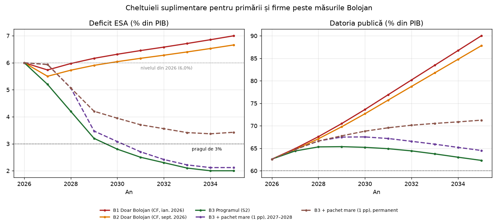
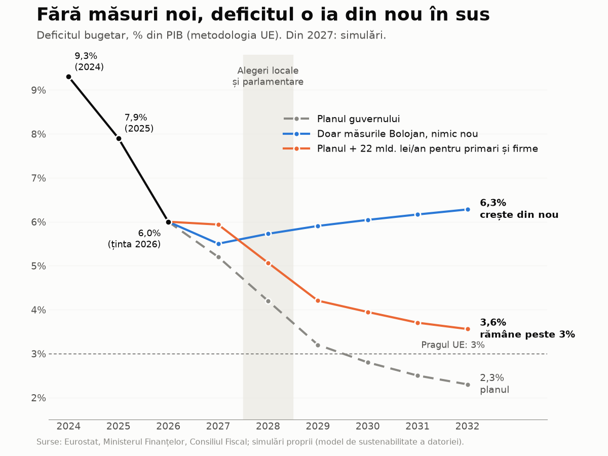

# Cât se poate da în plus primăriilor și firmelor?
## Spațiul fiscal al guvernului PSD – Niculescu în 2027–2030, cu măsurile Bolojan păstrate

**Data raportului:** 17 octombrie 2026

**Ce este:** sub-raport tematic al analizei principale de sustenabilitate a datoriei [S15]. Modelul este `model/model_spatiu_fiscal.py`; rezultatele sunt în `model/outputs/spatiu_fiscal_baze.csv`, `spatiu_fiscal_maxim.csv`, `spatiu_fiscal_pachete.csv` și `spatiu_fiscal_pensii_salarii.csv`, iar figurile în `model/figuri/fig12_spatiu_fiscal.png` și `fig13_spatiu_fiscal_simplu.png`. Rezumatul acestui sub-raport este §8.6 din raportul principal. Modelul folosește motorul și ipotezele macroeconomice din `model_dsa.py` (scenariile S1, S2 și S7 din raportul principal) și metoda de feedback macro din `model_macro_feedback.py`.

**Întrebarea:** guvernul condus de Luca Niculescu, în care Partidul Social Democrat (PSD) ocupă 11 ministere, are votul de învestitură pe 20 octombrie 2026; Partidul Național Liberal (PNL) a anunțat că îl votează, dar trece în opoziție [S12]. Dacă noul guvern păstrează măsurile de consolidare adoptate sub guvernul Bolojan în 2025–2026, cât poate da în plus primăriilor (programul Anghel Saligny, alocări din Fondul de rezervă al Guvernului) și firmelor (ajutoare de stat, scutiri de taxe) înainte ca deficitul să înceapă din nou să crească? Alegerile locale și parlamentare din 2028 fac din 2027–2028 fereastra în care presiunea pentru astfel de cheltuieli este cea mai mare.

Convenții: deficitul este în metodologia europeană ESA 2010 (Sistemul European de Conturi), cu excepția locurilor marcate „cash” (metodologia națională a Ministerului Finanțelor, MF). „pp” = puncte procentuale din produsul intern brut (PIB); „pb” = puncte de bază (0,01 pp). Sumele în lei sunt calculate pe PIB-ul scenariului S2: ~2.199 mld. lei în 2027 și ~2.335 mld. lei în 2028, deci 0,1 pp din PIB ≈ 2,2 mld. lei în 2027. Valorile marcate „model propriu” sau „estimare proprie” nu au fost publicate ca atare de instituții.

---

## 1. Pe scurt

**Răspunsul scurt:** *Fără măsuri noi, aproape nimic, și doar o dată. Măsurile Bolojan lasă în 2027 un spațiu de ~6–11 mld. lei (0,3–0,5% din PIB) față de deficitul din 2026; din 2028 deficitul crește singur, din cauza dobânzilor. Peste ținta din programul de guvernare (5,2% în 2027) nu există spațiu deloc: ținta cere deja măsuri noi, încă nespecificate. Chiar dacă le adoptă pe toate, guvernul mai poate adăuga permanent doar ~4 mld. lei pe an fără să rateze închiderea procedurii de deficit excesiv (PDE) în 2030.*

1. **Măsurile Bolojan singure lasă un spațiu de o singură dată, în 2027: ~6–11 mld. lei (0,27–0,5% din PIB).** Fără nicio măsură nouă, deficitul scade de la 6,0% din PIB în 2026 la 5,5–5,7% în 2027, pentru că efectele întregi ale măsurilor și revenirea economiei compensează creșterea dobânzilor. Din 2028 nu mai compensează nimic: deficitul crește singur cu 0,15–0,25 pp pe an, deci sunt necesare măsuri noi de 4–6 mld. lei în fiecare an doar ca să rămână pe loc (model propriu, §3). Un program recurent, de orice mărime, readuce deficitul peste nivelul din 2026 cel târziu în 2030; unul de ~11 mld. lei pe an, deja în 2028 (6,2%).
2. **Pensiile și salariile pot consuma singure tot spațiul din 2027.** Indexarea pensiilor după formulă (~7,3%) costă doar ~1 mld. lei pe an peste creșterea PIB-ului. Pensii +12% și salarii bugetare +10% costă însă 12–15 mld. lei pe an peste o creștere cât PIB-ul, mai mult decât cei 6–11 mld. lei lăsați de măsurile Bolojan, iar peste program amână închiderea PDE la 2032 sau mai târziu (model propriu, §5.1) [S10][S16].
3. **Programul de guvernare nu lasă spațiu: îl consumă dinainte.** Ținta de 5,2% din 2027 și traseul spre 2,8% în 2030 cer, peste măsurile Bolojan, măsuri noi de 7–12 mld. lei în 2027, 35–41 mld. lei în 2028 și 78–84 mld. lei pe an în 2030 (3,0–3,2% din PIB) (model propriu, §3) [S1][S3][S4]. Programul nu le detaliază, iar Consiliul Fiscal (CF) a observat că Strategia fiscal-bugetară nu compensează nici taxele eliminate de la 1 ianuarie 2027 [S1]. Fiecare leu dat în plus primăriilor sau firmelor se adaugă la această notă.
4. **Dacă toate aceste măsuri sunt adoptate, plafonul permanent este ~4 mld. lei pe an.** Atât (0,17% din PIB) mai încape ca deficitul să coboare sub 3% în 2030 și PDE să se închidă la termen; ~6,5 mld. lei pe an (0,29%) ca datoria să scadă în fiecare an după 2030 (§4). Cu o primă de risc de 50 pb pe randamente, spațiul permanent dispare. Rezultatul nu depinde de multiplicatorul fiscal ales.
5. **Un val electoral temporar încape doar dacă dispare complet după alegeri.** Până la ~16 mld. lei pe an în 2027 și 2028 (0,7% din PIB, ~32 mld. lei în total) sunt compatibili cu închiderea PDE în 2030, dar numai dacă programul se oprește în 2029 și toate măsurile din program sunt adoptate. După alegerile din 2024 nu s-a întâmplat așa: corecția a venit prin majorări de taxe, în 2025–2026.
6. **Un pachet ca în 2023–2024 (~22 mld. lei pe an, 1% din PIB), permanent, redeschide derapajul.** Chiar peste program, deficitul rămâne ~4% în 2030, PDE nu se mai închide până în 2040, iar datoria urcă la ~71% din PIB în 2035 și ~74% în 2040 (~77% cu o primă de risc de 50 pb), față de 62% și 59% în program (§5).
7. **Regula de cheltuieli a Uniunii Europene (UE) nu oprește singură cheltuielile din 2027.** Pentru că România a crescut cheltuielile nete mult sub plafon în 2025–2026, plafonul cumulat lasă în 2027 o marjă de ~24 mld. lei (~1,1% din PIB) peste plafonul anual de 4,6% (estimare proprie, §8) [S2]. Constrângerile care contează sunt ținta de deficit, ratingul (S&P a anunțat că retrogradează România dacă reducerea deficitului întârzie în 2027–2028) și termenul PDE din 2030 [S3].

---

## 2. Ce înseamnă „deficitul nu mai crește”: bazele și criteriile

**Măsurile Bolojan** sunt pachetele adoptate din iulie 2025 (Legile 141/2025 și 239/2025, Ordonanțele de urgență (OUG) 89/2025 și 8/2026): majorări de TVA și accize, extinderea bazei contribuției de asigurări sociale de sănătate (CASS), suprataxarea băncilor, impozite mai mari pe proprietate, înghețarea salariilor bugetare și a punctului de pensie în 2025–2026. Comisia Europeană (CE) le estimează efectul cumulat la ~3,7% din PIB [S15]. „Păstrate” înseamnă aici că nu sunt anulate. Tot din legislația din 2025 vine însă și o relaxare: OUG 89/2025 elimină de la 1 ianuarie 2027 impozitul minim pe cifra de afaceri (IMCA, redus deja la 0,5% în 2026), impozitul pe construcții speciale („taxa pe stâlp”) și impozitul suplimentar pe cifra de afaceri din petrol și gaze [S1]. Programul de guvernare confirmă eliminarea IMCA fără amânare [S4]. Nu am găsit o estimare publică a pierderii de venituri.

**Patru traiectorii de bază** (deficit ESA; 2026 = ținta de 6,0% în toate):

| Bază | Ce presupune | Deficit 2027 | Deficit 2030 | Datorie 2030 |
|---|---|---|---|---|
| **B1** Doar măsurile Bolojan (CF, ian. 2026) = scenariul S1 | din 2027, deficitul primar rămâne la 2,3% din PIB, structura bugetară de la finalul lui 2026 (scenariul „nicio schimbare de politică” al CF) [S1] | 5,7% | 6,3% | 73,6% |
| **B2** Doar măsurile Bolojan (CF, sept. 2026) | deficit de ~5,5% în 2027, estimarea „realistă” a CF dacă salariile și pensiile nu cresc mai repede decât PIB-ul [S3]; apoi soldul primar rămâne la nivelul din 2027 | 5,5% | 6,0% | 72,7% |
| **B3** Programul de guvernare = scenariul S2 | 5,2% în 2027, 4,2% în 2028, 3,2% în 2029, 2,8% în 2030 (ținte din Strategia fiscal-bugetară, reluate în program) [S4] | 5,2% | 2,8% | 65,2% |
| **B4** Program cu taxe înghețate și pensii indexate = scenariul S7 | 5,5% în 2027 (CF), apoi aceeași pantă ca B3 [S15] | 5,5% | 3,1% | 66,3% |

**Cheltuielile suplimentare** (transferuri pentru primării, ajutoare pentru firme) sunt modelate ca o scădere a soldului primar cu aceeași sumă, peste efortul bazei; dobânzile la datoria suplimentară trec în deficit. Două profiluri:

- **permanent**: aceeași sumă în fiecare an din 2027 (un program recurent, ca Anghel Saligny sau alocările anuale din Fondul de rezervă);
- **electoral**: aceeași sumă în 2027 și 2028, retrasă complet din 2029.

**Feedback macroeconomic**, cu metoda CE/CF folosită în raportul principal (§6.2 acolo): o cheltuială nouă ridică PIB-ul cu multiplicatorul m = 0,75, iar soldul bugetar recuperează 0,32 din creșterea PIB-ului (semi-elasticitatea bugetară). În primul an revine la buget ~24% din cheltuială (0,75 × 0,32), dar efectul se stinge în trei ani; retragerea cheltuielii lucrează invers. Sensibilitatea la m = 0,4 și m = 1,2 este în §4.

**Patru criterii** pentru „deficitul nu mai crește”:

- **K0** — țintele de deficit din program sunt respectate în fiecare an (5,2/4,2/3,2/2,8%);
- **K1** — deficitul nu crește de la un an la altul în 2027–2030 (citirea literală a întrebării);
- **K2** — deficitul coboară sub 3% din PIB în 2030, deci PDE se poate închide la termen;
- **K3** — datoria publică scade în fiecare an din 2031 până în 2040.

K1 singur este înșelător: un deficit înghețat la 6% „nu crește”, dar duce datoria pe traseul S1 (~90% din PIB în 2035). De aceea răspunsul se sprijină pe K2 și K3.

---

## 3. Ce lasă măsurile Bolojan, an de an

Spațiul de mai jos este cât poate crește cheltuiala într-un an fără ca deficitul să depășească nivelul din anul precedent (pozitiv = spațiu; negativ = măsuri noi necesare doar ca deficitul să stea pe loc). Ultima coloană arată cât cere programul (B3) peste fiecare bază: diferența de sold primar (model propriu).

| An | B1: deficit | B1: spațiu (mld. lei) | B2: deficit | B2: spațiu (mld. lei) | Creșterea dobânzilor (pp din PIB) | Măsuri noi cerute de program, față de B1 / B2 (mld. lei) |
|---|---|---|---|---|---|---|
| 2027 | 5,73% | **+5,9** | 5,50% | **+11,0** | +0,35 | 11,7 / 6,6 |
| 2028 | 5,97% | −5,6 | 5,73% | −5,3 | +0,24 / +0,23 | 40,7 / 35,2 |
| 2029 | 6,16% | −4,8 | 5,90% | −4,4 | +0,19 / +0,18 | 70,0 / 64,3 |
| 2030 | 6,32% | −3,9 | 6,04% | −3,6 | +0,15 / +0,14 | 84,0 / 77,9 |

**De ce crește deficitul din 2028 fără nicio cheltuială nouă:** rata efectivă a dobânzii urcă de la 5,5% în 2026 spre randamentele de ~7% ale emisiunilor noi, pe măsură ce ~20% din datorie se refinanțează în fiecare an, iar stocul crește odată cu deficitul (raportul principal, §4.2). În 2027, efectele întregi ale măsurilor și revenirea economiei (soldul primar urcă de la −2,9% la −2,1/−2,3% din PIB) acoperă creșterea dobânzilor de 0,35 pp și mai lasă 0,3–0,5 pp. Din 2028 dobânzile cresc în continuare, iar soldul primar nu se mai îmbunătățește fără măsuri.

**Spațiul din 2027 este de o singură dată.** Dacă cei 6–11 mld. lei merg într-un program recurent, deficitul din 2028 depășește nivelul din 2026: în B2, o cheltuială permanentă de ~11 mld. lei pe an duce deficitul la 6,2% în 2028 și 6,6% în 2030, iar datoria la ~92% din PIB în 2035 (§5). Feedback-ul macro permite o cheltuială brută cu ~30% mai mare în primul an (24% revine la buget), dar dispare în trei ani, deci nu creează spațiu permanent.

**Spațiul din 2027 este, în plus, o limită superioară.** Înainte de orice ban pentru primării sau firme, bugetul 2027 trebuie să acopere condițiile PSD și legislația deja adoptată: indexarea pensiilor după formula din Legea 360/2023 (~7,3% după Monitorul Fiscal, adică punctul de pensie de la 81 la ~87 lei; o indexare de 12% ar costa ~12 mld. lei în plus pe an) [S10], eliminarea CASS pentru unele categorii [S3] și taxele eliminate de OUG 89/2025 [S1]. B2 presupune deja pensii care cresc cât PIB-ul nominal (~6,5% în 2027); o indexare mai mare și taxele eliminate pot consuma integral spațiul din 2027 (§5.1).

---

## 4. Cât încape peste program: spațiul maxim pe criterii

Spațiul maxim este cea mai mare sumă anuală pentru care criteriul este îndeplinit (model propriu; sume în lei la PIB-ul din 2027, în 2028 cu ~6% mai mari).

| Criteriu | Program (B3), permanent | Program (B3), doar 2027–2028 | Program cu taxe înghețate și pensii indexate (B4), permanent |
|---|---|---|---|
| **K0** Țintele din program | 0 | 0 | depășit deja (5,5% în 2027) |
| **K1** Deficitul nu crește de la un an la altul | 1,09 pp ≈ 24 mld. lei/an | 1,09 pp ≈ 24 mld. lei/an | 0,68 pp ≈ 15 mld. lei/an |
| **K2** Deficit sub 3% în 2030 | **0,17 pp ≈ 4 mld. lei/an** | **0,71 pp ≈ 16 mld. lei/an** | −0,09 pp: măsuri de ~2 mld. lei/an |
| **K3** Datoria scade în fiecare an 2031–2040 | **0,29 pp ≈ 6,5 mld. lei/an** | nu limitează | 0,05 pp ≈ 1 mld. lei/an |

**Fără măsuri noi (B1, B2) nu există spațiu pozitiv pe K2 sau K3.** Ca deficitul să coboare sub 3% în 2030, sunt necesare măsuri permanente de 2,7–2,9% din PIB din 2027 (~58–64 mld. lei la PIB-ul din 2027); ca datoria să scadă după 2030, de 2,9–3,1% din PIB.

**Cum se citește tabelul:**

- K1 permite ~24 mld. lei pe an, dar asta înseamnă un deficit care rămâne la 6,0% în 2027 și coboară doar la ~4% în 2030, fără închiderea PDE și cu datoria în creștere (§5). „Deficitul nu crește” nu înseamnă „datoria nu crește”.
- Constrângerea care mușcă este **K2**, termenul PDE: ținta Consiliului UE pentru 2030 este 2,8%, deci până la pragul de 3% rămân doar 0,2 pp.
- Profilul electoral permite mai mult pe K2 (0,71 pp), dar numai cu retragere completă în 2029. Retragerea are și ea un cost: economia pierde impulsul, iar deficitul din 2029 și 2030 urcă din această cauză cu ~0,16 pp peste program pentru fiecare punct procentual de pachet.
- În **B4** (S7, varianta pe care raportul principal o consideră realistă pentru un guvern cu condițiile PSD), spațiul este deja consumat: S7 are 3,1% în 2030, deci PDE se închide abia în 2031 chiar fără primării și firme.

**Sensibilitate (B3):**

| Varianta | K1 permanent | K2 permanent | K3 permanent | K2 doar 2027–2028 |
|---|---|---|---|---|
| m = 0,4 (multiplicator mic) | 0,93 pp | 0,17 pp | 0,29 pp | 0,98 pp |
| **m = 0,75 (oficial CE/CF)** | **1,09 pp** | **0,17 pp** | **0,29 pp** | **0,71 pp** |
| m = 1,2 (economie în recesiune) | 1,38 pp | 0,18 pp | 0,29 pp | 0,53 pp |
| m = 0,75, randamente de piață +50 pb din 2027 | — | 0,00 pp | 0,08 pp | — |

Spațiul permanent nu depinde de multiplicator, pentru că feedback-ul s-a stins până în 2030. Un multiplicator mare ajută în primul an, dar face retragerea din 2029 mai costisitoare. O primă de risc de 50 pb (cât ar putea cere piețele la o retrogradare, ca în varianta S7 + 50 pb din raportul principal) anulează complet spațiul permanent pe K2.

---

## 5. Pachete tipice: ce se întâmplă dacă banii se dau oricum

Pachetele sunt cheltuieli **noi, peste ritmul din 2026**. Anghel Saligny decontează deja ~10–11 mld. lei pe an (§6), iar ritmul acesta este inclus în baze. Repere pentru mărimea pachetelor:

- **mic, 0,25% din PIB (~5,5 mld. lei pe an)**: cam jumătate din contractele Saligny nesemnate (11,25 mld. lei), eșalonată pe doi ani;
- **mediu, 0,5% din PIB (~11 mld. lei pe an)**: toate contractele Saligny nesemnate într-un an, sau alocări din Fondul de rezervă către primării în ritmul guvernului Ciolacu (~8 mld. lei pe an) plus ~3 mld. lei ajutoare pentru firme;
- **mare, 1% din PIB (~22 mld. lei pe an)**: ambele, ca în anii electorali 2023–2024.

| Varianta (model propriu) | Deficit 2027 | Deficit 2028 | Deficit 2030 | PDE închisă | Vârful datoriei | Datorie 2035 | Datorie 2040 |
|---|---|---|---|---|---|---|---|
| **B3 Programul (S2), fără cheltuieli suplimentare** | 5,20% | 4,20% | 2,80% | 2030 | 65,4% (2029) | 62,3% | 59,2% |
| B3 + mic, 2027–2028 | 5,38% | 4,42% | 2,87% | 2030 | 65,9% (2029) | 62,9% | 59,8% |
| B3 + mic, permanent | 5,38% | 4,42% | 3,09% | 2031 | 66,1% (2030) | 64,5% | 62,8% |
| B3 + mediu, 2027–2028 | 5,57% | 4,63% | 2,94% | 2030 | 66,4% (2029) | 63,4% | 60,4% |
| B3 + mediu, permanent | 5,57% | 4,63% | 3,37% | 2032 | 67,3% (2032) | 66,8% | 66,5% |
| B3 + mare, 2027–2028 | 5,94% | 5,07% | 3,08% | 2031 | 67,5% (2030) | 64,5% | 61,5% |
| B3 + mare, permanent | 5,94% | 5,07% | 3,95% | după 2040 | în creștere | 71,3% | 73,7% |
| B3 + mare, permanent, randamente +50 pb | 5,99% | 5,18% | 4,16% | după 2040 | în creștere | 73,2% | 77,4% |
| **B4 Program cu taxe înghețate și pensii indexate (S7)** | 5,50% | 4,50% | 3,10% | 2031 | 66,3% (2030) | 64,6% | 62,4% |
| B4 + mediu, permanent | 5,87% | 4,93% | 3,67% | după 2040 | în creștere | 69,1% | 69,7% |
| **B2 Doar măsurile Bolojan (fără nimic nou)** | 5,50% | 5,73% | 6,04% | după 2040 | în creștere | 87,8% | 103,1% |
| B2 + mediu, permanent | 5,87% | 6,16% | 6,62% | după 2040 | în creștere | 92,3% | 110,3% |

**Ce arată tabelul:**

- **Pachetele temporare lasă urme mici în datorie**, dar numai dacă sunt retrase. Un pachet mare doar în 2027–2028 (~45 mld. lei în total) amână închiderea PDE cu un an și lasă datoria cu ~2 pp peste program în 2035.
- **Pachetele permanente schimbă traiectoria.** Chiar și pachetul mic, permanent, amână PDE la 2031 și împiedică datoria să coboare sub 60% până în 2040. Pachetul mare, permanent, ține deficitul peste 3% tot deceniul și duce datoria la ~74% din PIB în 2040, cu dobânzi de 3,8% din PIB în 2035 (3,4% în program).
- **Fără măsuri noi, orice pachet se adaugă la un deficit care crește deja.** B2 + pachetul mediu: 6,2% în 2028 și 6,6% în 2030, cu datoria la ~92% din PIB în 2035. Acesta este traseul pe care l-ar urma un guvern care păstrează măsurile Bolojan, nu adaugă nimic și reia transferurile pentru primării.

### 5.1 Pensii și salarii bugetare

Condițiile PSD includ indexarea pensiilor conform legii [S3]. Formula din Legea 360/2023 dă pentru 2027 ~7,3% (punctul de pensie de la 81 la ~87 lei) [S10]. Costul unei indexări are o plajă: pensiile publice costă 154,7 mld. lei în 2026 (7,6% din PIB, proiectul bugetului asigurărilor sociale de stat) [S16], deci 1 pp de indexare a tuturor pensiilor costă ~1,55 mld. lei pe an; după Monitorul Fiscal, o indexare de 12% ar costa ~12 mld. lei în plus pe an, adică ~1 mld. lei pe punct procentual [S10]. Cheltuielile de personal sunt 8,2% din PIB în 2026 [S1].

Costul este socotit peste o creștere cât PIB-ul nominal (6,5% în 2027), ipoteza CF pentru deficitul de 5,5% (B2) [S3], și este permanent: majorarea intră în nivelul pensiilor și al salariilor, deci rămâne ca pondere în PIB și în anii următori (model propriu; intervalele vin din plaja de cost a indexării, 1,0–1,55 mld. lei pe punct procentual):

| Varianta (din 2027) | Cost peste creșterea PIB (mld. lei/an) | B2: deficit 2027 / 2028 / 2030 | B3: deficit 2030 | B3: PDE închisă | B3: datorie 2035 |
|---|---|---|---|---|---|
| Fără (referință) | 0 | 5,50 / 5,73 / 6,04% | 2,80% | 2030 | 62,3% |
| Pensii indexate după formulă (7,3%) | 0,8–1,2 | 5,53–5,54 / 5,76–5,77 / 6,08–6,11% | 2,84–2,86% | 2030 | 62,6–62,8% |
| Pensii +12% | 5,5–8,5 | 5,68–5,79 / 5,94–6,06 / 6,33–6,49% | 3,09–3,24% | 2031 | 64,5–65,8% |
| Salarii bugetare +10% | 6,3 | 5,71 / 5,97 / 6,37% | 3,13% | 2031 | 64,9% |
| **Pensii +12% și salarii bugetare +10%** | **11,9–14,9** | 5,90–6,00 / 6,19–6,31 / 6,66–6,82% | 3,42–3,57% | 2032 / după 2040 | 67,1–68,3% |

- **Indexarea după formulă încape:** ~1 mld. lei pe an peste creșterea PIB-ului.
- **Pensii +12% și salarii bugetare +10% costă 12–15 mld. lei pe an** peste o creștere normală, mai mult decât tot spațiul din 2027 (6–11 mld. lei, §3). Peste program, PDE se închide abia în 2032 sau deloc până în 2040.
- **Pentru salarii, calculul este mai degrabă optimist.** Strategia fiscal-bugetară coboară cheltuielile de personal de la 8,2% la 7,3% din PIB până în 2029 [S1], adică o masă salarială care crește cu doar ~2,5–3% pe an; față de această ipoteză, salariile +10% ar costa ~12–13 mld. lei (estimare proprie), nu 6,3 mld. lei.

---

## 6. Repere: cât au primit primăriile și firmele până acum

**Programul Anghel Saligny** (lansat în 2021, buget anunțat de 50 mld. lei până în 2028, actualizat la 53 mld. lei; contracte totale de ~66 mld. lei, din care 52 mld. semnate, în august 2025) [S7]:

- sumele decontate de Ministerul Dezvoltării, Lucrărilor Publice și Administrației (MDLPA): 17,4 mld. lei la 31 martie 2025 [S8], 19,6 mld. lei la 30 iunie 2025 [S9] și 31,0 mld. lei la 30 iunie 2026, din 55,2 mld. lei contractați pentru 4.597 de proiecte (56%; 562 de proiecte terminate) [S6]. Ritmul recent este de ~11 mld. lei pe an;
- 2025: cele 10 mld. lei alocate au fost cheltuite [S7]; 2024: Guvernul a alocat programului încă 7,6 mld. lei din Fondul de rezervă [S8];
- 2026: credite de angajament de 9 mld. lei, față de un necesar de 14 mld. lei estimat la elaborarea bugetului; 1.159 de contracte de finanțare, de ~11,25 mld. lei, nu erau semnate la începutul lui septembrie; ministrul Cseke Attila a propus prelungirea contractărilor până la 31 decembrie 2027 [S5];
- la 11 septembrie 2026 platforma de plăți a fost închisă: 1.626 de cereri de transfer, de 2,3 mld. lei, au rămas neplătite [S11], iar penalitățile către constructori cad în sarcina primăriilor [S5].

**Fondul de rezervă al Guvernului:** guvernele Ciucă și Ciolacu au alocat din el ~80 mld. lei, din care ~20 mld. lei primăriilor, direct sau prin MDLPA (3,7 mld. lei sub Nicolae Ciucă, 16,3 mld. lei sub Marcel Ciolacu); alocările către primării au crescut brusc de la jumătatea lui 2023 și au continuat mai ales în 2024 [S13].

**Firmele:** pe lângă taxele eliminate de OUG 89/2025 din 2027 (§2) [S1], programul de guvernare nu cuantifică alte ajutoare pentru firme [S4]; pachetele din §5 le includ în sumele totale. Granturile finanțate din fonduri europene cresc deficitul doar prin cofinanțarea națională; scutirile de taxe și ajutoarele de stat din bugetul național îl cresc integral.

---

## 7. Ce intră în deficit și ce nu

Nu orice ban dat primăriilor sau firmelor crește deficitul ESA, dar aproape orice ban crește datoria sau necesarul de finanțare:

| Instrument | Deficit ESA | Deficit cash | Datorie publică |
|---|---|---|---|
| Transfer de la bugetul de stat la bugetele locale | nu la transfer (rămâne în administrația publică), ci când lucrările sunt executate | nu la transfer (bugetul general consolidat îl elimină), ci când primăria plătește | da, prin finanțarea deficitului |
| Contracte noi Saligny sau alocări noi din Fondul de rezervă | da, pe măsura execuției | da, la plată | da |
| Plata restanțelor pentru lucrări deja executate (ex. cei 2,3 mld. lei Saligny; condiția PSD privind facturile plătite în 90 de zile) | nu: cheltuiala a fost înregistrată la executare | da | da: datoriile comerciale nu intră în datoria Maastricht, împrumutul cu care se plătesc intră (~0,1 pp din PIB pentru 2,3 mld. lei) |
| Garanții de stat pentru creditele firmelor | doar când garanțiile sunt executate | doar la executare | datorie contingentă (în afara stocului până la executare) |
| Scutiri sau taxe eliminate | da, prin venituri mai mici | da | da |
| Cheltuieli ale primăriilor din împrumuturi proprii | da: bugetele locale fac parte din administrația publică | da | da: datoria locală intră în datoria publică |

De aici o tentație: plata restanțelor și garanțiile pentru firme sunt „ieftine” în deficitul ESA, indicatorul urmărit de UE. Ele cresc însă datoria și necesarul de finanțare, adică exact ce urmăresc agențiile de rating și investitorii în titluri de stat.

---

## 8. Regula de cheltuieli a UE: o marjă formală, nu una reală

Recomandarea Consiliului UE din 8 iulie 2025 fixează rate maxime de creștere a cheltuielilor nete (cheltuieli primare finanțate național, după efectul măsurilor discreționare de venituri): 2,6% în 2026, 4,6% în 2027, 4,4% în 2028, 4,2% în 2029 și 4,0% în 2030; cumulat față de 2024, 5,5% în 2026 și 10,4% în 2027 [S2]. Programul de guvernare reia plafonul de 4,6% pentru 2027 [S4].

După calculele CE din primăvara lui 2026, cheltuielile nete au crescut cu 0,5% în 2025 și ar crește cu 1,8% în 2026 (2,3% cumulat), mult sub plafoane [S2]. Dacă 2026 se încheie așa, plafonul cumulat pentru 2027 permite o creștere de ~7,9%, nu de 4,6%: o marjă de ~3,3% din cheltuielile nete, adică ~24 mld. lei, ~1,1% din PIB (estimare proprie: cheltuielile nete reprezintă ~35% din PIB, adică cheltuielile totale de 42,4% din PIB în 2025, minus dobânzile de 2,6% și plățile din fonduri UE și din Planul Național de Redresare și Reziliență (PNRR), de 4,1%) [S14].

Marja este formală, din trei motive:

- există pentru că majorările de taxe din 2025–2026 se scad din cheltuielile nete; folosirea ei înseamnă cheltuirea supra-performanței obținute de măsurile Bolojan;
- CE verifică atât plafonul anual, cât și pe cel cumulat [S2], iar 24 mld. lei în plus ar ține deficitul din 2027 la ~6%, față de ținta de 5,2% din program;
- prognoza de toamnă a CE (noiembrie 2026) va recalcula 2026, inclusiv rectificarea bugetară.

---

## 9. Limite

- B1 și B2 sunt două variante ale aceleiași ipoteze (nicio măsură nouă). Niciuna nu include explicit taxele eliminate de OUG 89/2025, pentru care nu am găsit o estimare publică, sau o indexare a pensiilor peste creșterea PIB-ului (aceasta e tratată separat, în §5.1). Spațiul real din 2027 poate fi zero.
- Costul unei indexări a pensiilor are o plajă largă (1,0–1,55 mld. lei pe punct procentual), pentru că sursele nu spun ce parte din pensii (contributive, minime, speciale) intră în calcul.
- Toate variantele folosesc ipotezele macro din S2 (creștere nominală de 6,5% în 2027, randamente de ~7% în 2027, leu cu 1,5% mai slab pe an). Un șoc de curs, de creștere sau energetic (raportul principal, §6.7–§7.4) reduce spațiul.
- Prima de risc este modelată ca +50 pb fix. O retrogradare sub pragul investment grade (categoria recomandată pentru investiții) la două agenții ar fi neliniară: ieșirea din indicii de obligațiuni ar putea costa mai mult.
- Feedback-ul folosește multiplicatorul agregat al CE/CF. Investițiile locale pot avea un multiplicator mai mare, dar o parte importantă din materiale și echipamente este importată; spațiul permanent nu depinde oricum de multiplicator (§4).
- Bugetele locale (surplusuri, împrumuturi proprii) nu sunt modelate separat: cheltuiala suplimentară este tratată ca o cheltuială a administrației publice în ansamblu.
- Cifrele despre Anghel Saligny și Fondul de rezervă provin din presă și din Expert Forum, care citează MDLPA și hotărârile de guvern; documentele primare nu au fost arhivate local.

---

## Surse

[S1]: https://fs.icfm.ro/CF%20-%20Opinie%20-%202026.pdf
**[S1]** **Consiliul Fiscal**, *Opinia privind Legea bugetului de stat pe anul 2026, Legea bugetului asigurărilor sociale de stat pe anul 2026 și Strategia fiscal-bugetară 2026-2028* (martie 2026): scenariul no-policy change (deficit primar structural de 2,3% din PIB potențial), plafoanele de cheltuieli nete, eliminarea din 2027 a IMCA, a impozitului pe construcții speciale și a impozitului suplimentar din petrol și gaze (OUG 89/2025), fără măsuri compensatorii în Strategia fiscal-bugetară. Copie locală (arhivă privată): `date/pdf/CF_Opinie_2026.pdf`.

[S2]: https://data.consilium.europa.eu/doc/document/ST-11135-2026-INIT/en/pdf
**[S2]** **Consiliul UE**, ST 11135/26 (2026): ratele maxime de creștere a cheltuielilor nete din recomandarea PDE din 8 iulie 2025, anual și cumulat față de 2024 (considerentul 7), și evaluarea CE: +0,5% în 2025, +1,8% în 2026, 2,3% cumulat (considerentele 16–17). Copie locală (arhivă privată): `_research/Consiliu_ST-11135-2026_INIT_EN.pdf`.

[S3]: _research/stiri_2026-10-16.md
**[S3]** Dosar de știri din 16 octombrie 2026 (presă economică care citează MF, CF, S&P): estimarea CF de ~5,5% din PIB pentru deficitul din 2027, condițiile PSD pentru guvernul Niculescu (buget 2027 până la 1 decembrie, fără taxe noi, pensii indexate, eliminarea CASS pentru unele categorii, facturi restante plătite în 90 de zile), condițiile S&P pentru retrogradare.

[S4]: https://www.g4media.ro/programul-de-guvernare-psd-luca-niculescu-deficit-de-52-din-pib-in-2027-eliminarea-impozitului-minim-pe-cifra-de-afaceri-indexarea-prudenta-a-pensiilor-impozitarea-proprietati.html
**[S4]** G4Media, *Programul de guvernare PSD – Luca Niculescu* (15–16 oct. 2026): deficit ESA de 5,2% în 2027 (~110 mld. lei cash), cheltuieli nete în creștere cu cel mult 4,6% în 2027, IMCA eliminat de la 1 ianuarie 2027, indexare „prudentă” a pensiilor, „optimizarea transferurilor” către autoritățile locale, fără sume pentru primării sau firme.

[S5]: https://financiarul.ro/constructii/primariile-platesc-din-bugetele-proprii-penalitatile-pentru-facturile/
**[S5]** Financiarul, 5 oct. 2026, citând MDLPA: Anghel Saligny în 2026, credite de angajament de 9 mld. lei față de un necesar de 14 mld., 3,015 mld. lei folosiți, 1.159 de contracte nesemnate (~11,25 mld. lei), proiectul de lege pentru prelungirea contractărilor până la 31 decembrie 2027.

[S6]: https://www.observatorulph.ro/administratie/2798635-anghel-saligny-in-prahova-lucrari-intarziate-si-proiecte-de-sute-de-milioane-banii-pe-2026-s-au-terminat
**[S6]** Observatorul Prahovean, 15 sept. 2026, pe datele MDLPA la 30 iunie 2026: 4.597 de proiecte contractate (~55,22 mld. lei), 31,02 mld. lei decontați (56,2%), 562 de proiecte finalizate; suspendarea cererilor de transfer la 11 septembrie 2026.

[S7]: https://www.euronews.ro/articole/ce-este-programul-anghel-saligny
**[S7]** Euronews România, 19 aug. 2025: bugetul programului (50, apoi 53 mld. lei), contracte totale de ~66 mld. lei (52 mld. semnate), cele 10 mld. lei alocate pentru 2025 cheltuite.

[S8]: https://expertforum.ro/saligny-martie2025/
**[S8]** Expert Forum, stadiul PNI Anghel Saligny la 31 martie 2025: 17,4 mld. lei decontați; 7,6 mld. lei alocați programului din Fondul de rezervă în 2024.

[S9]: https://expertforum.ro/saligny-30iunie25/
**[S9]** Expert Forum, stadiul PNI Anghel Saligny la 30 iunie 2025: 45,8 mld. lei contractați, 19,6 mld. lei decontați (43%); distribuția proiectelor pe partidele primarilor.

[S10]: https://monitorfiscal.ro/indexare-pensii/
**[S10]** Monitorul Fiscal, 25 aug. 2026 (actualizat 28 sept.): indexarea pensiilor din 2027 după formula din Legea 360/2023, ~7,3% (punctul de pensie de la 81 la ~87 lei); o indexare de 12% ar costa ~12 mld. lei în plus pe an.

[S11]: https://arenaconstruct.ro/anghel-saligny-statul-are-restante-la-plata-de-peste-23-mld-lei-catre-constructori/
**[S11]** Arena Construcțiilor, 13 oct. 2026, citând MDLPA: 1.626 de cereri de transfer neplătite, de 2.315.332.689 lei, la închiderea platformei din 11 septembrie 2026.

[S12]: https://www.puterea.ro/ilie-bolojan-anunta-decizia-liberalii-voteaza-guvernul-niculescu/
**[S12]** Puterea.ro și AGERPRES, 17 oct. 2026: PNL votează învestirea guvernului Niculescu și trece în opoziție; votul în Parlament este programat marți, 20 octombrie 2026. AGERPRES: <https://agerpres.ro/politic/2026/10/17/liberalii-decid-sambata-cum-vor-vota-la-investirea-guvernului-niculescu--1603999>

[S13]: https://www.digi24.ro/stiri/actualitate/politica/pusculita-magica-a-lui-ciuca-si-ciolacu-cine-si-de-ce-a-primit-zeci-de-miliarde-de-lei-din-fondul-de-rezerva-al-guvernului-3321925
**[S13]** Digi24, 11 iul. 2025: ~80 mld. lei alocați din Fondul de rezervă de guvernele Ciucă și Ciolacu, din care ~20 mld. lei primăriilor (3,7 mld. sub Ciucă, 16,3 mld. sub Ciolacu).

[S14]: Raport_fiscal_Romania_2024-2026.md
**[S14]** Sub-raportul fiscal 2024–2026 (§2): cheltuieli totale 2025 de 808,7 mld. lei (42,4% din PIB, cash), dobânzi 2,6% din PIB, plăți din fonduri UE și PNRR de 78,55 mld. lei în 2025.

[S15]: Raport_Romania_Deficit_Sustenabilitate.md
**[S15]** Raportul principal, ediția din 17 octombrie 2026: scenariile S1, S2 și S7 (§5), măsurile din 2025–2026 și metoda de feedback macro (§6.1–§6.2), parametrii modelului (§4.2); rezumatul acestui sub-raport în §8.6.

[S16]: https://www.economica.net/76-din-pib-ne-costa-pensiile-din-sistemul-public-pe-care-romania-le-va-plati-in-2026_921041.html
**[S16]** Economica.net, 10 mart. 2026, după proiectul legii bugetului asigurărilor sociale de stat (BASS) pe 2026: plățile de pensii din sistemul public, 154,7 mld. lei (7,6% din PIB); valoarea punctului de referință, 81 de lei.
